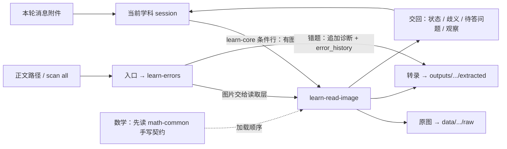

# 手写图片读取：跨学科读取层与数学核对契约

状态：已实施（2026-11-11）。

## 背景

`math-common/skills/handwritten-math-reader/` 是新增但尚未跟踪的技能目录。它来自另一个体系，基本骨架可用（先忠实读取、再判断；歧义只影响判断时才要求确认；不造置信分；静态图片不记录时间与意图），但与当前体系有五处硬冲突：

1. **注册不变量**：`scripts/check-skills.mjs`、`scripts/skill-contracts.test.mjs`、`AGENTS.md` 与 `docs/adr/0001` 都固定 `math-common` 只注册内部技能 `math-common`。新增第二个技能会同时打破四处。
2. **跨学科需求**：忠实读取不只服务数学；语文、英语同样需要读图。把能力锁在数学包里，其他学科要么重复实现，要么绕道。
3. **记录模型**：`learn-errors` 的 `error_history` 面向错题。做对的作业、教材页、题目照片不该进错题档案，也不该先问“你觉得错在哪”。
4. **归属**：技能自带 `upper-primary-math-coach`、`upper-primary-math-knowledge-map`、`math-learning-progress-tracker` 等本仓库不存在的交接对象；年级写死 4–6；带 `tutor / parent_review / transcription_only` 模式与运行时 YAML，仓库没有这些角色与配置层。
5. **可见输出与证据**：原技能的“四段式报告 + LaTeX”与 `may_update_progress: true` 和仓库冲突；仓库要求短句、不叙述准备、一个待答问题，证据要过 `confirmed_skills` 阈值。

目标不是“再做一个错题工具”，而是**采集学生的计算过程**：手写作业、草稿、教材页、题目照片都可以读；读到的步骤成为当前教学回合的证据，不只用来找错。

## 目标

- 新增一个跨学科内部技能 `learn-read-image`（`user-invocable: false`），只在“消息里有图”时加载：忠实转录、标歧义、归档、把结果交回当前教学回合；不诊断、不代答、不产 `session_segment`。
- 数学特有的读图提示、核对事实与证据映射放进 `math-common` 的第四份契约；年级无关；两个 band 先读契约，再加载读取技能。
- 原图为唯一忠实载体；转录是读取索引；不生成、不保存 SVG 作为记录。
- 原件进 `raw`，转录进 `extracted`；内容哈希识别同一张图，同一张图只读第一次。
- 所有学科可用；本轮不改语文、英语的正文，它们先用通用读取规则。

## 非目标

- 不做错误诊断与分类；`error_type` / `label` / `domain` 的唯一来源仍是 band 的 `strategy-diagnosis-rules.md`。
- 不做几何推理教学，不建 dummy 几何技能；本轮只读可见标注、单位与虚实线。
- 不改 `teaching-resolver`、`supported_stages`、数学画板协议与 `math_board_*` 工具。
- 不把数学规则放进 `learn`，也不在 `math-common` 注册第二个技能。
- 不要求特定 OCR 模型、bash 或某种语言；不承诺识别准确率。
- 不安装到当前 profile、不迁移学生数据、不发布包、不做 Web 界面目视验证。

## 方案

### 三层归属

| 层 | 归属 | 内容 |
|---|---|---|
| 读取层 | `learn/skills/learn-read-image/`（新内部技能） | 跨学科：整页与逐行读取、歧义标记、原图归档、转录写入、交回字段；不诊断 |
| 触发层 | `learn-core` 条件行；`learn-errors` 图片分支 | 有图才加载读取层；附件由当前学科技能触发，路径 / `scan all` 由入口交 `learn-errors` 触发 |
| 数学层 | `math-common/skills/math-common/references/handwritten-work-contract.md`（第四份契约） | 数学读图提示、核对事实、证据映射、信任与隐私、失败回退；年级无关；不诊断 |

两个数学 band 的 `math-core` 条件表各加一行：数学图片 → 先按名加载 `math-common` 并读第四份契约（读图提示），再加载 `learn-read-image`。**不建 band 本地指针**：年级无关、无本地差异；“指针 + 本地增补”是给有差异的契约用的。

### 调用链



- 附件由当前教学回合读：歧义问题由当前回合所有者问，证据并入本轮唯一 `session_segment`。
- 路径 / `scan all` 仍走现有入口：`learn-errors` 对图片加载同一个 `learn-read-image`；数学图片同样先读 `math-common` 手写契约（它已按现有规则加载当前学科 core），再加载读取层。学生把它当错题时，`learn-errors` 向同一份 `extracted` 追加诊断段并写 `error_history`；否则不写错题档案。
- 不碰生命周期与 `target-parsing`。

### 目录与命名

沿用现有双根目录，不新建体系：

| 产物 | 位置 | 规则 |
|---|---|---|
| 原图 | `data/students/<student_id>/<subject>/raw/<topic>-<NNN>-<YYYYMMDD>.<ext>` | 附件图在归档时作为**新原件**复制进来，按最终名命名；已有原件不改写、不覆盖、不删除，因此新副本不备份；已在 raw 的路径文件不复制 |
| 转录 | `outputs/students/<student_id>/<subject>/extracted/<同名>.md` | 一份原件对应一份转录；不产生第三份副本 |
| 备份 | `outputs/students/<student_id>/<subject>/backups/raw/` | 只服务 raw 内改名；附件归档不产生备份 |

`<topic>` 取短英文或拼音 slug（按题目或当前主题；无题目 slug 的学科回合用该主题 slug）；`<NNN>` 取 raw 与 extracted 中同 topic 的最大编号 + 1，三位补零；日期为当天。复制失败时转录照写，`archived: false` 并保留来源引用；由当前回合所有者说一句原件未归档，读取层不直接说话。

### 转录记录

`extracted/<name>.md` 由顶部结构化字段与正文组成；学生在确认后追加 `## 确认` 段：

```yaml
content_hash: "sha256:..."      # 环境提供哈希工具时；没有则 null
source_kind: uploaded_attachment | raw_file
original_path: "..."
archived: true | false
subject: math
topic: ...
read_at: 2026-11-11T16:...
page_scope: whole_page | one_problem | selected_region
read_status: clear | ambiguous | unreadable | partial
ambiguities:
  - region: "第 2 行第一位数字"
    alternatives: ["7", "1"]
    affects_judgment: true
    resolution: none | student_confirmed | closeup
confirmed:
  - region: ...
    value: ...
related_extracted: null            # 仅学生明说是同一页的补拍时
```

正文按行列出“我读到的内容”：印刷题目与学生手写分开，LaTeX 保留原样，划掉与旁注保留；不写诊断，不写掌握结论。学生在确认后，由当前回合所有者按记录规则追加 `## 确认` 段并更新 `confirmed`，**保留原歧义**。

### 内容指纹与去重

- 用当前环境提供的内容哈希工具计算（优先 SHA-256，MD5 也可）；不写死具体命令，不要求 bash 或某种语言。
- 查重：在当前学科的 `extracted` 顶部按 `content_hash` 匹配。命中即**复用第一次读取**，不重读、不新建记录、不重复复制原图。
- 环境没有哈希工具：`content_hash: null`，跳过查重，不向学生索取工具。
- **只使用第一次读取**：同一张图（哈希相同）不重读；学生说读错时，按学生确认/纠正更新 `confirmed`，不重新识别。更清晰的补拍是**不同的图**（哈希不同），按新图记录；仅当学生明说是同一页时写 `related_extracted`，并用它解决原记录的歧义（`resolution: closeup`），不替代原转录。
- 学生确认不等于独立掌握；确认值按“学生自述”处理。

### 读取纪律（只做读取，不做判断）

- 先看整页（题号、边界、箭头、划掉、旁注、印刷 / 学生墨迹 / 成人批改），再逐行读；不补造看不到的步骤。
- 原样转录数字、符号、小数点、分数线范围、括号、指数、根号、等号/不等号、单位、竖式对齐、进退位与图形标注；LaTeX 只是可读呈现，不是“修正后的等价式”。
- 歧义标出区域与候选（如 `第 2 行末位：1 或 7`）；不可读写 `unreadable`；**不造置信分**；歧义不影响判断时直接继续，影响判断时交回一个待答问题。
- 当前学科提供了读图提示时按提示读；没有就按通用规则，不自行发明学科规则。
- 读取层不写学生回复、不下诊断、不写档案；数学核对由数学层在读取之后做。

### 数学契约分章（第四份）

1. **范围与加载顺序**：数学图片；先读本契约再加载读取技能；年级无关；共享文本不写 band 名或 band 文件。
2. **读图提示**：分数线范围、竖式数位与进退位、`-` 与 `=`、上标与根号、单位、几何标注 / 虚实线 / 是否标明按比例。
3. **核对事实**：每一行按所写内容是否成立、单位与余数、数位对齐；只给确定性事实，不诊断、不下掌握结论、不代替 band 的分类。
4. **证据映射**：仅无歧义或已确认的步骤可进 `strategy_summary` / `strengths` / `difficulties`；歧义未确认＝未知；印刷内容不算学生表现；一张图不单独构成掌握；读取层不写档案。
5. **信任与隐私边界**：转录是模型读取，不是学生原话；原图是唯一忠实载体；不存 SVG；不提取姓名、学校、地址；不把附件再复制一份。
6. **失败与回退**：无读图能力、格式不支持（含 HEIC/HEIF）、复制失败、页面不可读时的说法与不变量。

### 失败与隐私

- 无读图工具：请学生发文字或换环境；不声称已读。
- 格式不支持或 HEIC/HEIF：请换 JPG/PNG 或发文字；不静默转换、不猜内容。
- 复制 / 归档失败：转录照写，`archived: false`，保留来源引用；由当前回合所有者说一句原件未归档。
- 删除与保留沿用 `learn-clean` 规则；原件只在 raw 一份，不额外备份；转录只含本学科所需内容，不抄身份信息。
- 不声称“已复原原图”或“识别准确率”。

### 证据身份

| 材料 | 记作 |
|---|---|
| 无歧义的学生手写步骤 | 观察到的手写表现（可进 segment 字段） |
| 歧义未确认的行 | 未知；不得变成错误、标签或掌握结论 |
| 学生确认 / 纠正后的值 | 学生自述 |
| 印刷题目、教材页 | 材料，不算学生表现 |
| 同一张图只读第一次 | 保证一致性，不产生“第二次读取更强”的假证据 |

## 决策记录

| # | 决策 | 结论 |
|---|---|---|
| 1 | 数学侧容器 | 第四份共享契约 reference；不注册第二个 `math-common` 技能 |
| 2 | 通用读取归属 | `learn` 内部技能 `learn-read-image`；跨学科、按需加载 |
| 3 | 记录位置 | 原图 `data/.../raw`，转录 `outputs/.../extracted`，不加第三份副本 |
| 4 | 年级 | 无关；共享文本不按年级分叉，不做 band 本地增补 |
| 5 | 核对归属 | 读取层只给事实；数学核对在 `math-common` 契约；不诊断 |
| 6 | 可见输出 | 默认不回读全文；只在歧义影响判断处回读；LaTeX 存 `extracted` |
| 7 | 证据身份 | 无歧义＝观察；歧义＝未知；确认＝学生自述；不写档案 |
| 8 | 学科范围 | 所有学科可用；几何只读可见内容；本轮不建 dummy 技能 |
| 9 | 忠实性 | 原图为唯一忠实载体；转录是索引；不存 SVG；不承诺稳定复原 |
| 10 | 调用点 | 附件由学科 session 触发；路径 / `scan all` 由入口→`learn-errors`；都收敛到读取层 |
| 11 | 图片归属 | 读取层负责读取与归档；`learn-errors` 只在错题时追加诊断与 `error_history` |
| 12 | 重复图 | 内容哈希查重；同一图只读第一次；补拍按新图记录 |
| 13 | 数学加载链 | `math-core` 条件行 → `math-common` 手写契约 → `learn-read-image`；无 band 指针 |
| 14 | 本轮语文 / 英语 | 能力可用，正文不改；等真实需求再加学科提示 |
| 15 | 命名与记录 | `learn-read-image`；哈希在 `extracted` 顶部；交回字段见下；先 spec 再实现 |

## 交回字段

读取层交回当前回合所有者（内部约定，不是运行时函数返回）：

- `reading_record_path`：读取记录路径；
- `read_status`：`clear | ambiguous | unreadable | partial`；
- `ambiguities`：区域 / 候选 / 是否影响判断；
- `confirmed`：已确认的 token；
- `observed_work`：印刷内容与学生手写分开；
- `archived`：原件是否归档；`false` 时由当前回合所有者说一句原件未归档；
- `pending_question`：最多一个，可为空。

当前回合所有者负责提问、等待与确认；读取层不产学生回复。格式不支持或读不了时，读取层返回“换 JPG/PNG 或发文字”的请求，由当前回合所有者问；原件未归档也由所有者说。多题页面转录全页，教学回合只选一道；选择会改变下一步且学生没说时问一次。正文答案与手写不一致时，以手写为可见事实，只问一个澄清问题。

## 文件改动清单

新增：

- `learn/skills/learn-read-image/SKILL.md`
- `learn/skills/learn-read-image/references/reading.md`
- `learn/skills/learn-read-image/references/record.md`
- `learn/skills/learn-read-image/references/handoff.md`
- `math-common/skills/math-common/references/handwritten-work-contract.md`
- `docs/adr/0002-handwritten-image-reading.md`
- `learn/tests/image-reading-scenarios.md`：无读图工具、HEIC、重复图、复制失败、待答问题归属、错题与做对作业的区分。

修改：

- `learn/skills/learn-core/SKILL.md`：条件表加“消息里有图 → 加载 `learn-read-image`”。
- `learn/skills/learn-errors/SKILL.md`：描述改为“文件与材料”；图片分支交给读取层；错题时向同一份 `extracted` 追加诊断、写 `error_history`；做对的作业不问自诊、不写错题档案。
- `learn/README.md`：内部技能清单与所有权加 `learn-read-image`。
- `math-common/skills/math-common/SKILL.md`：接口表加第四行；把“do not pre-load all three”改为“one matching reference”；边界说明“不含年级、不诊断、不选 band”。
- `math-common/README.md`：契约表、加载链路、验证说明加手写契约。
- `math-common/package.json`：description 加“handwriting”。
- `math-primary-low/skills/math-core/SKILL.md`、`math-primary-high/skills/math-core/SKILL.md`：条件表加数学图片行；安全兜底加“共享契约不可用时仍按通用规则读取，核对事实标未知”。
- `math-primary-low/README.md`、`math-primary-high/README.md`、根 `README.md`：契约与包说明加手写读取。
- `AGENTS.md`：加 `learn-read-image` 与第四份契约的说明；保留 math-common 单技能不变量。
- `GLOSSARY.md`：加“原图 / 读取记录 / 读取索引 / 内容指纹”，并把“过程证据”扩到书面步骤。
- `docs/skill-map/call-graph.md`：包依赖图、主图、数学子图、场景、§7 表与计数（42→43 份，37→38 个唯一名；原表计数已落后一份，按实际重算）。
- `scripts/skill-contracts.test.mjs`：固定技能清单加 `learn-read-image`；加读取层不诊断、不存 SVG、math-common 仍单技能、两个 band 先读契约再加载读取层等守卫。
- `math-common/tests/teaching-scenarios.md`：共同场景加歧义确认、印刷/手写区分、无诊断、无 SVG。

删除：

- `math-common/skills/handwritten-math-reader/`（`SKILL.md`、`references/evidence-contract.md`、`.DS_Store`）；可用内容并入上述新文件。

## 实施顺序

1. `learn-read-image` 与三份 references（读取、记录、交回）。
2. `learn-core` 条件行 + `learn-errors` 图片委派与错题追加规则。
3. `math-common` 第四份契约、接口行、README 与 package description；两个 band 的条件行与安全兜底。
4. 删除旧 `handwritten-math-reader/`。
5. `GLOSSARY.md`、ADR-0002、`AGENTS.md`、三个 README、`call-graph.md`。
6. `skill-contracts.test.mjs` 固定清单与守卫；`math-common` 与 `learn` 场景文件。
7. 静态检查与差异检查。

完成标准：新技能可被 `learn-core` 与 `learn-errors` 按名加载；两个 band 先读契约再读图；旧目录删除后 `check-skills` 与契约测试通过；没有新增选型候选。

## 验证

```bash
node scripts/check-skills.mjs
node --test scripts/skill-contracts.test.mjs
node --test scripts/install.test.mjs
git diff --check
```

分层记录：

| 层 | 动作 | 说明 |
|---|---|---|
| 静态 | 上述命令 | 只证明文档与接线；不当作教学行为通过 |
| 行为回放 | `math-common/tests/teaching-scenarios.md` + `learn/tests/image-reading-scenarios.md` | 未执行；未回放场景保持未测试 |
| 隔离加载 | `node scripts/install.mjs math-primary-low\|math-primary-high --dry-run` | 依赖闭包不变；读取层随 `learn` 安装 |

## 风险与回退

- **固定清单**：`skill-contracts.test.mjs` 的精确技能列表漏加会立刻失败；实施时先加名字再改内容。
- **错题记录退化**：`learn-errors` 委派图片后，错题的自诊与 `error_history` 必须保留；场景里同时测“做对作业”和“错题”。
- **读取层越权**：文本里不得出现诊断字段、掌握结论或学生可见回复；用契约测试守卫。
- **哈希不可用**：不阻塞读取；`content_hash: null`，跳过查重，不向学生索取工具。
- **复制失败**：`archived: false` 并如实说明；不伪造路径。
- **补拍 vs 重读**：同一哈希不重读；补拍是新图，只用于解决歧义，不覆盖第一次读取。
- **计数与文档**：`call-graph.md` 的 42/37 计数要一起改；否则文档自相矛盾。

回退单位：读取层、数学契约、文档与测试各自独立；删掉 `learn-read-image` 并恢复 `learn-errors` 的图片分支即可回到现状。

## ADR-0002

已落地为 [ADR-0002：手写图片读取作为 learn 内部技能](../../docs/adr/0002-handwritten-image-reading.md)。ADR 记录最终决策、备选方案与后果；本 spec 保留设计过程与决策表，两者冲突时以 ADR 与当前文件为准。

## Comments

### 2026-11-11 设计评审（grilling）

- Q1 位置：并入 `math-common` 作为第四份契约 reference，不注册第二个技能。
- Q2 归属：通用转录纪律进 `learn`，跨学科；没有图不读，有图才读。
- Q3 记录：原件 `raw`、转录 `extracted`；目录分析沿用现有双根目录。
- Q4 年级：无关。
- Q5 核对：读取层不诊断；数学核对归 `math-common`。
- Q6 可见输出：默认不回读全文；LaTeX 存 `extracted`。
- Q7 证据：无歧义＝观察，歧义＝未知，确认＝学生自述；读取层不写档案。
- Q8 范围：所有学科；几何只读可见内容；不建 dummy 技能。
- 忠实性：原图为准，转录为索引；不存 SVG；不承诺稳定复原。
- 调用点：附件学科触发，路径/`scan all` 走 `learn-errors`；都收敛到读取层。
- 图片归属：读取层读与归档；`learn-errors` 只做错题诊断与 `error_history`。
- 重复图：内容哈希；同一图只读第一次；补拍按新图。
- 数学加载链：`math-core` → `math-common` → `learn-read-image`；无 band 指针。
- 本轮语文/英语：能力可用，正文不改。
- 交付：先 spec（本文件）与 ADR 草稿，确认后实施。

### 2026-11-11 实施记录

已落地：`learn/skills/learn-read-image/`（SKILL + `reading.md` / `record.md` / `handoff.md`）、`math-common` 第四份契约、两个 band 的 `math-core` 条件行与安全兜底、`learn-core` 条件行、`learn-errors` 图片委派与 `error_history` 条件、`learn/tests/image-reading-scenarios.md`、`math-common/tests/teaching-scenarios.md`、`GLOSSARY.md`、ADR-0002、`AGENTS.md` / README / `call-graph.md` 与契约测试；旧 `handwritten-math-reader/` 已删除。

与设计的两处明确偏差（已写入 ADR-0002）：

- 附件归档在 `raw/` 建立一个**新**原件；已有原件不被覆盖、改写或删除，因此新副本不备份。原“raw 只读”按“已有原件只读”执行。
- 手写契约由 band 的 `math-core` 条件行直接加载，不建 band 本地指针；这是 ADR-0001 决策 4 对“年级无关、无本地增补”契约的例外。

验证：

| 层 | 命令 | 结果 |
|---|---|---|
| 静态 | `node scripts/check-skills.mjs` | 38 skills，0 errors，0 warnings |
| 静态 | `node --test scripts/skill-contracts.test.mjs` | 87 pass，0 fail |
| 静态 | `node --test scripts/install.test.mjs` | 15 pass，0 fail |
| 静态 | `node --test scripts/*.test.mjs` | 125 tests，124 pass，1 skipped（集成测试未设环境） |
| 静态 | `git diff --check` | 通过 |
| 行为回放 | `math-common/tests/teaching-scenarios.md` + `learn/tests/image-reading-scenarios.md` | 未执行；静态通过不当作教学行为通过 |

未执行：安装到当前 profile、真实 Web 对话中的读图与歧义确认、迁移学生数据、发布包。
