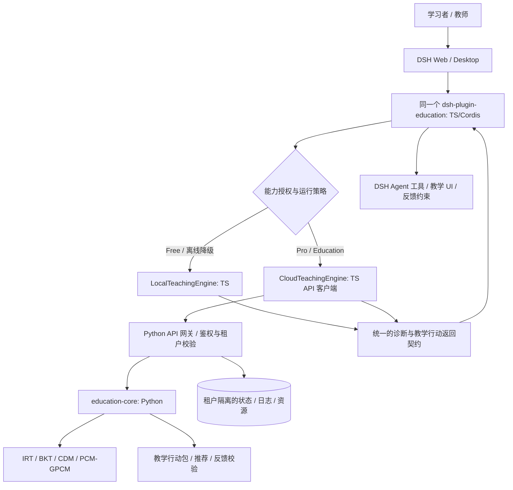
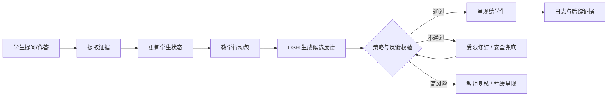

# DSH 教学智能体插件：最终产品与技术实施方案

> 版本：v1.0 · 日期：2026-11-01  
> 定位：面向 DeepSeek Harness (DSH) Web、Desktop 的教学插件，兼容未来的 Pi 与独立教学平台。  
> 状态：工程设计与验证计划；不代表所有 DSH 扩展点和商业化功能已经实现。

## 1. 执行摘要与核心决策

构建**一个 DSH TypeScript 插件 + 两种教学引擎 + 三档产品服务**：

- **Free（个人免费版）**：TS 本地执行基础教学规则，提供提问引导、分步提示、基本进度统计、规则推荐；无需用户安装 Python、部署教学后端或登录付费服务。用户依然需要 DSH 本身可用的模型连接，模型费用与教学插件免费是不同概念。
- **Pro（个人订阅版）**：同一插件调用开发者部署的 Python 教学服务，提供有证据依据的 IRT、BKT、CDM、PCM/GPCM（视数据条件）、教学行动包、长期学习状态、个性化学习材料推荐、可审计的反馈控制。
- **Education（机构版）**：增加教师工作台、班级管理、课程知识体系、组织权限、批量任务、审计与分析，支持托管及经验证后提供的机构私有化部署。

**关键边界**：TS 是 DSH 适配层及本地基础功能；Python 是高级教学能力的权威实现；云端 API 必须独立鉴权。保持统一数据契约，避免分别维护两套教学逻辑。免费版不是“伪 IRT”：仅输出有依据的基础统计，不冒充心理测量模型诊断。

## 2. 用户使用场景与部署责任

| 场景 | 用户安装/操作 | TS 插件运行位置 | Python 运行位置 | 是否需用户自行部署 Python |
|---|---|---|---|---|
| DSH Desktop + Free | 安装插件、配置 DSH 模型 | 用户本机 DSH Host | 不使用 | 否 |
| DSH Desktop + Pro | 安装插件、登录订阅 | 用户本机 DSH Host | 供应商云端 | 否 |
| 自己运行 DSH Web + Free | 运行 DSH Web、安装插件 | 用户自己的 DSH 服务端 | 不使用 | 否 |
| 自己运行 DSH Web + Pro | 运行 DSH Web、安装插件、登录 | 用户自己的 DSH 服务端 | 供应商云端 | 否 |
| 访问机构托管的 DSH Web | 浏览器登录（安装由管理员完成） | 机构 DSH 服务端 | 供应商或机构后端 | 否（机构管理员负责部署） |

**澄清**：DSH Web 并非仅靠浏览器执行的纯前端页面。所谓“本地 TS”是指在用户/组织控制的 **DSH Host 的 Node/TS 运行环境**执行，不代表浏览器 JavaScript 无限制地访问文件、数据库或本地服务。Desktop 与 Web 的插件代码可共用，但 **Profile、安装激活和生命周期分别管理**。

## 3. 总体架构



**分层原则**：

1. **产品层**：账户、套餐、订阅、配额、管理员界面。
2. **适配层（TS）**：Cordis 注册、工具暴露、插件配置、事件桥接、Client Slots UI、错误降级。
3. **教学策略层**：统一 `StudentState`、`Evidence`、`TeachingActionPackage`、`ValidationResult` 等契约；不允许模型自由修改服务端正式诊断结果。
4. **算法层（Python）**：模型估计、校准、状态更新、资源匹配、验证与日志；按数据充分性提供不同诊断深度。
5. **数据安全层**：身份、班级/组织授权、最小化上传、审计、删除、备份及隐私保护。

### 3.1 为什么不把全部 Python 改写成 TS？

IRT、BKT 等推断可以在 TS 实现，但已有 Python 研究代码、统计/测量工具与校准工作流更适合保留。若将整套研究链路迁移 TS，数值一致性验证和持续维护成本较高。**推荐仅把不依赖复杂拟合的轻量规则和简单统计实现为 TS。**

### 3.2 MCP 的定位

DSH 原生 MCP Client 支持 `stdio` 与 Streamable HTTP。因此 Python 教学核心可另外暴露 MCP 接口，让 Pi、其他 Agent 复用；但对于 **Pro 订阅、用户鉴权、配额、教师管理和审计**，核心业务路径优先使用明确的 HTTPS API。MCP 是互操作通道，而非商业化后端的替代品。若需要直接用 MCP 调用付费服务，仍须服务端执行鉴权与租户隔离。

## 4. 产品与功能分层

| 能力 | Free 本地 TS | Pro 云端 Python | Education 机构 |
|---|---|---|---|
| AI 问答与基础知识解释 | 依托用户配置的 DSH 模型 | 同 Free | 同 Free / 机构模型配置 |
| 苏格拉底式提问、基础分步提示 | 支持（提示词 + 规则） | 结合学生状态动态控制 | 机构可设策略 |
| 学习进度 | 本地正确率、完成数、最近记录 | 长期历史与趋势 | 班级聚合 |
| 诊断 | 基础统计，不称为 IRT | IRT/CDM；数据不足时标注不可估计 | 题库校准与数据质量监控 |
| 知识追踪 | 简单最近表现 | BKT，成熟后选用 DKT | 多课程知识点体系 |
| 步骤题评价 | 规则或量规基础版 | PCM/GPCM（有合格等级数据与标定时） | 教师量规管理 |
| 教学行动包 | 固定规则、基础难度调整 | 状态驱动的五槽位决策 | 策略模板与教师覆盖 |
| 学习材料推荐 | 标签、规则匹配 | 证据驱动的个性化推荐 | 学校资源库与教师审核 |
| 受控反馈 | 基础提示、规则检查 | 多环节校验、审计、必要时人工复核 | 管理控制台与审核流程 |
| 账号、跨设备同步 | 不要求 | 支持 | SSO/组织管理（后续） |

**不宜承诺**：付费版“算法越多就一定学得越好”。应通过诊断准确性、学习增益、练习效率、违反教学约束率、延迟和用户留存来验证价值。

## 5. 核心契约设计

所有入口都返回具有版本号、来源和证据可用性的信息，不把缺数据时的默认值伪装成模型估计。

```typescript
interface EvidenceSummary {
  itemCount: number;
  observationWindow?: string;
  qualityFlags: string[];
}

interface StudentState {
  schemaVersion: '1.0';
  studentId: string;
  source: 'local_rules' | 'irt' | 'bkt' | 'cdm' | 'pcm' | 'ensemble';
  observedAt: string;
  evidence: EvidenceSummary;
  abilities?: Record<string, number>;
  mastery?: Record<string, number>;
  uncertainty?: Record<string, number>;
  unavailableReasons?: string[];
}

interface TeachingActionPackage {
  schemaVersion: '1.0';
  primaryIntent: string;
  activitySequence: string[];
  supportLevel: string;
  difficulty: string;
  feedbackStrategy: string;
  evidenceRefs: string[];
  guardrails: string[];
}

interface ValidationResult {
  allowed: boolean;
  violations: string[];
  suggestedRemediation?: string;
  requiresTeacherReview: boolean;
}

interface TeachingEngine {
  diagnose(input: unknown): Promise<StudentState>;
  recommend(input: unknown): Promise<TeachingActionPackage>;
  validateFeedback(input: unknown): Promise<ValidationResult>;
}
```

正式开发应改用 Zod（TS）与 Pydantic（Python）从同一个 OpenAPI/JSON Schema 生成或校验契约，并提供跨语言契约测试。`unknown` 为架构占位，不应作为生产代码的数据类型。

## 6. TS 插件实现

### 6.1 模块结构

```text
education-suite/
├── packages/
│   ├── education-contracts/       # JSON Schema / OpenAPI / 类型生成
│   ├── dsh-plugin-education/      # Cordis: Tool / Service / Hooks
│   ├── education-local-ts/        # Free: 规则、统计、基础推荐
│   └── education-client-ui/       # React / DSH Client Slots
├── python/
│   ├── education-core/           # IRT、BKT、CDM、PCM、推荐、反馈
│   ├── education-api/            # FastAPI、鉴权、租户与配额
│   └── education-mcp/            # 可选互操作适配
├── infrastructure/               # Docker、迁移、监控、密钥管理
├── tests/                        # TS/Python/跨端契约与 E2E
└── docs/                         # 用户文档、权限说明、运维手册
```

### 6.2 统一引擎选择

```typescript
// 概念示例：实际权限必须由云端验证，前端标记不可作为授权依据。
const local = new LocalTeachingEngine();
const cloud = new CloudTeachingEngine({ endpoint, tokenProvider });

async function diagnose(input: DiagnosisInput): Promise<StudentState> {
  if (await cloud.hasValidEntitlement()) {
    try {
      return await cloud.diagnose(input);
    } catch (err) {
      reportCloudFailure(err);
    }
  }
  return local.diagnose(input); // 返回 source=local_rules，清晰提示降级
}
```

**严禁在本地放入云端服务的 API 密钥或订阅验证密钥**。订阅校验与套餐配额在服务端执行。云端失败时不复用过期诊断并标为新结果；应明确标注离线/降级状态。

### 6.3 DSH 接入点

- Cordis Tool：`education_get_state`、`education_recommend_activity`、`education_validate_feedback`。
- Cordis Service：承载 `TeachingEngine`，供多个工具与 UI 共享。
- UI：使用 DSH Client Slots 挂载学生状态摘要、教学行动卡、插件设置、授权登录入口。
- 生命周期：根据 DSH 当前正式扩展点接入工具调用、Agent 事件及日志。**不要假设工具钩子可拦截所有 Agent 最终回复**；最终自然语言受控反馈须单独验证可用的生成后拦截/修订扩展点，不能保证时使用受控响应代理层或限定对话入口。
- Profile：分别为 `web`、`desktop`、`sdk` 验证安装与激活；不默认自动跨 Profile 同步。

## 7. Python 服务设计

### 7.1 技术栈

- Python 3.11 + uv；FastAPI + Pydantic；PostgreSQL；Redis（缓存、配额及异步任务的可选组件）。
- 诊断：IRT / BKT / CDM / PCM-GPCM 分成独立模块；模型训练、参数校准与在线推断解耦。
- 任务：在线轻量推断优先同步 CPU 服务；标定、批量分析、资源索引等使用队列/后台 Worker。
- 部署：容器、HTTPS 反向代理、审计与指标监测；需要时按组织分库或逻辑租户隔离。

### 7.2 API 建议

| 接口 | 作用 | 安全约束 |
|---|---|---|
| `POST /v1/diagnosis` | 学生学习状态 | 身份与学生访问控制 |
| `POST /v1/actions` | 教学行动包 | 课程、证据版本与策略校验 |
| `POST /v1/feedback/validate` | 反馈验证 | 记录策略版本、处理敏感数据 |
| `POST /v1/events` | 学习事件录入 | 幂等键、来源校验、防重复 |
| `GET /v1/entitlements` | 套餐权益 | 服务端计算，有效期及额度 |
| `GET /v1/materials/recommendations` | 材料推荐 | 内容授权与课程范围 |
| `POST /v1/sync` | 可选本地学习记录同步 | 明确授权与冲突处理 |

服务端从可信 token/session 推导 `userId`、`tenantId`、可访问的 `studentId`；拒绝任意传入他人学生标识。教育测量输出必须包含证据样本量、参数版本、质量标记与适用条件。

## 8. 受控反馈：教学插件真正的差异化

建议形成以下可追踪工作流：



**五槽位教学行动包**：`primary_intent`、`activity_sequence`、`support_level`、`difficulty`、`feedback_strategy`。校验重点：是否直接提供应由学生完成的答案、是否替代推理、是否越过提示层级、是否违反教师预设限制、证据与生成理由是否一致。

**技术风险**：只使用 LLM 自评或简单关键词检查不足以保证合规；需关键场景确定性规则、限定工具权限、必要时教师人工复核、固定测试集与违规日志。离线 Free 应保留基本规则但坦诚其能力边界。

## 9. 订阅、商业化与数据治理

### 9.1 订阅授权

- Free 不强制创建账户（若 DSH 本体要求账户或模型配置，以 DSH 为准）。
- Pro 登录后获得短期访问凭据；每次调用由云端校验权益、租户、额度与接口权限。
- Education 管理员配置组织、课程、学生及教师角色；教师不可跨班级访问未获授权的数据。
- 订阅支付系统与产品权限服务分开；不将付费状态仅存储在本地插件配置中。
- 设定调用量、存储和数据保留策略；实际定价基于成本与用户验证，不在当前方案虚构价格。

### 9.2 模型成本

免费插件不承担用户原有 DSH 模型调用费用；付费诊断 API 的定价也不默认包含大模型 Token。若提供服务端 LLM 评分，需要单独统计、限额、透明说明。IRT/BKT 在线推断可优先使用 CPU，云成本主要受并发、数据库、存储、日志和 LLM 调用影响。

### 9.3 隐私合规

- 学习记录默认仅收集必要字段；个体教育数据上传前需清晰告知与授权。
- 数据传输加密、静态加密、租户隔离、RBAC、审计、数据导出与删除。
- 针对未成年学生、跨境处理及学校采购，另行完成当地适用法规与合同审查。
- 防止 Agent 工具与文件访问超权。DSH SDK 的 `sdk-minimal` 示例使用 `danger-full-access`，**不能直接作为未隔离的多用户教学执行环境**。

## 10. 测试与验收标准

### 10.1 关键测试矩阵

| 测试 | Free | Pro | Web | Desktop |
|---|---|---|---|---|
| 首次安装及启用 | ✓ | ✓ | ✓ | ✓ |
| 没有 Python 的终端也能使用 Free | ✓ | — | ✓ | ✓ |
| 断网基础功能 | ✓ | 降级 | 自托管适用 | ✓ |
| 登录/退出/订阅过期 | — | ✓ | ✓ | ✓ |
| 诊断证据不足时正确标注 | ✓ | ✓ | ✓ | ✓ |
| 云端超时/限流/故障恢复 | — | ✓ | ✓ | ✓ |
| 跨用户/跨班级越权尝试 | 本地限制 | ✓ | ✓ | ✓ |
| 教学违规反馈拦截与审计 | 基础版 | ✓ | ✓ | ✓ |
| Profile 升级与插件兼容 | ✓ | ✓ | ✓ | ✓ |

### 10.2 上线门槛（建议，待基线验证）

- Free：在目标系统不安装 Python 即可完成核心教学流程；离线时基础规则仍可用；升级不丢本地数据。
- Pro：所有敏感 API 有鉴权、对象级访问控制、限流与审计；跨租户越权测试必须全部拒绝；云端失败有明确、可见的降级反馈。
- 诊断：对真实/模拟数据分别验证参数拟合、可靠性、校准与不确定性；无可靠证据则禁用该模型输出。
- 教学反馈：用冻结的任务集测量直接泄题、越权、无证据解释和不一致率；先设基线，再预注册验收阈值。
- 多用户：并发、长会话、服务重启、用户退出、课程切换均做 E2E 验证。

## 11. 分阶段交付路线

### P0 — 兼容性验证（第一优先级）

- 锁定 DSH 版本，验证 Cordis bundle 在 Web 与 Desktop 安装及启用。
- 验证 Client Slots 能否共享 React UI；确认真正能约束最终回答的生命周期位置。
- 在 TS 中实现一个本地教学工具；调用模拟云端 Python `/v1/diagnosis`。
- **退出条件**：两端可安装、可调用、可呈现结果；清楚记录无法实现的钩子和限制。

### P1 — Free MVP

- TS 本地规则引擎：问答策略、分步提示、进度统计、简易推荐。
- 本地持久化与数据导出；插件设置面板；面向非技术用户的安装流程。
- **退出条件**：无需 Python、无需开发者指导即可完成基本教学流程。

### P2 — Pro Beta

- Python API：授权、`diagnosis`、`actions`、`feedback/validate`、事件记录。
- 优先落地 BKT 与证据质量检查；IRT/CDM 随题库标定与数据条件逐步启用；PCM/GPCM 需要合格的分级任务数据。
- 加入云端故障降级、配额、隐私设置与端到端日志。
- **退出条件**：通过隔离、数据质量及闭环教学测试。

### P3 — Education 与跨平台复用

- 教师/班级管理、报告、课程资源库、机构数据治理。
- 可选暴露 Python MCP；在 Pi 扩展中复用同一教学 API；根据需要支持机构私有部署。
- **退出条件**：至少在受控教学试点中完成效果与运维评估。

## 12. 关键风险与决策

| 风险 | 影响 | 缓解措施 |
|---|---|---|
| DSH 快速迭代造成插件 API 改动 | Web/Desktop 失效 | 固定兼容版本，CI 冒烟测试，`engines.dsh` 约束 |
| DSH 最终反馈缺少合适拦截点 | 无法严格受控 | P0 优先验证；必要时自建代理层，不夸大承诺 |
| 教育测量数据不足 | 无法可信估计 IRT/CDM 等 | 数据门槛、模型质量标志、回退到基础规则 |
| 商业授权只检查客户端 | 被绕过 | 云端逐请求校验、配额、日志 |
| Web 与 Desktop 权限不一致 | 功能和安全差异 | 分 Profile 测试，明确 Host/Client 边界 |
| 学生隐私与多租户隔离 | 合规与信任风险 | 最小数据、授权、RBAC、租户隔离、审计 |
| 订阅价值不明显 | 转化率低 | 用实际学习增益与使用体验验证 Pro 价值 |

## 13. 明确不做的事情（首版范围）

1. 不要求每位用户安装 Python、配置 uv 或部署云端服务。
2. 不将所有教育测量算法迁移 TS。
3. 不在首版把复杂 DKT、离线 RL、跨校多租户私有化全部上线。
4. 不将“本地模型/插件运行”误解为“免费模型推理”。
5. 不以增加 IRT 名称作为付费价值证明。
6. 不假设 DSH 插件能天然读取任意 Web/桌面用户的身份；授权映射需要单独设计。

## 14. 建议实施结论

**最终选择：标准 DSH TypeScript/Cordis 插件 + 本地 TS FreeTeachingEngine + 开发者托管的 Python ProTeachingEngine + 统一教学契约 + 可选 MCP 适配。**

这套方案使用户无须自己部署 Python 服务，Web 与 Desktop 能复用插件业务逻辑；Python 教育测量研究成果也不受 DSH 绑定，并可用于 Pi 与独立教学平台。**先解决“跨端插件正常运行 + 免费功能零部署 + 最终回复受控”三个不确定性，再开发付费诊断及机构管理**，是风险最小的实施顺序。

## 15. 官方文档与依据

- [DSH 架构、Cordis、Profile 与 Desktop](https://deepseek-harness.github.io/deepseek-harness/reference/)
- [创建 DSH 工具插件](https://deepseek-harness.github.io/deepseek-harness/develop/basic/tool)
- [插件打包与安装](https://deepseek-harness.github.io/deepseek-harness/develop/basic/publish)
- [Web Client Slots](https://deepseek-harness.github.io/deepseek-harness/en/reference/subsystems/slots)
- [MCP 连接配置与行为](https://deepseek-harness.github.io/deepseek-harness/guide/mcp-memory)
- [MCP Client 配置目录](https://deepseek-harness.github.io/deepseek-harness/reference/config-catalog)
- [Python SDK 使用说明与运行隔离警告](https://deepseek-harness.github.io/deepseek-harness/guide/python-sdk)

> 注：以上文档支持相应技术机制的可行性判断；教学插件、订阅系统、云端诊断、跨端 UI 和受控反馈完整闭环均属于拟开发内容，需要 P0/P1 验证。
