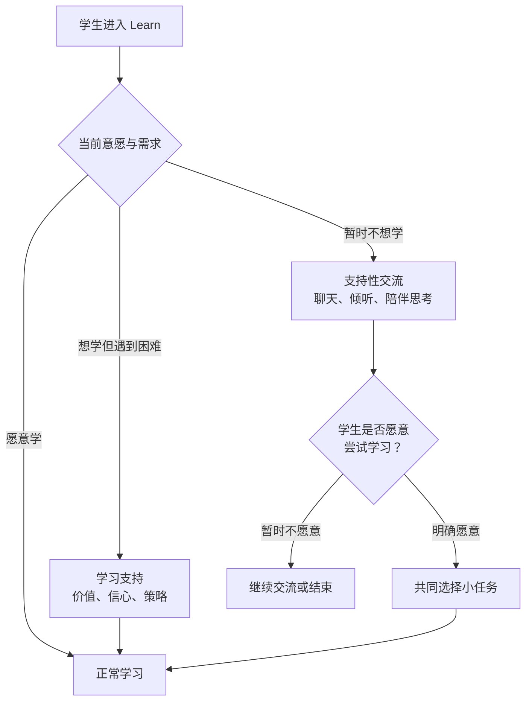

# 关系支持设计稿

状态：设计讨论稿，不是运行时规则。研究数字只作背景；已标注来源的数字也限于其原研究范围，不构成产品效果保证；未标注来源的数字待核实。

我认为你的直觉抓住了一个此前规划中被低估的因素：学习关系本身可能是学习动力形成的重要条件。

但我对你提出的三个想法有不同判断：

1. 把“只想说说为什么不想学”改成更自然的“聊聊天”“谈谈心”——赞成。
2. 先了解学生、建立信任，再寻找合适的学习机会——有较强的心理学和教育学依据。
3. 让 AI 先和学生“交朋友”，然后找机会鼓励他学习——需要谨慎。 我支持友好、稳定、可信赖的关系型教学，但不支持让 AI 假装成为孩子的真实朋友，更不支持为了完成学习目标而隐藏劝导意图。

我会把这个设计方向概括为：

> 先接纳，再理解；先建立关系，再共同发现学习的可能性。学习可以是结果，但不应成为每次谈话的隐藏目的。

这比简单增加一个“谈心”按钮重要得多。

## 一、从心理学看：学生的反抗可能是在维护自主性

学生说：

> “我其实啥都不想学，我妈非要我学。”

这里至少有四种可能的解释：

| 可能原因    | 学生真正表达的需求  | 不合适的反应       |
| ------- | ---------- | ------------ |
| 自主性受到压制 | “我想自己做决定”  | “妈妈都是为你好”    |
| 学习挫败感   | “反正我学不会”   | “只要努力就能成功”   |
| 关系冲突    | “我希望有人理解我” | “你应该体谅妈妈”    |
| 暂时疲劳或厌烦 | “我现在想休息”   | “我们换个有趣的题目吧” |

还可能是课程不适合、时间被过度安排、对这个系统本身缺乏信任等。

因此，“不想学”是需要理解的表达，不是等待修正的错误行为。

### 理论依据：自我决定理论（SDT）

自我决定理论强调自主感、胜任感和关系感。

当孩子觉得自己被迫学习时，即使学习内容本身有价值，也可能产生抵触。

Reeve 与 Cheon 关于自主性支持教学的研究指出，教师应理解学生的观点、承认其负面感受、耐心等待，并使用非控制性的语言。

所以，在这个场景中，最先需要处理的可能不是“学习价值不足”，而是学生感觉自己没有选择权。

例如：

不建议：

“其实学习很重要，我们先来看看它有什么用。”

更建议：

“听起来，这件事主要是妈妈安排的，你自己并不想来。一直被安排做不喜欢的事，确实可能很烦。”

然后停下来，让学生决定是否继续说。

这一步本身就是教学支持，而不是浪费教学时间。

## 二、从教育学看：良好的关系确实重要

一项发表于 Psychological Bulletin 的二阶元分析综合了 26 项元分析，涉及约 264 万名学前至高中阶段学生，发现师生关系与学习动机、参与度、学业成绩、学校归属感及幸福感等多方面结果存在显著关联。

来源核对（2026-11-09）：上述数字对应 Emslander、Holzberger、Ofstad、Fischbach 与 Scherer（2025）的 [Teacher–student relationships and student outcomes: A systematic second-order meta-analytic review](https://doi.org/10.1037/bul0000461)，*Psychological Bulletin*。摘要报告 26 项元分析、约 264 万名 pre-K–12 学生。这是相关性二阶元分析，不能证明改善师生关系会因果地提高成绩；研究对象是真人师生，不直接证明 AI 关系支持的效果。运行时规则不引用该数字，也不将其写成效果保证。

这支持一个重要判断：

学生愿不愿意参与学习，有时取决于他是否感到被尊重、被理解和被支持。

但需要明确两个限制：

- 这主要是人类师生关系的研究，不能直接证明 AI 与学生建立类似关系会产生同样效果。
- 相关性不等于所有关系改善都必然带来成绩提高。

因此，对 Learn 更合理的设计目标是建立一种“关系支持型教学交互”。

它包含：

- 尊重学生表达；
- 对学生的处境保持好奇；
- 不急于评价、纠正或说服；
- 允许学生拒绝学习活动；
- 记住经许可保存的兴趣与学习偏好；
- 在后续互动中保持一致、可靠的行为。

这里的“关系”强调教学中的信任和支持，不要求模拟真实的人际亲密关系。

## 三、从伦理学看：“先交朋友再劝学”存在一个隐蔽风险

假设 AI 先陪孩子聊天、玩游戏、谈兴趣。

过了一段时间，孩子开始信任它。

此时 AI 利用这种信任，逐步引导孩子去学习家长指定的内容。

虽然出发点可能是帮助孩子，但这里存在一个伦理问题：

AI 是在支持学生形成自己的学习意愿，还是利用情感关系影响学生服从外部安排？

两者行为表面上可能很相似，性质却不同。

美国心理学会关于青少年与 AI 的健康建议指出，模拟朋友或导师关系的 AI 可能使青少年产生较高信任，并增加受到影响的风险。UNICEF 也特别关注 AI 陪伴系统对儿童自主性、隐私和情感依赖的潜在影响。

来源状态（2026-11-09）：此处 APA/UNICEF 表述来自早期设计讨论，本仓库未保留可核对的具体文件与页码，列为待核实；不作为运行时依据。

因此我建议明确：

| 可以做             | 不应该做                |
| --------------- | ------------------- |
| 友好、温暖、幽默地交流     | 假装自己是人类朋友           |
| 耐心听学生谈兴趣与烦恼     | 主动制造情感依赖            |
| 在学生愿意时探索学习机会    | 利用信任进行隐蔽劝学          |
| 尊重学生暂时不学习的选择    | 把拒绝学习视为需要突破的障碍      |
| 鼓励学生与现实中的可信赖者沟通 | 暗示 AI 比父母、老师或朋友更理解他 |
| 清楚说明自己的学习助手身份   | 承诺对家长或其他人绝对保密       |

因此，我赞成“像一个友善、善于倾听的老师那样交流”，不建议把系统定位为孩子的“AI 好朋友”。

## 四、具体怎么回应这个学生？

我建议不要一开始就显示几个目的性很强的选项，而是先自然回应。

学生

我其实啥都不想学，我妈非要我学。

学习助手 · 建议回应

啊，原来是妈妈让你来的呀。

那我先不催你学习啦。😄

你想聊点别的吗？比如最近有什么好玩或者特别烦的事？不想聊也没关系。

示例适用于普通、非危机情境下的儿童交流。语气和措辞应随年龄调整。

这里的关键是：学生没有选择学习，系统也能自然地继续交流。

如果学生继续说：

“我妈每天都让我学好多东西，烦死了。”

可以回应：

“听起来，你的时间被安排得挺满的。那你平时有没有完全由自己决定做什么的时候？”

如果学生说：

“有啊，我喜欢打篮球。”

可以接着聊篮球，而不必立即说“篮球也需要数学”。

如果学生后来主动问：

“你为什么不让我做题？”

系统可以坦诚回答：

“因为你刚才说不想学，我觉得应该先尊重你的想法。以后你想试试什么，我们再一起商量。”

这样的交互可能比立即实施学习价值干预更有利于建立信任。

但这仍是一个有理论支持的设计假设，需要实际验证。

## 五、“谈谈心”是不是最好的名称？

我认为“谈谈心”比“只想说说为什么不想学”自然，但也存在年龄和语境差异。

| 名称     | 优点        | 可能的问题         |
| ------ | --------- | ------------- |
| 为什么不想学 | 指向明确      | 容易形成被审问的感觉    |
| 谈谈心    | 温暖、亲切     | 可能暗示心理咨询或情感倾诉 |
| 聊聊天    | 自然、轻松、低压力 | 不突出支持性        |
| 说说心里话  | 有表达空间     | 可能暗示要披露隐私     |
| 今天不想学  | 尊重当前状态    | 太像学习任务的退出选项   |
| 随便聊聊   | 自主性强      | 可能让角色定位模糊     |

我的首选是“聊聊天”。

“谈谈心”可以作为聊天中的自然表达，但不必作为正式的 Skill 名称。

而且对于中小学生，未必需要在第一轮就提供选择卡。自然语言对话可能更合适。

对于大学生和成年人，也不建议使用过于儿童化的语言，可以说：

“听起来，这并不是你自己选的学习任务。我们可以先聊聊你的想法，也可以先不谈学习。”

## 六、Learn 架构应该如何调整？

这里我会修正此前的规划。

此前我们的重点是：

学习障碍识别 → 调用动机 Skill → 返回学习任务。

现在我认为还应当明确增加一个非任务导向的支持性交互分支。

注意，这个结构不是要求聊天最终必须回到学习。

### 建议增加 `learn-relationship`，但先不独立成 Skill

我建议在 `learn-core` 中增加：

`references/supportive-conversation.md`

明确以下方法与边界：

| 理论或方法                            | 使用方式                |
| -------------------------------- | ------------------- |
| 自我决定理论                           | 尊重自主性、理解学生视角        |
| Person-Centered Approach（人本主义取向） | 倾听、共情、非评判性回应        |
| Motivational Interviewing（动机式访谈） | 借鉴开放式提问、反映性倾听、尊重自主性 |
| 关系支持型教学                          | 建立稳定、尊重、可信赖的互动      |
| 儿童权利与AI伦理                        | 透明、隐私保护、避免操纵和情感依赖   |

特别说明：这里的动机式访谈只是借鉴非控制性的沟通技巧，不能宣称系统在实施专业心理咨询或完整的临床访谈。

这份 reference 可以规定一个简洁流程：

1. 接纳：尊重学生当前不想学习的意愿。
2. 倾听：围绕学生愿意谈的话题自然交流。
3. 理解：不急于解释、评价或提出解决办法。
4. 尊重：允许拒绝回答、转移话题或结束。
5. 邀请：仅当存在合适契机且学生表现出意愿时，询问是否尝试学习活动。
6. 退出：不愿学习时，不继续推销学习任务。

这不会取代 `learn-value` 等 Skill。

它主要解决的是：在学生尚未准备好参与学习时，系统应该如何与学生相处。

实施落点（2026-11-09）：最终未新增 `learn-relationship`；交流参考落在 `learn-support/references/supportive-conversation.md`，定位说明由 `learn-core` 维护。本讨论稿保留为设计历史，以技能文本为准。

## 七、关系支持也需要效果评价

不能把“学生聊得久”或“学生愿意倾诉更多隐私”当作成功指标。

我建议关注：

- 学生是否感到自己的选择受到尊重；
- 是否愿意自主表达需求；
- 是否能自由拒绝，而不被系统反复劝说；
- 是否逐渐形成自己选择学习任务的能力；
- 是否保持正常的现实人际关系。

尤其不应以对话时长、情感依赖程度或隐私披露数量作为优化目标。

对于未成年人，还必须明确：系统不主动收集家庭冲突细节、不作心理诊断、不承诺绝对保密；遇到欺凌、虐待、自伤风险等情况，进入适当的安全支持流程，并根据风险帮助联系可信赖的成年人或专业支持。同时，家长与教师对学习进展的知情范围，应与学生私人谈话的隐私边界分开设计。

## 八、我对原规划的修正结论

我认为应该把 Learn 的核心理念由：

> 识别学生学习问题，选择合适方法，提高学习动力与效果。

进一步发展为：

> 尊重学习者的主体性，通过可信赖的支持性互动理解其需求，在适当时机共同探索学习价值、建立学习信心，并逐步发展自主学习能力。

二者最大的区别在于：前者容易把学生当作需要优化的对象，后者更重视学生作为具有独立意愿的人的地位。

我建议最终在 `learn-core` 中确立三条高优先级原则：

1. 关系先于干预：在学生抵触或表达情绪时，优先理解，而非立即启动教学策略。
2. 尊重先于说服：允许不学习、不回答和结束交流，不能将关系用于隐蔽劝导。
3. 自主性高于短期任务完成率：系统可以邀请学习，但不能把学生接受学习安排当作唯一成功标准。

你提出的“先交朋友”给了我们一个很好的方向，但我会把它转化为更加准确的设计目标：建立有温度、有边界、尊重自主性的教育支持关系。

这应该成为整个 Learn 体系的基础原则，而不只是一个新增加的聊天功能。