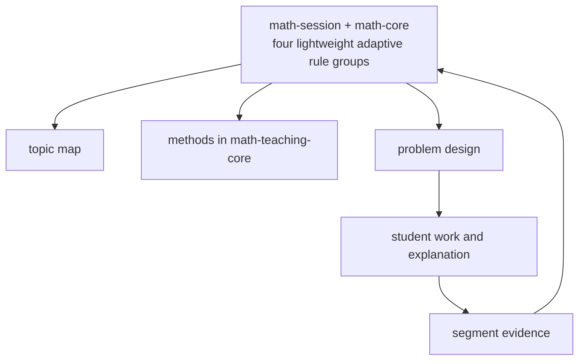

# Grade 4–6 method provenance (`math-primary-high`)

Maintainer background only — **teaching material, not installed skills**. Runtime method choice and steps live in the installed package: [`math-teaching-core.md`](../math-primary-high/skills/math-core/references/math-teaching-core.md), plus leaf skills and the other `math-core` references listed below. `math-primary-high/package.json` → `files` ships only `cordis.patch.yml`, `skills`, and `README.md`.

Former module-style method skills were retired from the package tree so a single skill does not carry two conflicting control-flow rules for the same act. This page keeps the mapping from those method names to their installed homes.

## Method → installed home

| Former method name | Installed home | Grade 4–6 use |
|---|---|---|
| `concrete-pictorial-abstract` | `math-teaching-core.md` (CPA) | Object or imagined action → diagram → notation; fractions, decimals, ratio, geometry, early algebra |
| `polya-problem-solving` | `math-teaching-core.md` (Pólya) | Understand, plan, carry out, look back for multi-step and unfamiliar problems |
| `variation-theory-math` | `math-teaching-core.md` (variation); practice rules | Contrast examples that differ in one critical feature and expose invariants |
| `inquiry-and-proof` | `math-teaching-core.md` (inquiry) | Constrained pattern → conjecture → test and counterexample → reason |
| `explicit-instruction-math` | `math-teaching-core.md` (explicit); `scaffold-calibration.md` | Worked example → faded step → independent check when prerequisites are weak |
| `formative-metacognition-math` | `math-teaching-core.md` (formative); scaffold notes | Elicit thinking → one actionable feedback point → child self-assessment |
| `mathematical-modeling` | leaf `math-application-modeling` | Situation → assumptions → representation → solve → interpret and validate |
| `upper-primary-math-knowledge-map` | `references/topic-map.md` | Concept ids, prerequisite edges, misconception probes |
| `adaptive-math-task-generator` | `references/problem-design.md` | Verified task bundles with a child view and an adult key |
| `math-learning-progress-tracker` | `references/math-segment-fields.md` | Evidence per activity with independence and support; no aggregated score |
| `handwritten-math-reader` | shared entry `learn-errors` | Faithful reading of handwritten photos, scans, or ink |
| `upper-primary-math-coach` | `math-session` + `math-core` rules | Knowledge point, difficulty, hints, and method — one change at a time |

`references/learn-act-allocation.md` chooses the activity owner; `math-teaching-core.md` chooses the teaching method independently. Interface skill names (`math-core`, `math-session`, `math-diagnose`, `math-practice`, `math-student-problem`) match the lower-primary package on purpose so the teaching resolver can select one math implementation per session.

## Adaptive design constraints

Packaging-era notes (old name `upper-primary-math-coach` → today's `math-session` and `math-core`). Implementation follows [`adaptive-thresholds.md`](../math-primary-high/skills/math-core/references/adaptive-thresholds.md) and [`learn-act-allocation.md`](../math-primary-high/skills/math-core/references/learn-act-allocation.md). Thresholds are configurable defaults, not claims of empirical calibration.

| Mechanism | Rule |
|---|---|
| Knowledge-point adaptivity | Use the topic map for prerequisites; backtrack at most one node when needed |
| Difficulty adaptivity | L1–L3 from independent completion and explanation |
| Hint adaptivity | H0–H4, increase or fade help gradually |
| Method adaptivity | Pick CPA, Pólya, variation, etc. from the difficulty type |

Additional constraints still in force:

- All adaptive thresholds are configurable.
- A single error does not trigger knowledge-point backtrack.
- Correct without explanation does not automatically raise difficulty.
- Prefer adjusting hints and representation before changing teaching method.
- Interest, fatigue, and student choice can adjust the activity.
- After a session, record the evidence needed for the next activity.



## Task bundle illustration

Operational multi-part and verification rules are in [`problem-design.md`](../math-primary-high/skills/math-core/references/problem-design.md). Example shape for maintainers:

```yaml
task_bundle:
  topic_id: equivalent-fractions
  learning_target: explain why scaling numerator and denominator preserves value
  assumed_prerequisites: [fractions-as-number, multiplicative-thinking]
  grade: 5
  method: concrete-pictorial-abstract
  goal: reasoning
  difficulty: core
  child_view:
    - id: diagnose
      prompt: "Which is larger, 3/4 or 6/8? Explain using the same-sized whole."
    - id: build
      prompt: "Draw two equal bars, split one into 4 pieces and the other into 8. Shade equivalent amounts."
    - id: transfer
      prompt: "Is 4/6 the same as 6/9? How do you know without decimal conversion?"
  adult_key:
    - id: diagnose
      reasoning: "They are equal; 6/8 is obtained by partitioning each quarter into two equal pieces."
      error_probe: "Comparing the size of numerator/denominator independently"
    - id: transfer
      reasoning: "Both simplify to 2/3; multiplying both parts of 4/6 by 1.5 is valid numerically, but 2/3 equivalence is clearer."
  graduated_hints:
    - "What is the whole?"
    - "Can the two bars be the same length?"
    - "What happens if each fourth is cut into two?"
  verification: {arithmetic_checked: true, unique_answer: true, units_checked: true}
```
