# 教学技能调用关系与使用场景

> 覆盖 `learn/`、`math-primary-low/`、`chinese-reading/`、`english/` 四个 DSH 技能包。  
> 调用边以各 `SKILL.md` 与 `learn-data/references/session-lifecycle.md` 为准；本文件是运行时总览。入口按 `<subject>-session` / `<subject>-core` 命名定位学科包，约定见 `learn-data/references/subject-contract.md`。

## 1. 包依赖

`math-primary-low`、`chinese-reading` 与 `english` 通过 **skill 名称** 加载 `learn` 包中的共享能力；不能依赖 checkout 绝对路径。包配置以 `dependencies` 正式声明这些依赖，`math-primary-low` 还必需依赖独立的 `math-board`。使用 `node scripts/install.mjs <学科包>` 自动把完整依赖闭包安装为 profile 顶层 bundle；当前 DSH 不会递归启用 npm 间接依赖，不能只 link 一个学科包。详见[统一安装说明](<../installation.md>)。

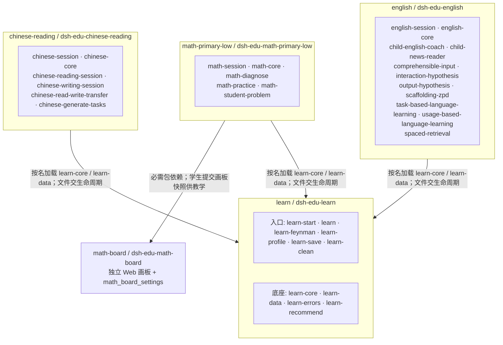

| 包 | 对外入口 | 内部能力 |
|---|---|---|
| `learn` | `/learn-start` `/learn` `/learn-feynman` `/learn-profile` `/learn-save` `/learn-clean` | `learn-core` `learn-data` `learn-errors` `learn-recommend` |
| `math-primary-low` | 无用户 `/` 入口；生命周期统一进入 `math-session` | `math-session` 集中调度三个 leaf + `math-core` |
| `chinese-reading` | 无用户 `/` 入口；由生命周期路由进入 | `chinese-session` 及子 skill + `chinese-core` |
| `english` | 无用户 `/` 入口；由生命周期路由进入 | `english-session` 及方法 skill + `english-core` |

## 2. 调用面分层

DSH 没有独立的「skill 调 skill」通道：父 skill 写「加载 `X`」时，仍是模型执行 `skill` 工具。因此内部 skill **必须**可被模型调用（`user-invocable: false`），**禁止**对内部 skill 设 `disable-model-invocation: true`。

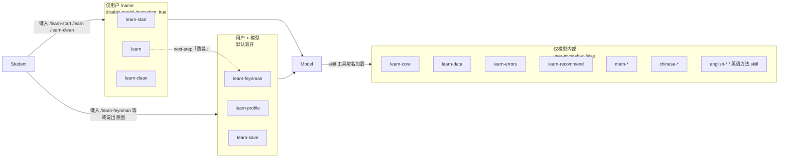

| 档位 | Skill | 为何如此 |
|---|---|---|
| 仅用户 | `learn-start` `learn` `learn-clean` | 会话边界与破坏性清理；避免自动建档、开学习循环或清空记录 |
| 双开 | `learn-feynman` `learn-profile` `learn-save` | 「我来给你讲」「看看档案」「保存一下」可自动加载；`/learn` 基础菜单的「费曼」也加载 `learn-feynman` |
| 仅模型 | 其余内部 skill | 从 `/` 菜单隐藏，供入口与学科 skill 按名加载 |

## 3. 技能调用总图

箭头表示按名加载 / 路由；标注 `read` 的边读取参考文件，不调用独立 skill。`session-lifecycle` 是 `learn-data` 的 reference，由 `/learn` 与 `/learn-feynman` 读取执行。

图例：实线 = 主干加载 / 路由；虚线 = 条件加载或标注的证据回传。每教学轮只产出**一个** `session_segment`；数学 leaf 只回证据，由 `math-session` 合并。日志追加与 finalize 由入口 + `session-lifecycle` / `finalize-session` 完成。

### 3.0 主图（主干）

只保留「入口 → 底座 / 生命周期 → 学科入口 / 投放文件」四层，细节见下列子图。只有 `learn` / `learn-feynman` 进入生命周期；`learn-start` / `learn-profile` 只到底座；`learn-save` 经底座走 finalize。`learn-clean` 只加载数据协议，预览并确认后清理生成数据，不进入生命周期或 finalize。

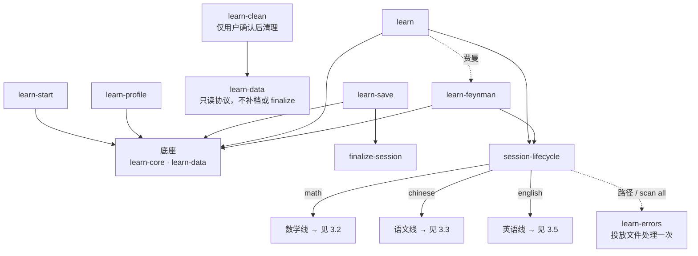

详见 [3.1](#31-入口与底座)。

### 3.1 入口与底座

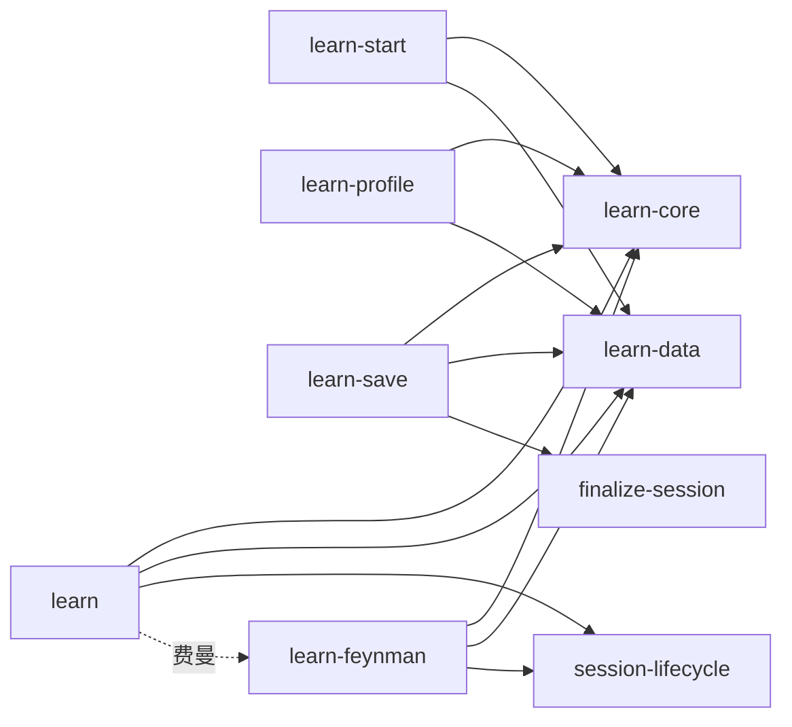

模式切换与迁移不另开 `session_id`：

- 显式 `/learn-feynman` 或 next-step「费曼」 → 加载 `learn-feynman` / 设 `mode: feynman`，写回日志 context
- 显式迁移或学科 `stage_options` 的 transfer 动作 → 设 `context.activity: transfer`，仍进对应 `<subject>-session`（见 [3.2](#32-数学调用子图) / [3.3](#33-语文调用子图)）
- 中断恢复只读日志 context；模式与动作不写进 `current_state`

细则在 `learn-data/references/session-lifecycle.md` 的 Dispatch、Resolve Target 与 Route And Record与 `learn-data/references/next-step.md`。

### 学习推荐分支

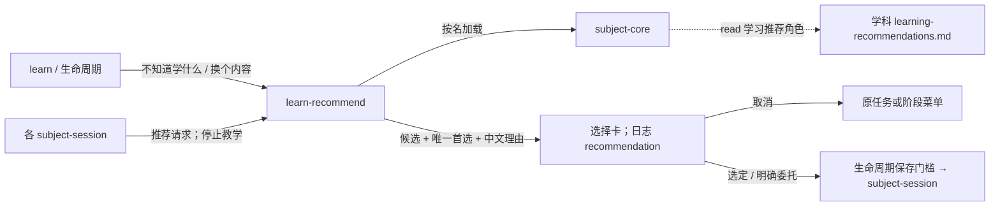

只在当前学科内推荐，分科教学法决定内容、难度与排序；普通恢复顺序不变。英语推荐理由也用中文。闭环先显示「换个内容」，点击后才展开候选；合并菜单超限时用「更多活动」保留分科动作。推荐不是教学轮，不生成 segment、不改原 focus、不提前 finalize 或清画板；待选状态可从日志恢复。具体规则以 `learn-recommend` 与生命周期推荐闸门为准。

### 3.2 数学调用子图

数学采用与英语相同的**集中调度原则**，不要求教学流程完全同构。生命周期（含费曼与 `activity=transfer`）统一进入 `math-session`；只有它决定三个 leaf 的加载。leaf 只回传证据、等待状态与建议动作，`math-session` 合并本轮唯一 `session_segment`，leaf 之间不互调。`learn-core` / `learn-data` 已由入口加载；数学分支只再加载 `math-core`。

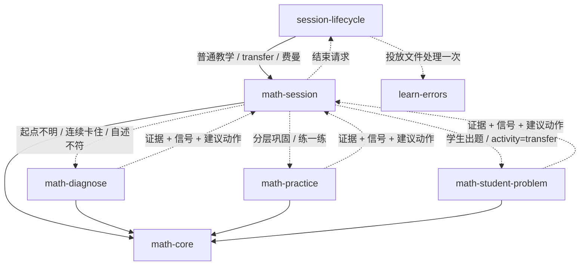

诊断触发由 `math-session` 判断：起点判断确需补证、连续两轮引导卡住、自述与表现不符，或练习需识别错误模式——不把每个新主题都先测一遍。leaf 发现这些情况时只建议诊断，由 session 决定下一动作。

leaf 用 `await_student` 表达等待，以 `continue_diagnose` / `continue_practice` / `continue_student_problem` 建议下一分支，以 `return_teaching` 建议接回主线，以 `request_end` 回传结束请求。等待学生时在 `context.turn_state` 保留 `active_leaf`、`leaf_step` 与待答问题，本轮停止，不串调；下一条回应接续原步骤。同轮最多加载两个 leaf（如诊断 → 练习或出题 → 诊断），第二次须由 session 发起，且已有证据足以推进、没有待答问题；第二个 leaf 提问后即停止，不再反向跳转。这里的加载上限指逻辑调度，已加载内容按 §6 复用，不重复调用工具。

普通学习闭环时回传 `stage_options`：`迁移` → `math-student-problem`，`练一练` → `math-practice`；由入口按 `next-step.md` 与基础菜单合并展示。未处理文件交回生命周期调用一次 `learn-errors`，已处理文件只读 extracted / `material_refs`；本包不直接加载 `learn-errors`。segment 的 `source` 沿用 `target_context.source`，不因切换 leaf 覆盖材料来源；`submode` 由 session 按本轮已有学生表现证据的主任务合并。leaf 收到结束请求先回传 session，再交生命周期处理；不直接 finalize。`mode=feynman` 优先于迁移，保持学生主讲，不并行开启出题迁移。

画板：消息带 `我的画板.json` / `我的修改记录.json`，或学生问画板怎么用时，按 `math-core` 条件表 **read** `references/structured-drawing.md`（不是独立 skill）。出题不因此去写摆法。新的学习 `session_id` 不接上一场题面和画板修改；同一条未保存日志才接本场未答题。画板只认本场已发送附件。可选 Web 插件 `dsh-edu-math-board` 见 [`math-board/README.md`](../../math-board/README.md)。

### 3.3 语文调用子图

生命周期只进 `chinese-session`；路由器每轮只选一个子 skill。mode 细表见 [3.4](#34-语文路由分派)。`learn-core` / `learn-data` 已由入口加载；本包只再加载 `chinese-core`。

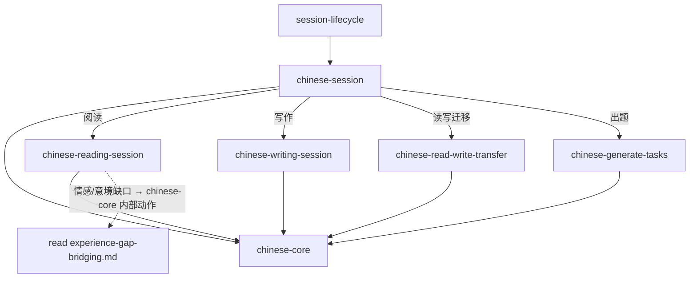

普通阅读/写作闭环时回传 `stage_options`：`写一写` / `action: transfer`。未处理的投放文件：路由器**不**自载 `learn-errors`，交回生命周期调一次；已处理（`files_processed: true`）则复用 extracted / `material_refs`，不再加载。

`activity=transfer` 由 `chinese-session` 分流：来源为**阅读** → `intent: transfer_read_write`（进 `chinese-read-write-transfer`）；来源为**写作** → `type: writing_draft`、`intent: revise_writing`（进 `chinese-writing-session` revise，本次写作迁移最多 2 轮）。

### 3.4 语文路由分派

主分流（每轮一个）。明确 `intent` 优先于旧 `type`；冲突时用 `ask_user_question` 确认一个动作。`mode=feynman` 优先决定教学方式；出题/迁移目标只保留其阅读或写作领域，不在费曼下并行开迁移/出题子 skill。

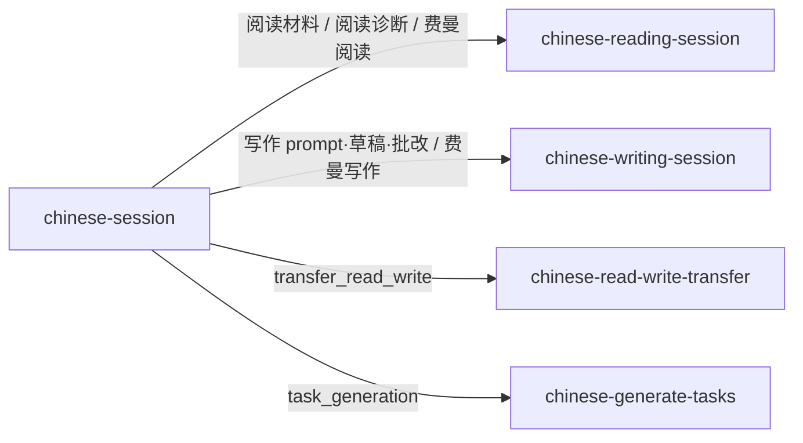

`mode`（`learn` / `feynman`）原样传递；下表的 `task_mode` 是子 skill 内部分支，不写回 context。

| 条件 | 子 skill | 传入 `task_mode` |
|---|---|---|
| `mode=feynman` + 阅读类 | `chinese-reading-session` | `feynman` |
| `mode=feynman` + 写作类 | `chinese-writing-session` | `feynman` |
| `mode=feynman` + `profile` / 中文默认 | 先定领域，再对应子 skill | `feynman` |
| `intent=transfer_read_write`（或「我想试试自己写」沿用本文技巧） | `chinese-read-write-transfer` | 不传 |
| `type=task_generation` | `chinese-generate-tasks` | 不传 |
| `type=writing_prompt` | `chinese-writing-session` | `start` |
| `type=writing_draft` | `chinese-writing-session` | `revise` |
| `type=assessment` 且 `intent=assess_writing` | `chinese-writing-session` | `assess` |
| `type=assessment` 且 `intent=assess_reading` | `chinese-reading-session` | `diagnose` |
| `reading_material` | `chinese-reading-session` | `learn` |
| `type=profile` 选阅读 / 写作 | 对应子 skill | `learn` / `start` |
| `type=error_files` 未处理 | 交回生命周期 → `learn-errors` | — |
| `type=error_files` 已处理 | 按 After File Processing 归类后再路由 | 见上 |

阅读结束后「我想试试自己写」→ `chinese-read-write-transfer`，**不要**重新走写作 `start`。

### 3.5 英语调用子图

生命周期只进 `english-session`，它是方法的唯一调度者和本轮唯一 `session_segment` 的产出者。主线按 core 的唯一方法表（`target_context.type` + 当前观察）选一个主方法，需要时补一个辅助方法；方法只提供做法、材料与证据建议，彼此不加载，辅助需求也交 session 决定。`learn-core` / `learn-data` 已由入口加载；本包只再加载 `english-core`。

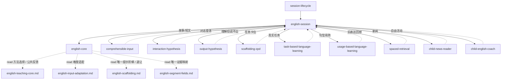

图中方法是可选能力，不是固定执行序列；具体选择条件只维护在 [`english-teaching-core.md`](../../english/skills/english-core/references/english-teaching-core.md)，本总览与 coach 不另设路由表。难度按 [`english-input-adaptation.md`](../../english/skills/english-core/references/english-input-adaptation.md)，提示/退让按 [`english-scaffolding.md`](../../english/skills/english-core/references/english-scaffolding.md)，学生表现到记录字段的映射只由 [`english-segment-fields.md`](../../english/skills/english-core/references/english-segment-fields.md) 定义。

`child-english-coach` 只给跨轮活动计划、当前步骤与方法建议，不自行加载方法。`child-news-reader` 复用入口快照、target、材料和 context；负责新闻来源、fact ledger、成熟度/版权与事实保真，语言适配遵 core。摘要始终是完整原创教育摘要，保留来源和不确定性。1–3 个阅读问题只是内部跨轮计划，每轮只呈现一个主要待答问题。方法将来源、已呈现内容、支持与待答状态交 session 合并进 context / turn_state 和唯一 segment；恢复接原步骤，不重新建档或重开阅读。方法不独立写进度便条、文件、提醒或 finalize；结束请求经 session 回 lifecycle。

未处理投放文件仍交生命周期调用一次 `learn-errors`，路由前等待 `files_processed`；学科方法不自载文件处理。

普通学习闭环时回传 `stage_options`：`读一个故事`、`说一说`、`玩一个任务`、`复习旧表达`；由入口与基础菜单合并。`mode=feynman` 优先：本轮让学生讲，不新开新闻检索或新的写作任务。英语默认只做文本交互；没有真实音频或图片能力时，不记录发音或口语结论。

## 4. 使用场景

### 4.1 `/learn-start` 建档 / 切学生

不进入学科教学；建档后提示 `/learn`。

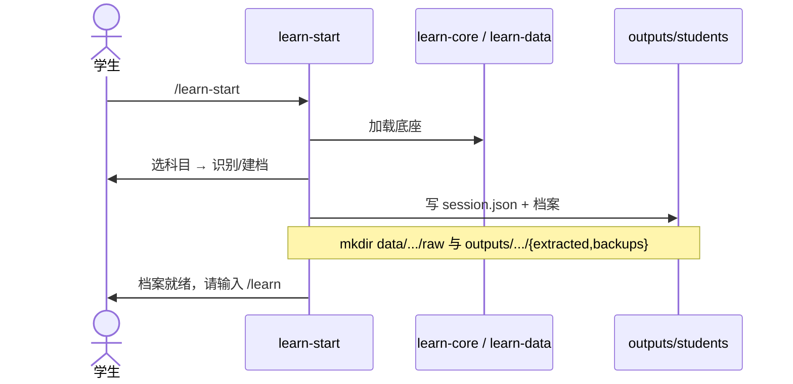

流程分叉（科目、身份、年级、偏好）用 `ask_user_question`；教学留给 `/learn`。

### 4.2 `/learn` 数学一回合

生命周期：Snapshot → Classify → Open/Resume → Dispatch → Resolve Target → Route And Record → Continue；Finalize 由 Dispatch 或恢复调用。数学集中调度与文件细节见 [4.2.1](#421-数学集中调度与投放文件)。

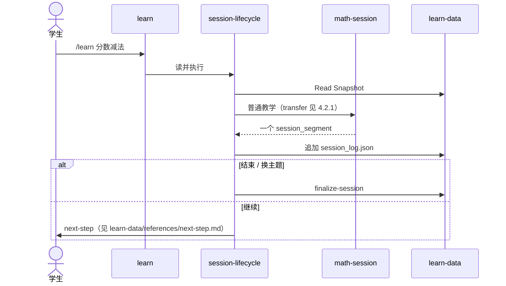

next-step：基础菜单为「继续」「费曼」「结束」；学科 `stage_options`（数学「迁移」「练一练」等）按 `next-step.md` 合并进同一张卡。年级只调措辞与难度，不裁剪选项。`feynman_readiness = not_ready` 时仍显示费曼，但不标推荐。

#### 4.2.1 数学集中调度与投放文件

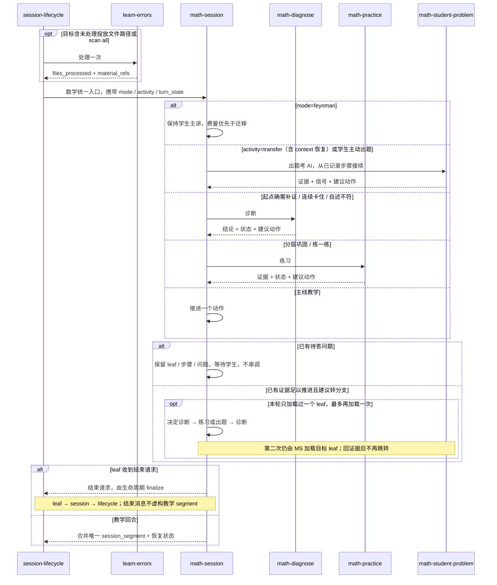

### 4.3 `/learn` 语文经 `chinese-session`

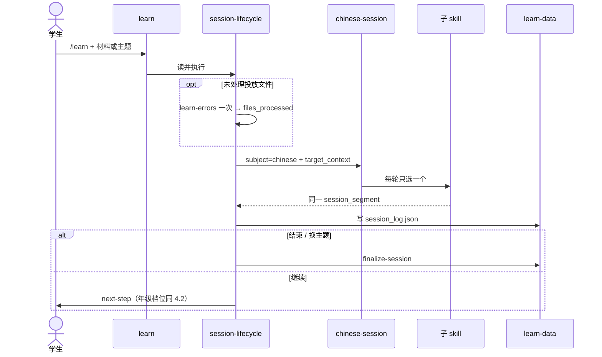

子 skill 候选：`chinese-reading-session` · `chinese-writing-session` · `chinese-read-write-transfer` · `chinese-generate-tasks`（分派见 [3.4](#34-语文路由分派)）。阶段附加选项：`写一写` → transfer，由 `chinese-session` 按来源分流。

### 4.4 `/learn-feynman` 模式切换

可用户 `/learn-feynman`，也可由模型在学生说「我来给你讲」、next-step 选「费曼」时加载。有活跃会话时**不新建** `session_id`，按生命周期的 Dispatch 只切 `mode: feynman`、`activity: teaching`，并清迁移专属进度。

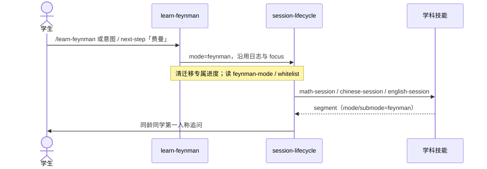

费曼回合收束用 `ask_user_question` 只给「继续讲」「换一个点」「结束」，不另造后台菜单或 segment。无活跃会话时新开：`entry_point: learn-feynman`，目标按生命周期的 Resolve Target（显式目标 → 日志 context / focus → 档案 → 年级默认）。

### 4.5 投放文件经 `learn-errors`

`data/.../raw/` 是通用投放区（错题、阅读材料、草稿等），不是错题专用。支持单路径或 **scan all**。科目日志若有 `finalize_plan`，先恢复保存成功再处理新文件。

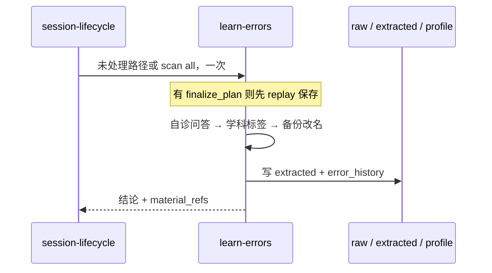

调用方：

- **生命周期 / target-parsing**：目标含路径或扫描时处理一次
- **数学**：`math-session` 将未处理文件交回生命周期，三个 leaf 只复用 extracted / `material_refs`；数学 skill 不直接加载 `learn-errors`
- **语文**：`chinese-session` 对未处理文件**交回**生命周期，路由器自己不加载
- **英语**：`english-session` 对未处理文件交回生命周期，自己不加载

无学生时引导 `/learn-start`。学科标签来自 `math-core`、`chinese-core` 或 `english-core`（`learn-errors` 只加载 `learn-data` + 学科 core）。备份到 `outputs/.../backups/raw/` 后再 `mv` 改名；`data/.../raw/` 内容只读。

### 4.6 `/learn-save` 手动 finalize

不启动教学；幂等检查 `last_finalized_session_id`。未完成日志若带 `finalize_plan`，生命周期恢复时也会先 replay 同一协议。

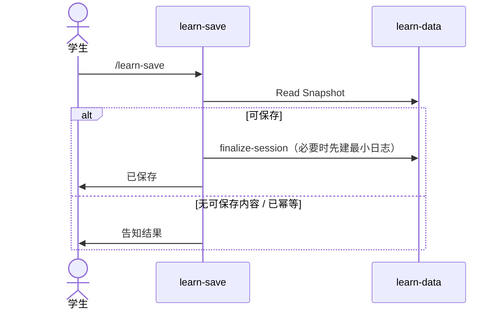

### 4.7 读写迁移

阅读后学生要「用本文技巧写」，或选阶段选项「写一写」/ 恢复 `activity=transfer` 且来源为阅读。`chinese-read-write-transfer` 本次迁移最多 **2 轮**。

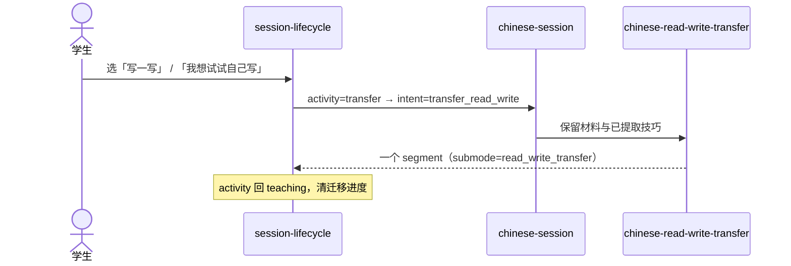

规则加载：`chinese-core`（确认 / 个性化 / 白名单仍按条件读 `learn-core`）。

写作来源的迁移（局部改写 / 换角度）不进 `chinese-read-write-transfer`：`chinese-session` 传 `writing_draft` + `revise_writing` → `chinese-writing-session`；本次写作迁移不超过 **2 轮**。

### 4.8 经验桥接（阅读内部子流程）

仅 `chinese-reading-session` 在情感/意境进不去且缺少生活经验时执行；按 `chinese-core` **内部动作表**读取 `references/experience-gap-bridging.md`，**不另造 bridge segment**，不再注册辅助 skill。调用方经 `chinese-core` 定位，不拼跨包路径、不直接点名该文件为独立 skill。

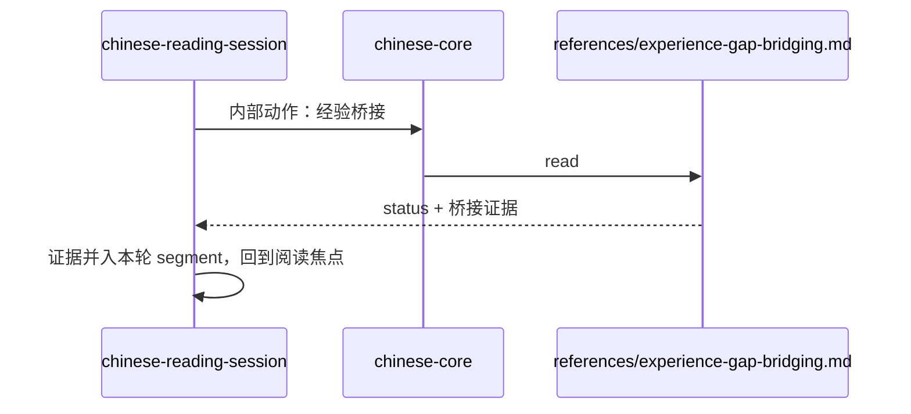

失败换方法；危机按 `learn-core` 停教学。

### 4.9 `/learn` 英语经 `english-session`

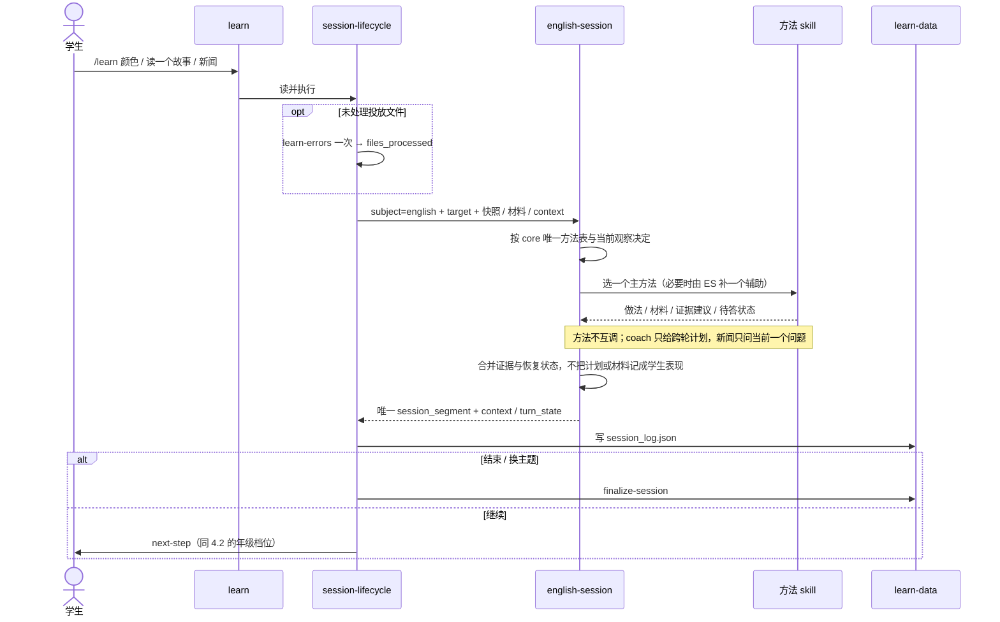

新闻目标由 session 选择 `child-news-reader`，来源与成熟度筛选由新闻方法负责；没有可靠来源时明确说明无法核实。摘要文本可标暂定可读性水平，但不当作学生等级；一次答对不升级 `current_levels`。文章完整呈现，提问跨真实回应推进，不另产 progress note。阶段附加选项：`读一个故事` / `说一说` / `玩一个任务` / `复习旧表达`，由 `english-session` 执行；结束保存归 lifecycle。

## 5. 数据与规则依赖

### 5.1 谁依赖谁（规则 / 数据）

主图：教学 skill 依赖「入口已加载的共享底座 + 学科 core」；投放文件另挂 `learn-errors`。

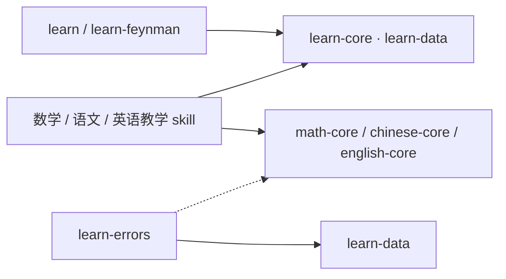

#### 5.1.1 分层说明

| 层 | Skill | 职责 |
|---|---|---|
| 规则 · 共享 | `learn-core` | 语气、确认、年级、费曼、安全、`ask_user_question` 流程分叉 |
| 规则 · 学科 | `math-core` / `chinese-core` / `english-core` | 教学、诊断、练习/写作标签等；数学含画板 reference，英语含唯一方法表、输入适配、提示阶梯/退让、反馈与证据映射；均含「学科契约」表 |
| 数据 | `learn-data` | 快照、finalize、lifecycle / next-step / target-parsing；每轮日志与 segment 读 `session-schema.md`，建档与 finalize 再读 `profile-schema.md` |
| 文件 | `learn-errors` | `data/.../raw/` 只读、备份、extracted、`error_history`；依赖 `learn-data` + 学科 core；由生命周期调用，学科包不自载 |
| 产出 | `math-*` / `chinese-*` / `english-*` 教学 skill | 每轮一个 segment；lifecycle 路由 `<subject>-session`，由它决定内部调度；数学 leaf 回证据，由 `math-session` 合并；英语方法仅回建议，由 `english-session` 合并并唯一产段 |

### 5.2 写入时机

| 时机 | 写什么 | 谁负责 |
|---|---|---|
| 每教学轮 | `session_log.json`（追加 segment）与 `context.turn_state` | `session-lifecycle` |
| 会话结束 / `/learn-save` / 换主题 | 科目 `profile` `memory` `current_state` `milestones`；清空或结束日志 | `finalize-session` |
| 有 `finalize_plan` 未完成 | 先 replay 保存，再允许新教学或新文件处理 | lifecycle / `learn-errors` / `/learn-save` |
| 用户投放文件分析 | `extracted/*.md`、科目 `profile.error_history`；`data/.../raw/` 仅 `mv` | `learn-errors` |
| `/learn-start` 建档 | 共享 `profile.json` + 科目骨架 + `session.json`；mkdir 双根目录 | `learn-start` + `learn-data` Create Student |
| `/learn-profile` 修改 | 共享或科目档案字段 | `learn-profile` + Write Protocol |

幂等标记：`current_state.last_finalized_session_id`。跨科个性化字段：共享 `personal.interests`（语文、数学与英语都必须读）。语文按语文个性化使用；数学题目按 CGI，题面形式按 `problem-design`，同一关系换场景检验迁移；只在学生做不出当前题时搭桥。英语用兴趣选故事、任务和例句内容，不让兴趣覆盖当前语言目标。

### 5.3 Session Gate（共性）

会话门槛只在生命周期的 Snapshot 执行一次；学科 skill 不再各自检查 `session.json`。

1. 存在 `outputs/students/session.json` 且 `student_id` 非空，否则引导 `/learn-start` 并停止。
2. 学科复用入口已读快照与交接字段，不重复整份 Read Snapshot；无入口交接时请学生输入 `/learn`。
3. 每教学轮一个 segment；诊断、桥接等方法/内部证据并入该段。数学由 `math-session` 合并，leaf 不另产 segment；内部调度上限见 §3.2。英语仅 `english-session` 产段，方法提供材料/做法/证据建议与待答状态，不自行写日志或进度文件。
4. 不直接 finalize；结束信号归 `learn-core` 的 `session-end-signals.md`，保存归 `learn-data`。

## 6. 调用纪律速查

1. **入口先底座**：`learn-core` + `learn-data`（若尚未加载）。
2. **一会话不重复加载**同一 skill；复用已有 `<skill_content>`。
3. **学科入口集中调度**：lifecycle 只加载 `<subject>-session`；`chinese-session` 每轮只选一个子 skill；仅 `english-session` 选择/加载英语方法，每轮一个主方法（可补一个辅助），方法不互调、coach 只给计划，选择表与公共规则见 §3.5；数学统一 → `math-session` → leaf，含 transfer 恢复。数学等待与同轮最多二次 leaf 加载的条件见 §3.2，leaf 只回证据与信号，由 session 合唯一 segment；结束请求经 session 回 lifecycle。
4. **跨包只按名**：写「加载 `learn-core`」，不写相对路径或 `@.pi/...`。
5. **reference 相对 skill base directory**：先 `skill` 拿到目录，再 `read <base>/references/...`；生命周期 / next-step / target-parsing / session-schema 在 `learn-data/references/`。
6. **内部 skill 保持模型可调用**：只用 `user-invocable: false`，不用 `disable-model-invocation`。
7. **流程分叉用卡片**：科目、身份、年级、偏好、基础菜单（继续/费曼/结束）与学科 `stage_options` 用 `ask_user_question`；教学追问保持纯文字。
8. **学科未安装**：生命周期说明需要对应包，停止教学路由，保留已有日志。
9. **静态检查**：`node scripts/check-skills.mjs` 校验 frontmatter、调用策略与悬空引用。

## 7. 技能清单（30）

| 包 | Skill | 调用面 | 角色 |
|---|---|---|---|
| learn | `learn-start` | 仅用户 | 选科、建档、激活 |
| learn | `learn` | 仅用户 | 自适应学习入口 |
| learn | `learn-feynman` | 双开 | 费曼模式 |
| learn | `learn-profile` | 双开 | 查/改档案 |
| learn | `learn-save` | 双开 | 手动保存 |
| learn | `learn-core` | 内部 | 跨科教学规则 |
| learn | `learn-data` | 内部 | 数据协议与生命周期 reference |
| learn | `learn-errors` | 内部 | 投放文件解析 |
| math-primary-low | `math-core` | 内部 | 数学规则（含画板 reference） |
| math-primary-low | `math-session` | 内部 | 数学主回合、唯一 leaf 调度者与 segment 合并者 |
| math-primary-low | `math-diagnose` | 内部 | 策略/错题诊断，回证据与建议动作 |
| math-primary-low | `math-practice` | 内部 | 分层练习，回证据与建议动作 |
| math-primary-low | `math-student-problem` | 内部 | 出题考 AI，回证据与建议动作 |
| chinese-reading | `chinese-core` | 内部 | 语文规则（含经验桥接 reference） |
| chinese-reading | `chinese-session` | 内部 | 语文路由器 |
| chinese-reading | `chinese-reading-session` | 内部 | 阅读教学/诊断 |
| chinese-reading | `chinese-writing-session` | 内部 | 写作 start/revise/assess |
| chinese-reading | `chinese-read-write-transfer` | 内部 | 读写迁移 |
| chinese-reading | `chinese-generate-tasks` | 内部 | 出题 |
| english | `english-core` | 内部 | 英语公共规则、方法选择依据与学科契约 |
| english | `english-session` | 内部 | 英语唯一方法调度者、教学回合与 segment 合并者 |
| english | `child-english-coach` | 内部 | 自由活动跨轮计划与方法建议，不自行调度 |
| english | `child-news-reader` | 内部 | 新闻来源/事实核对、成熟度/版权筛选、阅读材料与证据建议 |
| english | `comprehensible-input` | 内部 | 可理解输入 |
| english | `interaction-hypothesis` | 内部 | 对话协商 |
| english | `output-hypothesis` | 内部 | 输出尝试 |
| english | `scaffolding-zpd` | 内部 | 支架与退让 |
| english | `task-based-language-learning` | 内部 | 任务驱动 |
| english | `usage-based-language-learning` | 内部 | 用法积累 |
| english | `spaced-retrieval` | 内部 | 间隔提取 |
