# 教学技能调用关系与使用场景

> 覆盖 `learn/`、`math-low/`、`chinese-reading/` 三个 DSH 技能包。  
> 调用边以各 `SKILL.md` 与 `learn-data/references/session-lifecycle.md` 为准；本文件是运行时总览，不是迁移史（迁移见 [`docs/migration/pi-to-dsh-skills.md`](../migration/pi-to-dsh-skills.md)）。

## 1. 包依赖

`math-low` 与 `chinese-reading` 通过 **skill 名称** 加载 `learn` 包中的共享能力；不能依赖 checkout 绝对路径。单独安装学科包时，缺少 `learn` 则共享规则与数据协议不可用。

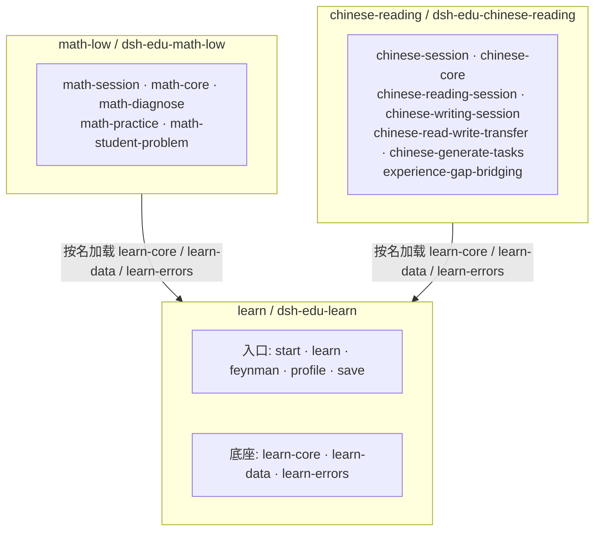

| 包 | 对外入口 | 内部能力 |
|---|---|---|
| `learn` | `/start` `/learn` `/feynman` `/profile` `/save` | `learn-core` `learn-data` `learn-errors` |
| `math-low` | 无用户 `/` 入口；由生命周期路由进入 | `math-session` 及旁路 + `math-core` |
| `chinese-reading` | 无用户 `/` 入口；由生命周期路由进入 | `chinese-session` 及子 skill + `chinese-core` |

## 2. 调用面分层

DSH 没有独立的「skill 调 skill」通道：父 skill 写「加载 `X`」时，仍是模型执行 `skill` 工具。因此内部 skill **必须**可被模型调用（`user-invocable: false`），**禁止**对内部 skill 设 `disable-model-invocation: true`。

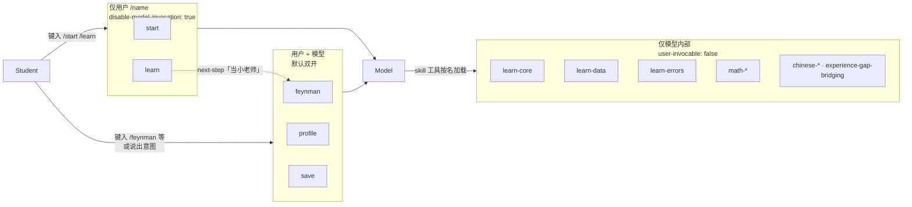

| 档位 | Skill | 为何如此 |
|---|---|---|
| 仅用户 | `start` `learn` | 会话边界；避免闲聊中建档或开学习循环 |
| 双开 | `feynman` `profile` `save` | 「我来给你讲」「看看档案」「保存一下」可自动加载；`/learn` 的 next-step 也可加载 `feynman` |
| 仅模型 | 其余 15 个 | 从 `/` 菜单隐藏，供入口与学科 skill 按名加载 |

## 3. 技能调用总图

箭头表示「运行时通过 `skill` 工具加载 / 路由进入」。`session-lifecycle` 不是独立 skill，是 `learn-data` 的 reference，由 `/learn` 与 `/feynman` 读取执行。

图例：实线 = 几乎每轮必载；虚线 = 条件旁路。学科 skill 只产出**一个** `session_segment`；日志追加与 finalize 由入口 + `session-lifecycle` / `finalize-session` 完成。

### 3.0 主图（主干）

只保留「入口 → 生命周期 → 学科入口 / 投放文件」四层，细节见下列子图。

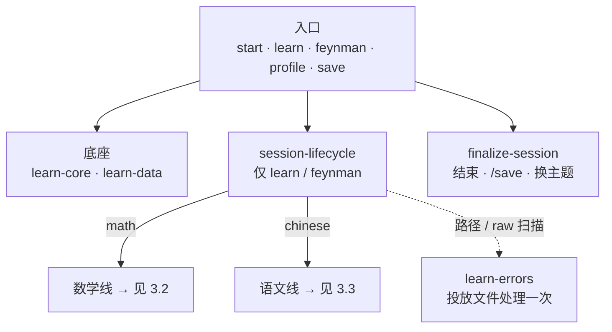

`start` / `profile` 只到底座；`save` 经底座走 finalize；只有 `learn` / `feynman` 进入生命周期。详见 [3.1](#31-入口与底座)。

### 3.1 入口与底座

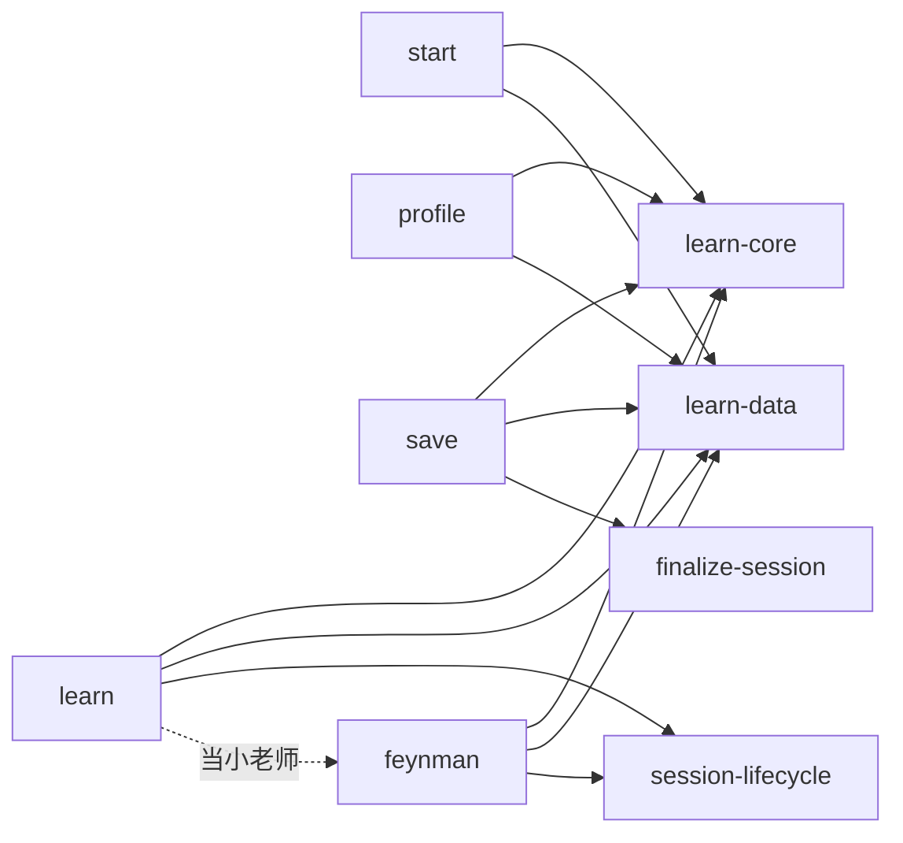

模式切换与迁移不另开 `session_id`：显式 `/feynman`、next-step「当小老师」、或 `pending_feynman_handoff` → 加载 `feynman` / 设 `mode: feynman`；显式迁移或 `pending_transfer_phase` → 按学科路由（见 [3.2](#32-数学调用子图) / [3.3](#33-语文调用子图)）。细则在 `session-lifecycle` 第 4 步与 `next-step.md`。

### 3.2 数学调用子图

生命周期对数学的路由，以及 `math-session` 的条件旁路。旁路结论**并入本轮唯一 segment**，不另记一轮。

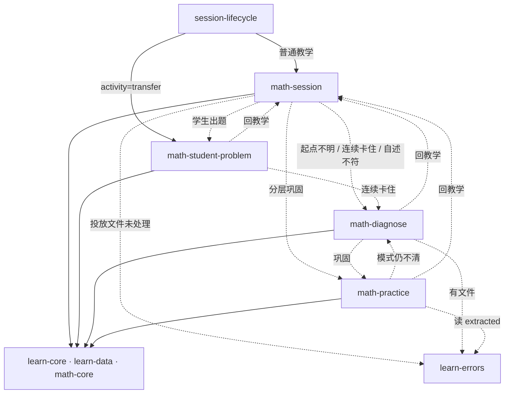

诊断触发（`math-session` / `math-diagnose`）：起点判断确需补证、连续两轮引导卡住、自述与表现不符，或练习需识别错误模式——不把每个新主题都先测一遍。

### 3.3 语文调用子图

生命周期只进 `chinese-session`；路由器每轮只选一个子 skill。mode 细表见 [3.4](#34-语文路由分派)。

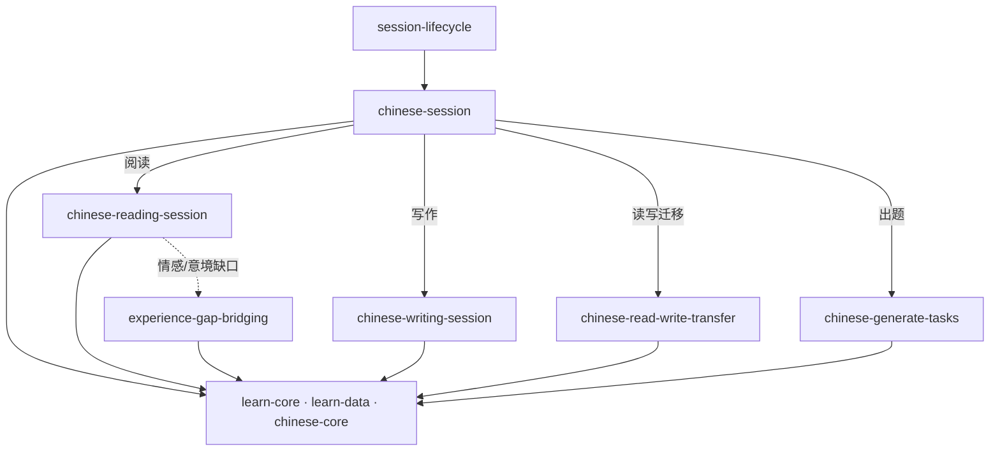

未处理的投放文件：路由器交回生命周期 → `learn-errors` 一次；已处理（`files_processed: true`）则复用 extracted，不再加载。

生命周期对迁移的分流：`activity=transfer` 且来源为**阅读** → 传 `intent: transfer_read_write`（进 `chinese-read-write-transfer`）；来源为**写作** → 传 `type: writing_draft`、`intent: revise_writing`（进 `chinese-writing-session` revise）。

### 3.4 语文路由分派

主分流（每轮一个）：

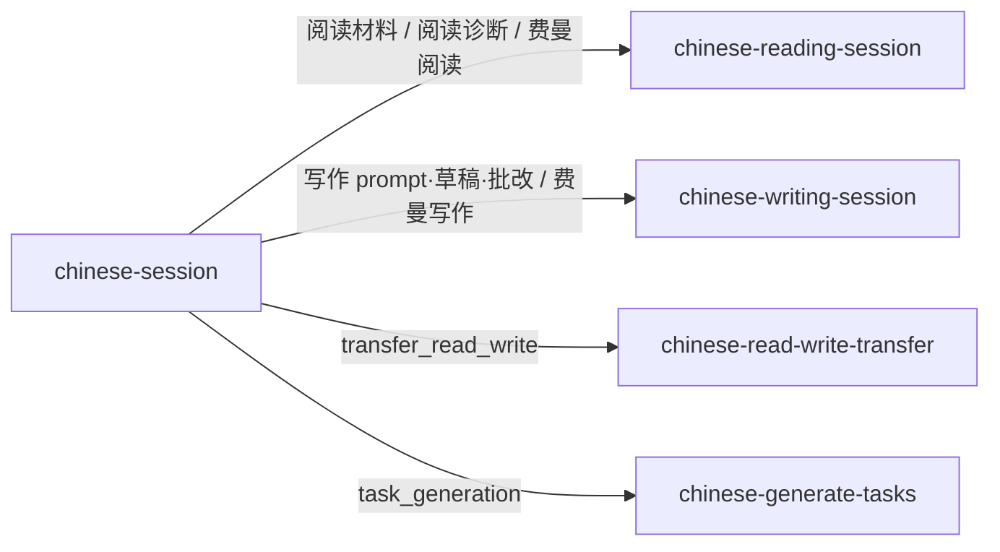

| 条件 | 子 skill | mode |
|---|---|---|
| `mode=feynman` + 阅读类 | `chinese-reading-session` | `feynman` |
| `mode=feynman` + 写作类 | `chinese-writing-session` | `feynman` |
| `mode=feynman` + `profile` / 中文默认 | 先定领域，再对应子 skill | `feynman` |
| `intent=transfer_read_write` | `chinese-read-write-transfer` | `learn` |
| `type=task_generation` | `chinese-generate-tasks` | `learn` |
| `type=writing_prompt` | `chinese-writing-session` | `start` |
| `type=writing_draft` | `chinese-writing-session` | `revise` |
| `assess_writing` | `chinese-writing-session` | `assess` |
| `reading_material` | `chinese-reading-session` | `learn` |
| `assess_reading` | `chinese-reading-session` | `diagnose` |
| `type=profile` 选阅读 / 写作 | 对应子 skill | `learn` / `start` |
| `type=error_files` 未处理 | 交回生命周期 → `learn-errors` | — |
| `type=error_files` 已处理 | 按 After File Processing 归类后再路由 | 见上 |

`mode=feynman` 优先决定教学方式；出题/迁移目标只保留其阅读或写作领域，不在费曼下并行开迁移/出题子 skill。

## 4. 使用场景

### 4.1 `/start` 建档 / 切学生

不进入学科教学；建档后提示 `/learn`。

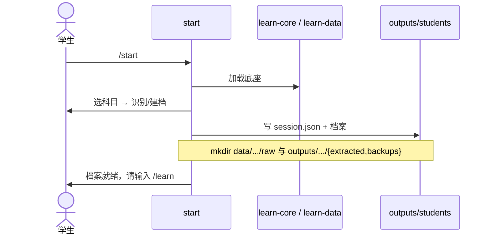

流程分叉（科目、身份、年级、偏好）用 `ask_user_question`；教学留给 `/learn`。

### 4.2 `/learn` 数学一回合

生命周期：Open/Resume → Resolve Target → Route → Record → Continue/Finalize。旁路细节见 [4.2.1](#421-数学旁路与投放文件)。

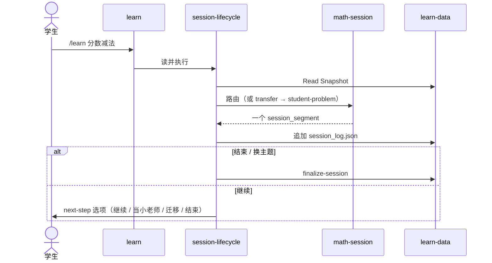

#### 4.2.1 数学旁路与投放文件

在进入或停留于 `math-session` 时，按需插入下列分支（结论并入本轮 segment）：

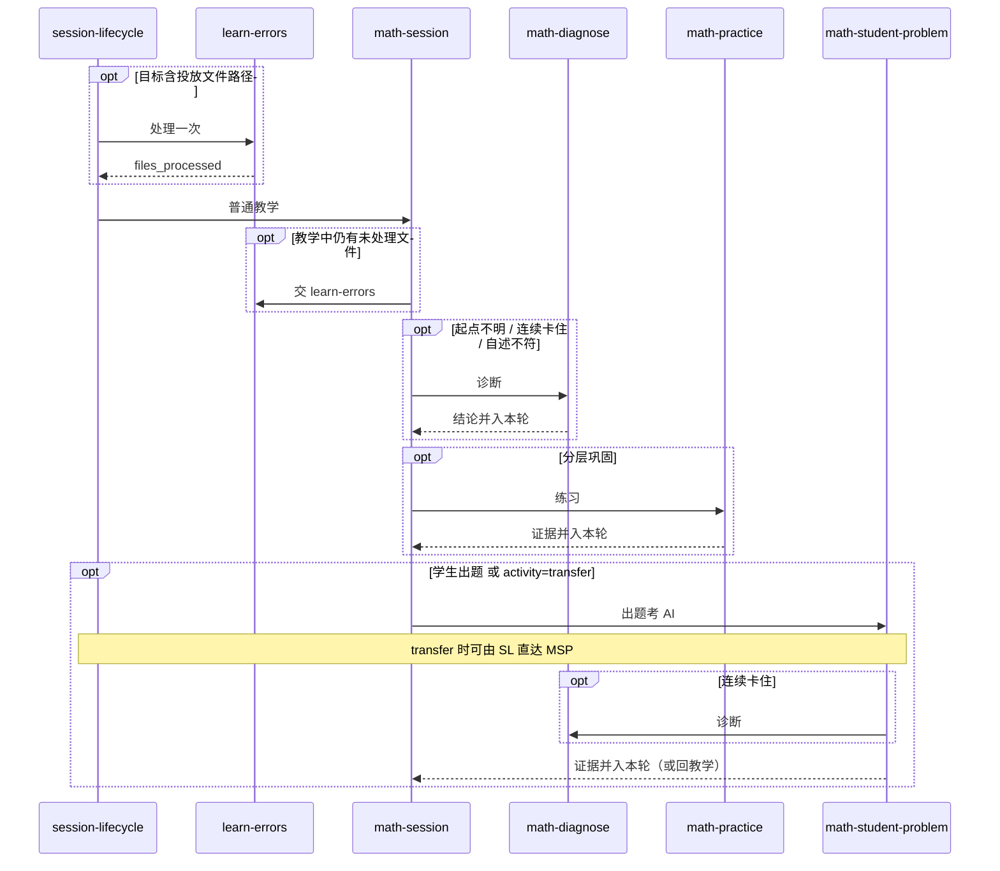

### 4.3 `/learn` 语文经 `chinese-session`

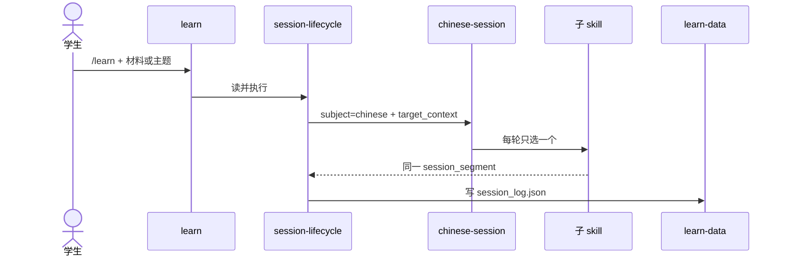

子 skill 候选：`chinese-reading-session` · `chinese-writing-session` · `chinese-read-write-transfer` · `chinese-generate-tasks`（分派见 [3.4](#34-语文路由分派)）。

### 4.4 `/feynman` 模式切换

可用户 `/feynman`，也可由模型在学生说「我来给你讲」或 next-step 选「当小老师」时加载。有活跃会话时**不新建** `session_id`，只切 `mode: feynman`、`activity: teaching`。

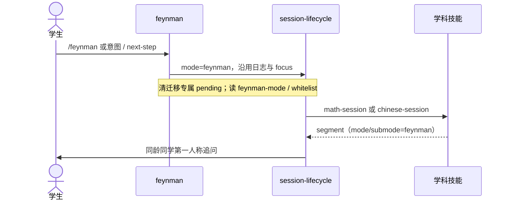

费曼回合收束用 `ask_user_question` 只给「继续讲」「换一个点」「结束」，不另造后台菜单或 segment。

### 4.5 投放文件经 `learn-errors`

`data/.../raw/` 是通用投放区（错题、阅读材料、草稿等），不是错题专用。入口、`math-session` / `math-diagnose` / `math-practice` 在需要文件时加载；`chinese-session` 对**未处理**文件交回生命周期调一次，已处理则不再加载。

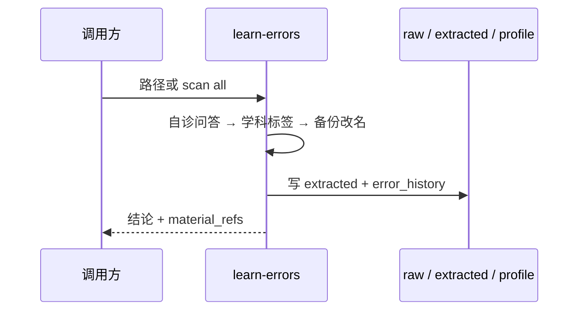

调用方：`session-lifecycle`、`math-session`、`math-diagnose`、`math-practice`；无学生时引导 `/start`。学科标签来自 `math-core` 或 `chinese-core`。备份到 `outputs/.../backups/raw/` 后再 `mv` 改名；`data/.../raw/` 内容只读。

### 4.6 `/save` 手动 finalize

不启动教学；幂等检查 `last_finalized_session_id`。

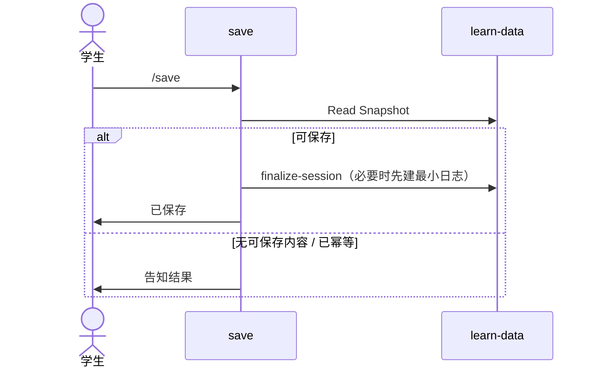

### 4.7 读写迁移

阅读后学生要「用本文技巧写」，或 next-step / pending 恢复 `transfer` 且来源为阅读。

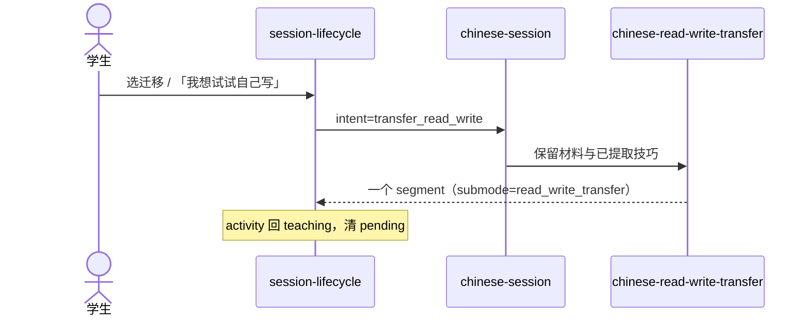

规则加载：`chinese-core` + `learn-core`（确认 / 个性化 / 白名单）。

写作来源的迁移（局部改写 / 换角度）不进 `chinese-read-write-transfer`：生命周期传 `writing_draft` + `revise_writing` → `chinese-writing-session`。

### 4.8 经验桥接（阅读内部子流程）

仅 `chinese-reading-session` 在情感/意境进不去且缺少生活经验时加载；**不另造 bridge segment**。

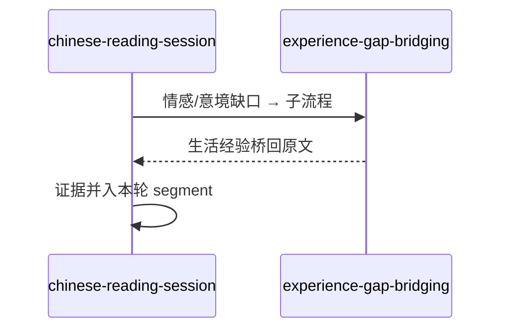

失败换方法；危机按 `learn-core` 停教学。

## 5. 数据与规则依赖

### 5.1 谁依赖谁（规则 / 数据）

主图：教学 skill 依赖「共享底座 + 学科 core」；投放文件另挂 `learn-errors`。

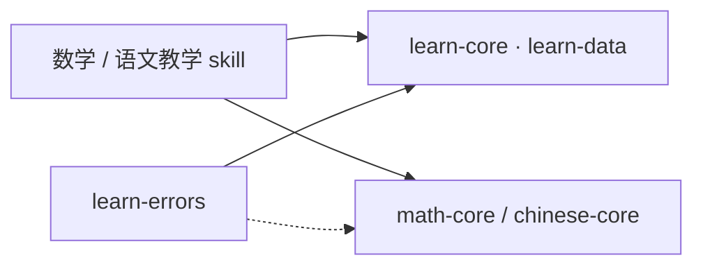

#### 5.1.1 分层说明

| 层 | Skill | 职责 |
|---|---|---|
| 规则 · 共享 | `learn-core` | 语气、确认、年级、费曼、安全、`ask_user_question` 流程分叉 |
| 规则 · 学科 | `math-core` / `chinese-core` | 教学、诊断、练习/写作标签等 |
| 数据 | `learn-data` | 快照、segment、日志、finalize、lifecycle / next-step references |
| 文件 | `learn-errors` | `data/.../raw/` 只读、备份、extracted、`error_history` |
| 产出 | `math-*` 教学 skill / `chinese-*` 教学 skill | 每轮一个 segment；调度归 lifecycle |

### 5.2 写入时机

| 时机 | 写什么 | 谁负责 |
|---|---|---|
| 每教学轮 | `session_log.json`（追加 segment） | `session-lifecycle` |
| 会话结束 / `/save` / 换主题 | 科目 `profile` `memory` `current_state` `milestones`；清空或结束日志 | `finalize-session` |
| 用户投放文件分析 | `extracted/*.md`、科目 `profile.error_history`；`data/.../raw/` 仅 `mv` | `learn-errors` |
| `/start` 建档 | 共享 `profile.json` + 科目骨架 + `session.json`；mkdir 双根目录 | `start` + `learn-data` Create Student |
| `/profile` 修改 | 共享或科目档案字段 | `profile` + Write Protocol |

幂等标记：`current_state.last_finalized_session_id`。跨科个性化字段：共享 `personal.interests`（语文与数学都必须读）。

### 5.3 Session Gate（共性）

几乎所有内部学科 skill 在开头要求：

1. 存在 `outputs/students/session.json` 且 `student_id` 非空，否则引导 `/start` 并停止。
2. 复用入口已读快照，不重复整份 Read Snapshot。
3. 本轮只路由 / 只产一个 segment；诊断、桥接、旁路结果并入该段。
4. 不直接 finalize；结束信号归 `learn-core` 的 `session-end-signals.md`，保存归 `learn-data`。

## 6. 调用纪律速查

1. **入口先底座**：`learn-core` + `learn-data`（若尚未加载）。
2. **一会话不重复加载**同一 skill；复用已有 `<skill_content>`。
3. **一回合一路由**：`chinese-session` 不并行加载多个子 skill 教学内容；数学旁路结论并入主段。
4. **跨包只按名**：写「加载 `learn-core`」，不写相对路径或 `@.pi/...`。
5. **reference 相对 skill base directory**：先 `skill` 拿到目录，再 `read <base>/references/...`。
6. **内部 skill 保持模型可调用**：只用 `user-invocable: false`，不用 `disable-model-invocation`。
7. **流程分叉用卡片**：科目、身份、年级、偏好、继续/结束、当小老师/迁移等用 `ask_user_question`；教学追问保持纯文字。
8. **学科未安装**：生命周期说明需要对应包，停止教学路由，保留已有日志。
9. **静态检查**：`node scripts/check-skills.mjs` 校验 frontmatter、调用策略与悬空引用。

## 7. 技能清单（20）

| 包 | Skill | 调用面 | 角色 |
|---|---|---|---|
| learn | `start` | 仅用户 | 选科、建档、激活 |
| learn | `learn` | 仅用户 | 自适应学习入口 |
| learn | `feynman` | 双开 | 费曼模式 |
| learn | `profile` | 双开 | 查/改档案 |
| learn | `save` | 双开 | 手动保存 |
| learn | `learn-core` | 内部 | 跨科教学规则 |
| learn | `learn-data` | 内部 | 数据协议与生命周期 reference |
| learn | `learn-errors` | 内部 | 投放文件解析 |
| math-low | `math-core` | 内部 | 数学规则 |
| math-low | `math-session` | 内部 | 数学主回合 |
| math-low | `math-diagnose` | 内部 | 策略/错题诊断 |
| math-low | `math-practice` | 内部 | 分层练习 |
| math-low | `math-student-problem` | 内部 | 出题考 AI |
| chinese-reading | `chinese-core` | 内部 | 语文规则 |
| chinese-reading | `chinese-session` | 内部 | 语文路由器 |
| chinese-reading | `chinese-reading-session` | 内部 | 阅读教学/诊断 |
| chinese-reading | `chinese-writing-session` | 内部 | 写作 start/revise/assess |
| chinese-reading | `chinese-read-write-transfer` | 内部 | 读写迁移 |
| chinese-reading | `chinese-generate-tasks` | 内部 | 出题 |
| chinese-reading | `experience-gap-bridging` | 内部 | 经验桥接子流程 |
