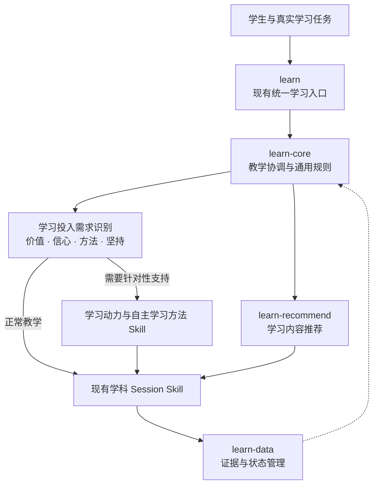
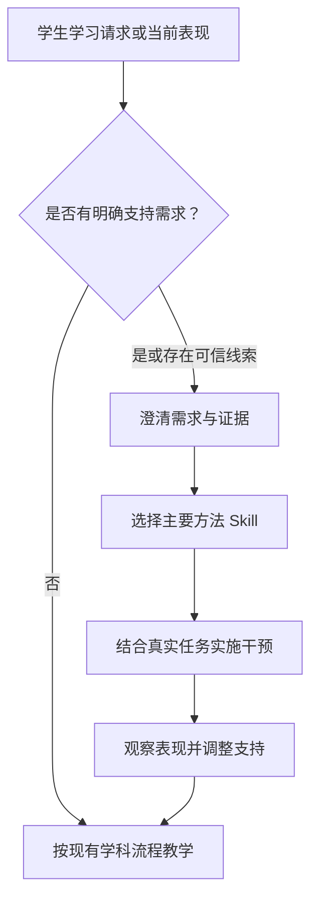

对于许多学生，“为什么学习”是比“怎么学习”更上游的问题。

> 学生学习的首要问题，往往不是缺少学习方法，而是尚未建立对学习价值的认同、对学习成功的信心，以及主动参与学习的意愿。
>
> 教育首先需要帮助学生回答“为什么值得学”，同时让学生相信“我能够学会”，然后帮助学生掌握“怎样学得更好”。

这里有一个非常关键的区别：

- 为什么学？ 我认为学习有意义吗？
- 能学会吗？ 我相信自己能够通过努力取得进步吗？
- 怎么学？ 我知道采用什么方法才能真正理解和掌握吗？

这三个问题彼此影响，而非严格的先后关系。

例如，一个学生明明知道数学很重要，却依然不愿意学，可能不是缺少学习意义，而是长期失败后认为自己根本学不会。

反过来，一个学生可能最初不理解为什么要学习编程，但通过完成一个有趣的小项目，逐渐获得成就感，进而开始主动学习。

因此，学习动机既可能是学习的起点，也可能是成功学习的结果。

## 一、有哪些研究？

我认为最值得关注的是以下四个理论。

### 1. 自我决定理论：学生为什么愿意主动学习？

Self-Determination Theory（SDT）｜Deci & Ryan

这是与你的观点最直接相关的理论之一。

它认为，人具有三种基本心理需要：

自主感

这是我愿意做的

胜任感

我能够取得进步

关系感

有人支持和接纳我

更有利于形成自主学习动机

兴趣、个人认同、主动投入与持续努力

这一理论特别强调：学生不一定需要喜欢每一项学习任务，但最好能够理解并认同它的价值。

例如：

- “老师要求我学习 Python”：外部要求。
- “学好 Python 才能拿到证书”：工具性目标。
- “我想用 Python 解决自己遇到的问题”：价值认同。
- “我喜欢通过编程创造东西”：内在兴趣。

这些动机并非完全非此即彼，而是具有不同程度的自主性。

2021 年的一项元分析整合了 144 项研究、超过 79,000 名学生的数据，支持基本心理需要与自主学习动机之间的重要联系。自主学习动机也与学生的投入、坚持和学业表现等积极结果相关。

[image](https://www.google.com/s2/favicons?domain=https://pubmed.ncbi.nlm.nih.gov\&sz=32)

pubmed.ncbi.nlm.nih.gov


对教学的启示：不能只向学生强调学习的重要性，更要创造条件，让学生愿意把学习变成自己的事情。

### 2. 期望—价值理论：为什么知道重要，学生还是不学？

Expectancy-Value Theory（EVT）及情境期望—价值理论（SEVT）｜Eccles & Wigfield

这个理论能够很好地补充你的观点。

学生是否愿意投入一项学习活动，通常受到三个方面影响：

| 维度     | 学生心中的问题                   |
| ------ | ------------------------- |
| 成功期望   | 我能学会吗？                    |
| 主观任务价值 | 学它有意思、有用，或者对我重要吗？         |
| 学习成本   | 要花多少时间、精力，会不会让我焦虑或失去其他机会？ |

例如，一个高职学生认为人工智能非常重要，但他同时认为：

- 自己数学基础太差；
- AI 技术发展太快，学了也可能过时；
- 学习需要投入大量时间；
- 毕业后未必用得上。

即使教师反复强调人工智能的重要性，也很难解决这些问题。

因为学生真正的问题可能是“我学这个不划算”或者“我不相信自己能学会”。

这个理论经过数十年发展，2020 年的情境期望—价值理论进一步强调学习选择所处的社会、文化和具体情境。

[image](https://www.google.com/s2/favicons?domain=https://www.sciencedirect.com\&sz=32)

sciencedirect.com


对教学的启示：回答“为什么学”，还必须同时回答“我为什么能学会”和“付出这些成本是否值得”。

### 3. 学习价值干预：让学生自己发现学习的意义

Utility-Value Intervention｜Hulleman & Harackiewicz

这一研究方向尤其有实践意义。

研究人员并非只向学生灌输某门课程的重要性，而是让学生自己思考：

> 今天学习的知识，可能怎样帮助我解决生活中的问题，或者与我关心的人和事情产生联系？

2009 年发表于 Science 的一项高中科学课堂随机实验发现，要求学生建立课程知识与个人生活的联系，有助于提高原本成功期望较低学生的学习兴趣和课程成绩。

[image](https://www.google.com/s2/favicons?domain=https://www.tandfonline.com\&sz=32)

tandfonline.com


随后，研究者还在大学课程、数学教育和家长参与的 STEM 教育中开展了相关研究。

[image](https://www.google.com/s2/favicons?domain=https://pmc.ncbi.nlm.nih.gov\&sz=32)

pmc.ncbi.nlm.nih.gov+1


这里有一个值得注意的发现：让学生自己生成学习价值的联系，可能比教师单方面告诉学生“这个知识很有用”更有效。

例如，面对“为什么要学习线性回归”，教师可以提出三个问题：

1. 你生活中遇到过哪些需要预测的问题？
2. 如果给你一些历史数据，你最想预测什么？
3. 线性回归能否帮助你完成这个任务？

学生在思考和尝试的过程中，可能逐渐建立学习意义。

### 4. 自我调节学习：有动机之后，仍然需要方法

Self-Regulated Learning（SRL）｜Zimmerman 等研究者

这一理论提醒我们：即使学生有很强的学习意愿，也不一定能够取得好的学习效果。

学生还需要：

- 设定合理目标；
- 选择有效学习策略；
- 监控自己是否真正理解；
- 根据反馈调整方法；
- 管理时间、注意力和努力程度。

2021 年一项针对大学生自我调节学习训练的元分析发现，相关训练可以改善学业表现、学习策略使用和学习动机。

[image](https://www.google.com/s2/favicons?domain=https://doi.org\&sz=32)

doi.org


这意味着“怎么学习”不仅影响学习效果，还可能通过成功体验反过来提升“为什么学习”的动力。

所以，动机与方法更接近一个相互促进的循环。

## 二、我认为应该发展为一个循环模型

我建议将“为什么学习—怎么学习”的二层结构扩展为四个环节：

概念性教学模型：四个环节可相互作用，图中顺序并非固定因果顺序。

这个模型可以解释两种常见教学现象：

第一种：先有意义，后有学习。

学生对某个问题产生兴趣 → 愿意尝试 → 学会方法 → 获得成功 → 进一步提高兴趣。

第二种：先有成功，后有意义。

学生原本不感兴趣 → 教师设计适当难度的任务 → 学生成功完成 → 产生胜任感 → 开始认为学习值得投入。

第二种情况尤其重要。

对于长期学习困难、缺乏自信的学生，反复强调“为什么学习”可能收效有限。让他先体验到“原来我也能学会”，往往是值得尝试的入口。

## 三、从实际教学出发，我有五条建议

| 教学建议        | 实际操作                  | 对应理论     |
| ----------- | --------------------- | -------- |
| 1. 先呈现真实问题  | 从学生关心的生活、职业或社会问题切入    | 任务价值     |
| 2. 让学生发现意义  | 让学生自己讨论知识的用途，而非教师单向讲述 | 价值内化     |
| 3. 尽早获得成功   | 设计低门槛、可完成、可观察进步的任务    | 胜任感、成功期望 |
| 4. 给予有限选择权  | 允许学生选择任务主题、作品形式或学习路径  | 自主性支持    |
| 5. 明确教授学习方法 | 教会检索练习、间隔复习、自我解释和反馈利用 | 自我调节学习   |

以你正在建设的人工智能通识课程为例，我尤其建议使用这样的教学顺序：

第一步

提出问题：AI 能帮我解决什么？

学生根据自己的专业，选择一个真实问题，例如营销文案、设备故障分析、旅游路线规划。

第二步

获得体验：原来我也能做到

用简单工具完成一个小作品，建立初步的胜任感。

第三步

发现不足：为什么结果还不够好？

学生在解决真实问题时遇到限制，自然产生学习新知识和方法的需要。

第四步

系统学习：掌握解决问题的方法

教师引导学习提示词、数据、模型原理、验证和评价。

第五步

再次实践：看见自己的进步

回到原问题，比较作品质量，展示知识和方法带来的改进。

这与你一直强调的“做中学”“自上而下”“实战掌握”是契合的。

但我建议再增加一个明确环节：让学生解释自己为什么需要学习接下来的知识。

这可以成为课堂中的一个小型形成性评价，而不只是课程导入。

## 四、需要警惕：学习动机并不是万能解释

我不建议将“为什么学习”表述成所有学生学习困难的根本原因，主要有三个理由。

1. 动机与成绩的相关性不等于单向因果。 学习价值可能促进投入，学习成功也可能改变价值判断。
2. 学习障碍可能来自能力与环境。 基础知识缺失、任务过难、持续焦虑、学习资源不足等，都不能简单归因为“不想学”。
3. 不同阶段的主要瓶颈不同。 初学者可能需要价值感和成功体验；已经高度投入的学生，可能更需要有效的学习策略及专业反馈。

因此，在教学实践中，我认为最好的办法是先判断学生卡在哪里，再选择干预。

| 学生状态            | 优先解决的问题      |
| --------------- | ------------ |
| “学这个有什么用？”      | 学习价值         |
| “我肯定学不会。”       | 成功期望、基础支架    |
| “我想学，但不知道怎么学。”  | 学习策略         |
| “我会学，但总坚持不下来。”  | 自我调节、环境支持    |
| “我很努力，但成绩没有提高。” | 方法诊断、反馈与知识缺口 |

## 五、推荐深入阅读的研究

下面五篇适合用作教学改革或研究设计的理论与实证依据。

1

Howard et al. (2021). Student Motivation and Associated Outcomes: A Meta-Analysis From Self-Determination Theory.

从大量研究综合分析不同类型的学习动机及其与学习结果的关系。

Perspectives on Psychological Science

[阅读论文](https://pubmed.ncbi.nlm.nih.gov/33593153/?utm_source=chatgpt.com)

2

Wigfield & Eccles (2020). From Expectancy-Value Theory to Situated Expectancy-Value Theory.

系统解释学生为什么选择、投入或回避学习任务。

Contemporary Educational Psychology

[阅读论文](https://www.sciencedirect.com/science/article/pii/S0361476X20300242?utm_source=chatgpt.com)

3

Hulleman & Harackiewicz (2009). Promoting Interest and Performance in High School Science Classes.

非常值得精读的课堂干预研究，直接展示如何让学生建立课程内容与个人生活的联系。

Science

[阅读论文](https://doi.org/10.1126/science.1177067?utm_source=chatgpt.com)

4

Wang et al. (2024). A Systematic Review and Meta-Analysis of Self-Determination-Theory-Based Interventions in the Education Context.

汇总自我决定理论指导下的教育干预研究，适合寻找可转化的教学方法。

Learning and Motivation

[阅读论文](https://www.sciencedirect.com/science/article/pii/S0023969024000572?utm_source=chatgpt.com)

5

Self-Regulated Learning Training Programs Enhance University Students’ Academic Performance, Self-Regulated Learning Strategies, and Motivation: A Meta-Analysis (2021).

说明学习方法训练与学习动机可以共同改善，为“怎么学”提供实证依据。

Contemporary Educational Psychology

[阅读论文](https://doi.org/10.1016/j.cedpsych.2021.101976?utm_source=chatgpt.com)

## 六、我的进一步思考：AI 时代，这个问题可能更加重要

结合你此前关注的“AI 生成内容的速度远大于人类理解速度”这一研究方向，我认为这里存在一个很值得深入探索的命题：

当 AI 越来越擅长回答“怎么做”时，教育是否应该把更多注意力转向“为什么学、学什么、理解到什么程度”？

传统教学经常假设：

教师决定学什么 → 学生接受任务 → 教师讲授方法 → 学生完成学习。

AI 时代，学生可以迅速通过大模型获得解释、代码、答案乃至完整作品。这可能带来一个新问题：

学生在没有充分理解学习目的时，就已经通过 AI 完成了任务。

因此，未来教学需要帮助学生形成三个方面的判断能力：

- 价值判断：这个问题为什么值得研究？
- 认知判断：我需要真正理解哪些知识，哪些内容可以借助 AI 完成？
- 方法判断：我应该如何学习、验证和运用这些知识？

这与其说是简单的学习动机研究，不如说涉及学习动机、自我调节学习、元认知以及 AI 支持的学习者自主性。

不过，目前不能据此直接断言 AI 已经使“为什么学习”在实证意义上超过“怎么学习”；这可以作为值得检验的研究假设。

### 最后，我建议凝练成一句话：

> 教育首先要让学生找到值得学习的理由，建立能够学会的信心，再帮助他们掌握有效的学习方法；而成功的学习体验，又会不断深化学习的意义。

如果进一步用于你的教学改革或 AI 教育研究，我认为最有价值的研究问题是：

“帮助学生发现学习意义”与“帮助学生获得早期成功”，哪一种干预更能激发持续学习？对于不同学习基础和动机水平的学生，效果是否存在差异？

这个问题比单纯论证“为什么学比怎么学重要”更容易形成可检验的假设，也更有可能产生真正可推广的教学方法。


----

现有 `learn` 已经具备完整的自适应学习教学框架，应该在它的基础上增加“学习动力与自主学习支持能力”，没有必要重新建立一套平行的学习系统。

而且，你现有的设计已经解决了不少新体系原本需要解决的问题，包括：

- 跨学科教学协调与学科 Skill 路由；
- 学生档案、学习证据与会话恢复；
- 小目标教学、支架调整与费曼学习；
- 学习内容推荐、错题分析；
- 学习动机信号的初步记录。

因此，建议保留现有架构，进行一次有针对性的增强。

# 一、现有 learn 的能力与缺口

根据实际文件，我整理了以下对应关系。

| 现有 Skill          | 已有功能              | 建议优化                       |
| ----------------- | ----------------- | -------------------------- |
| `learn`           | 自适应学习主循环          | 增加学习投入障碍识别和按需干预            |
| `learn-start`     | 选科目、建档、识别学生       | 扩展小学至大学及成人阶段               |
| `learn-core`      | 通用教学规则、反馈、支架、难度调整 | 增加学习价值、自主性、信心支持的共同规则       |
| `learn-profile`   | 学生档案、学习进展         | 支持查看学习目标、动机变化及自主学习进步       |
| `learn-recommend` | 基于学科表现推荐学习内容      | 将学生兴趣、价值认同、成功期望与学习成本纳入推荐理由 |
| `learn-feynman`   | 学生解释知识、AI扮演学生     | 保留，可作为元认知训练方法              |
| `learn-errors`    | 错题分析与诊断           | 保留                         |
| `learn-data`      | 会话状态、档案、证据、保存     | 扩展轻量学习动力状态                 |
| `learn-save`      | 学习会话保存            | 保留现有保存协议                   |
| `learn-clean`     | 数据清理              | 保留现有安全删除规则                 |

有一个特别好的基础：

在 `learn-data/references/profile-schema.md` 中，你已经定义了：

```
{
  "profile_memory": {
    "preferred_scaffolds": [],
    "motivation_signals": [],
    "expression_traits": []
  }
}
```

其中的 `motivation_signals` 正好可以成为新体系的切入点。

但现在它主要用于决定鼓励方式和下一步措辞，尚未形成系统的：

动机证据识别 → 原因澄清 → 方法选择 → 学习活动 → 效果观察。

这是我建议重点补齐的部分。

# 二、优化后的整体架构



这里有三个关键设计原则。

第一，`learn` 仍然是唯一的日常学习主入口。

学生不需要主动判断应该调用哪个学习动机 Skill。

第二，新的方法 Skill 只负责教学干预方法。

不重新实现会话管理、证据存储、学科诊断和任务推荐。

第三，动机支持要嵌入学习活动，而不是成为独立的说教环节。

例如，面对“数学太难，我不想学”，系统可以先调整任务难度，让学生获得真实成功，再观察其投入是否改善。

# 三、建议新增的 Skill

第一版我建议新增五个，而不是此前提出的八九个。

| 新 Skill             | 职责                 | 不负责       |
| ------------------- | ------------------ | --------- |
| `learn-value`       | 发现学习价值、专业认同与职业关联   | 学科教学内容    |
| `learn-confidence`  | 建立成功期望和真实胜任感       | 学科掌握度诊断   |
| `learn-autonomy`    | 选择权、目标认同、主动学习      | 学习任务推荐排序  |
| `learn-strategies`  | 检索练习、自我解释、学习规划、元认知 | 具体学科的题型规则 |
| `learn-persistence` | 拖延、学习中断、困难应对及持续学习  | 长期数据管理    |

其他能力应通过现有 Skill 扩展。

例如：

- `goal-setting` 可并入 `learn-autonomy`；
- `metacognitive-reflection` 可作为 `learn-strategies` 的按需 reference；
- `learning-progress-tracker` 由 `learn-data` 和 `learn-profile` 承担；
- `learning-context-adapter` 由 `learn-core` 的年龄阶段配置承担；
- `ai-learning-literacy` 建议先作为 `learn-strategies` 的独立 reference，成熟后再考虑拆分。

这样能够减少 Skill 数量和职责重叠。

# 四、年龄适配：首先要修改现有的设计边界

这是你现有 `learn` 最明显的结构性限制。

在 `learn-start/SKILL.md` 中，新生建档的年级目前限定为 1—6 年级。

在 `learn-data/references/grade-band-defaults.md` 中，只有：

```
grades_1_3: lower_primary
grades_4_6: upper_primary
```

要支持通用学习体系，建议改成：

| 阶段    | 内部标识               | 默认支持重点              |
| ----- | ------------------ | ------------------- |
| 小学低年级 | `lower_primary`    | 兴趣、成功体验、家长支持        |
| 小学高年级 | `upper_primary`    | 学习习惯、信心、初步自主学习      |
| 初中    | `junior_secondary` | 学科价值、自我效能、学习方法      |
| 高中    | `senior_secondary` | 目标选择、学习策略、压力与成本     |
| 大学及高职 | `higher_education` | 专业认同、职业价值、自主学习、AI协作 |
| 成人    | `adult`            | 实际需求、时间成本、知识更新      |

但必须注意：不能只扩展年级枚举。

现有共享档案的 `grade` 是整数，学科包的年级默认也主要面向小学。如果直接让大学生填写“大学一年级”，可能破坏现有档案协议和学科初始化逻辑。

建议采用兼容扩展：

- 保留已有 `grade`，服务小学等既有学科；
- 新增可选的 `education_stage`；
- 根据阶段使用对应的 `stage_detail`；
- 旧档案自动按现有年级推导阶段；
- 学科包自行声明支持哪些阶段；
- 不支持的阶段停止路由并明确说明。

同时保留一个原则：年龄影响表达和任务设计，不改变学习证据的判定标准。

# 五、学习动力如何进入现有教学闭环？

我建议增加一个轻量决策规则，而不是每轮都进行完整动机诊断。

| 学生表现         | 初步假设    | 推荐 Skill            |
| ------------ | ------- | ------------------- |
| “不知道为什么学”    | 价值联系不足  | `learn-value`       |
| “我肯定学不会”     | 成功期望较低  | `learn-confidence`  |
| “都是老师让我学”    | 自主性可能不足 | `learn-autonomy`    |
| “我想学但不知道怎么学” | 策略不足    | `learn-strategies`  |
| “我总是学两天就放弃”  | 持续学习困难  | `learn-persistence` |

这些只是触发进一步澄清的线索，不能直接作为稳定诊断。

建议加入三个约束：

1. 优先从真实学习行为中获取证据；
2. 一轮只确定一个主要支持目标；
3. 干预后回到真实学习任务，观察变化。

还有一个非常重要的规则：

学生只是一次不想学、回答错误或者没有回应，不应立即更新为长期的“学习动机不足”。

你的现有 `guidance-non-response-handling.md` 已经强调沉默和短答不能直接推断能力不足。这条原则也应扩展到学习动机判断。

# 六、数据层应该怎样扩展？

我不建议第一版创建新的心理测量数据库。

现有 `motivation_signals` 可以继续保留，用于记录稳定、可追溯的观察线索。

另外，在会话中增加一个可选的临时支持状态，例如：

```
{
  "learning_support": {
    "primary_need": "confidence",
    "evidence": {
      "source": "student_statement",
      "observation": "学生表示自己肯定学不会"
    },
    "status": "hypothesis",
    "method": "small_success",
    "outcome": "pending"
  }
}
```

其中：

- `primary_need`：本轮主要支持需求；
- `evidence`：判断依据及来源；
- `status`：假设、已澄清或需要更多证据；
- `method`：选用的干预方法；
- `outcome`：后续是否观察到变化。

建议将这一临时状态放在现有 `session_log.context` 的可选扩展中，并由 `learn-data` 统一管理。

只有观察到具有一定稳定性的模式，才考虑汇总进长期记忆。

这意味着还需要同步修改：

- `session-schema.md`：增加可选支持状态；
- `session-lifecycle.md`：明确动机支持的路由和恢复；
- `finalize-session.md`：定义哪些观察可进入长期记忆；
- `profile-schema.md`：明确动机信号的数据语义；
- `next-step.md`：允许依据当前支持需求调整下一步。

尤其不能绕过你现有的 `finalize_plan`、幂等保存和失败重放机制。

# 七、AI时代的学习能力应成为大学阶段的重要特色

我建议先在 `learn-strategies` 中设计三个按需模块。

自底向上：理解核心原理

识别必须亲自理解的概念、机制与推理，使用自我解释、反例、费曼教学和独立验证。

自上而下：通过实践把握整体

借助 AI 快速完成可运行原型，理解系统结构、组件关系和工程约束。

理解深度决策：哪些必须自己掌握？

根据学习目标和任务风险，区分深刻理解、验证使用与合理委托 AI 的内容。

这一设计既可以支持大学生，也能逐步下沉到中学阶段，只是任务复杂度和自主性要求有所不同。

# 八、建议的修改优先级

我不建议一次修改整个 `learn`，尤其是你的会话生命周期和数据保存协议已有不少严谨设计。

| 优先级 | 修改目标                | 具体内容                   |
| --- | ------------------- | ---------------------- |
| P0  | 保留现有核心协议            | 会话、保存、推荐选择、学科路由行为不变    |
| P1  | `learn-core`        | 增加动机识别、按需干预、年龄情境适配规则   |
| P1  | 新增方法 Skill          | 先实现价值、信心、自主性三个         |
| P1  | `learn-data`        | 增加临时学习支持状态，保持向后兼容      |
| P2  | `learn-recommend`   | 纳入价值、信心和成本，但不替代学科内容排序  |
| P2  | `learn-strategies`  | 加入自主学习、元认知和 AI 时代学习方法  |
| P2  | `learn-start`       | 扩展年龄阶段及身份档案            |
| P3  | `learn-persistence` | 根据实际学习中断与坚持问题完善        |
| P3  | 研究验证                | 比较不同干预对投入、独立完成和长期学习的影响 |

这里还有一项技术工作不能忽略：你上传包的 README 提到了 `scripts/check-skills.mjs` 与 `scripts/skill-contracts.test.mjs`，但这份 ZIP 没有包含这些脚本。因此，当前可以审核 Skill 设计和协议文本，还不能基于此压缩包完成原有自动化回归测试。

## 最终建议

我认为应该把 `learn` 发展为两层互相协作的能力：

- 学习内容层：学生学什么、如何理解、如何练习、如何评价——你现有的体系已经比较完善。
- 学习者发展层：学生为什么投入、是否相信自己能够成功、怎样自主选择和调整学习方式——这是本次主要增强的方向。

两层共享同一套教学会话、学习证据和学科 Skill。

而且建议在每次学习中贯彻一个核心原则：

> 先判断学生当前最需要什么支持，再通过真实学习活动提供支持，最后让学生逐渐不再需要这些支持。

这会让你的 `learn` 从“自适应教学系统”进一步发展为“兼顾知识掌握与自主学习能力发展的学习支持系统”。

目前我完成的是对上传版本的架构审阅与整合设计，尚未修改 ZIP 内的 Skill 文件。实际实施时，我建议以原 `learn` 为基础进行兼容式增量修改，优先完成 P1，并针对小学与大学两类差异最大的学习情境进行对话验收，再扩展其他阶段。


我建议先制定一份\*\*《Learn 通用学习动力与自主学习支持体系总体规划》\*\*，作为后续开发的统一依据。

核心思路是：保留现有 Learn 的架构和教学闭环，通过引入成熟的教育心理学理论与教学方法，增强学生学习价值认同、成功信心、自主学习和持续学习能力。

同时沿用你在英语、数学 Skill 中采用的设计原则：

- 理论驱动：明确每个 Skill 使用的理论、方法及适用条件。
- 够用即止：Skill 只规定关键行为、决策规则和边界，不重复解释整套理论。
- 渐进式披露：核心规则保持简洁，具体方法按需加载。
- 复用优先：现有 Learn 已有的能力尽量复用，避免重复建设。
- 轻量自适应：通过学生表现、少量澄清问题和规则路由实现适应性。
- 重视证据：区分学生自述、观察到的行为和实际学习成果。

# 一、总体目标

构建一个适用于小学、中学、大学和成人的通用学习支持体系，重点解决四个相互关联的问题。

| 核心问题    | 教育目标          | 主要研究领域   |
| ------- | ------------- | -------- |
| 为什么学习？  | 建立学习价值认同与内在动力 | 学习动机     |
| 我能学会吗？  | 建立成功期望与自我效能   | 自我效能、胜任感 |
| 怎样学习？   | 掌握有效的学习方法     | 学习科学、元认知 |
| 如何持续学习？ | 形成自主调节与持续学习能力 | 自我调节学习   |

四者相互影响，不规定必须按照某个顺序执行。

最终目标是帮助学生逐渐从外部支持走向自主学习。

# 二、总体架构规划

保留你现有的 `learn` 体系，在此基础上分为四层。

\#chatgpt-mermaid-\_r_190\_{font-family:-apple-system-body,ui-sans-serif,-apple-system,system-ui,"Segoe UI",Helvetica,"Apple Color Emoji",Arial,sans-serif,"Segoe UI Emoji","Segoe UI Symbol";font-size:16px;fill:rgb(13, 13, 13);}@keyframes edge-animation-frame{from{stroke-dashoffset:0;}}@keyframes dash{to{stroke-dashoffset:0;}}#chatgpt-mermaid-\_r_190\_ .edge-animation-slow{stroke-dasharray:9,5!important;stroke-dashoffset:900;animation:dash 50s linear infinite;stroke-linecap:round;}#chatgpt-mermaid-\_r_190\_ .edge-animation-fast{stroke-dasharray:9,5!important;stroke-dashoffset:900;animation:dash 20s linear infinite;stroke-linecap:round;}#chatgpt-mermaid-\_r_190\_ .error-icon{fill:rgb(243, 243, 243);}#chatgpt-mermaid-\_r_190\_ .error-text{fill:rgb(13, 13, 13);stroke:rgb(13, 13, 13);}#chatgpt-mermaid-\_r_190\_ .edge-thickness-normal{stroke-width:1px;}#chatgpt-mermaid-\_r_190\_ .edge-thickness-thick{stroke-width:3.5px;}#chatgpt-mermaid-\_r_190\_ .edge-pattern-solid{stroke-dasharray:0;}#chatgpt-mermaid-\_r_190\_ .edge-thickness-invisible{stroke-width:0;fill:none;}#chatgpt-mermaid-\_r_190\_ .edge-pattern-dashed{stroke-dasharray:3;}#chatgpt-mermaid-\_r_190\_ .edge-pattern-dotted{stroke-dasharray:2;}#chatgpt-mermaid-\_r_190\_ .marker{fill:rgb(143, 143, 143);stroke:rgb(143, 143, 143);}#chatgpt-mermaid-\_r_190\_ .marker.cross{stroke:rgb(143, 143, 143);}#chatgpt-mermaid-\_r_190\_ svg{font-family:-apple-system-body,ui-sans-serif,-apple-system,system-ui,"Segoe UI",Helvetica,"Apple Color Emoji",Arial,sans-serif,"Segoe UI Emoji","Segoe UI Symbol";font-size:16px;}#chatgpt-mermaid-\_r_190\_ p{margin:0;}#chatgpt-mermaid-\_r_190\_ .label{font-family:-apple-system-body,ui-sans-serif,-apple-system,system-ui,"Segoe UI",Helvetica,"Apple Color Emoji",Arial,sans-serif,"Segoe UI Emoji","Segoe UI Symbol";color:rgb(13, 13, 13);}#chatgpt-mermaid-\_r_190\_ .cluster-label text{fill:rgb(13, 13, 13);}#chatgpt-mermaid-\_r_190\_ .cluster-label span{color:rgb(13, 13, 13);}#chatgpt-mermaid-\_r_190\_ .cluster-label span p{background-color:transparent;}#chatgpt-mermaid-\_r_190\_ .label text,#chatgpt-mermaid-\_r_190\_ span{fill:rgb(13, 13, 13);color:rgb(13, 13, 13);}#chatgpt-mermaid-\_r_190\_ .node rect,#chatgpt-mermaid-\_r_190\_ .node circle,#chatgpt-mermaid-\_r_190\_ .node ellipse,#chatgpt-mermaid-\_r_190\_ .node polygon,#chatgpt-mermaid-\_r_190\_ .node path{fill:rgb(222, 234, 251);stroke:rgb(83, 154, 248);stroke-width:1px;}#chatgpt-mermaid-\_r_190\_ .rough-node .label text,#chatgpt-mermaid-\_r_190\_ .node .label text,#chatgpt-mermaid-\_r_190\_ .image-shape .label,#chatgpt-mermaid-\_r_190\_ .icon-shape .label{text-anchor:middle;}#chatgpt-mermaid-\_r_190\_ .node .katex path{fill:#000;stroke:#000;stroke-width:1px;}#chatgpt-mermaid-\_r_190\_ .rough-node .label,#chatgpt-mermaid-\_r_190\_ .node .label,#chatgpt-mermaid-\_r_190\_ .image-shape .label,#chatgpt-mermaid-\_r_190\_ .icon-shape .label{text-align:center;}#chatgpt-mermaid-\_r_190\_ .node.clickable{cursor:pointer;}#chatgpt-mermaid-\_r_190\_ .root .anchor path{fill:rgb(143, 143, 143)!important;stroke-width:0;stroke:rgb(143, 143, 143);}#chatgpt-mermaid-\_r_190\_ .arrowheadPath{fill:rgb(143, 143, 143);}#chatgpt-mermaid-\_r_190\_ .edgePath .path{stroke:rgb(143, 143, 143);stroke-width:1px;}#chatgpt-mermaid-\_r_190\_ .flowchart-link{stroke:rgb(143, 143, 143);fill:none;}#chatgpt-mermaid-\_r_190\_ .edgeLabel{background-color:rgb(252, 252, 252);text-align:center;}#chatgpt-mermaid-\_r_190\_ .edgeLabel p{background-color:rgb(252, 252, 252);}#chatgpt-mermaid-\_r_190\_ .edgeLabel rect{opacity:0.5;background-color:rgb(252, 252, 252);fill:rgb(252, 252, 252);}#chatgpt-mermaid-\_r_190\_ .labelBkg{background-color:rgba(252, 252, 252, 0.5);}#chatgpt-mermaid-\_r_190\_ .cluster rect{fill:rgb(243, 243, 243);stroke:rgba(0, 0, 0, 0.1);stroke-width:1px;}#chatgpt-mermaid-\_r_190\_ .cluster text{fill:rgb(13, 13, 13);}#chatgpt-mermaid-\_r_190\_ .cluster span{color:rgb(13, 13, 13);}#chatgpt-mermaid-\_r_190\_ div.mermaidTooltip{position:absolute;text-align:center;max-width:200px;padding:2px;font-family:-apple-system-body,ui-sans-serif,-apple-system,system-ui,"Segoe UI",Helvetica,"Apple Color Emoji",Arial,sans-serif,"Segoe UI Emoji","Segoe UI Symbol";font-size:12px;background:rgb(243, 243, 243);border:1px solid rgba(0, 0, 0, 0.1);border-radius:2px;pointer-events:none;z-index:100;}#chatgpt-mermaid-\_r_190\_ .flowchartTitleText{text-anchor:middle;font-size:18px;fill:rgb(13, 13, 13);}#chatgpt-mermaid-\_r_190\_ rect.text{fill:none;stroke-width:0;}#chatgpt-mermaid-\_r_190\_ .icon-shape,#chatgpt-mermaid-\_r_190\_ .image-shape{background-color:rgb(252, 252, 252);text-align:center;}#chatgpt-mermaid-\_r_190\_ .icon-shape p,#chatgpt-mermaid-\_r_190\_ .image-shape p{background-color:rgb(252, 252, 252);padding:2px;}#chatgpt-mermaid-\_r_190\_ .icon-shape .label rect,#chatgpt-mermaid-\_r_190\_ .image-shape .label rect{opacity:0.5;background-color:rgb(252, 252, 252);fill:rgb(252, 252, 252);}#chatgpt-mermaid-\_r_190\_ .label-icon{display:inline-block;height:1em;overflow:visible;vertical-align:-0.125em;}#chatgpt-mermaid-\_r_190\_ .node .label-icon path{fill:currentColor;stroke:revert;stroke-width:revert;}#chatgpt-mermaid-\_r_190\_ .node .neo-node{stroke:rgb(83, 154, 248);}#chatgpt-mermaid-\_r_190\_ [data-look="neo"].node rect,#chatgpt-mermaid-\_r_190\_ [data-look="neo"].cluster rect,#chatgpt-mermaid-\_r_190\_ [data-look="neo"].node polygon{stroke:url(#chatgpt-mermaid-\_r_190\_-gradient);filter:drop-shadow( 1px 2px 2px rgba(185,185,185,1));}#chatgpt-mermaid-\_r_190\_ [data-look="neo"].swimlane.cluster rect{filter:none;}#chatgpt-mermaid-\_r_190\_ [data-look="neo"].node path{stroke:url(#chatgpt-mermaid-\_r_190\_-gradient);stroke-width:1px;}#chatgpt-mermaid-\_r_190\_ [data-look="neo"].node .outer-path{filter:drop-shadow( 1px 2px 2px rgba(185,185,185,1));}#chatgpt-mermaid-\_r_190\_ [data-look="neo"].node .neo-line path{stroke:rgb(83, 154, 248);filter:none;}#chatgpt-mermaid-\_r_190\_ [data-look="neo"].node circle{stroke:url(#chatgpt-mermaid-\_r_190\_-gradient);filter:drop-shadow( 1px 2px 2px rgba(185,185,185,1));}#chatgpt-mermaid-\_r_190\_ [data-look="neo"].node circle .state-start{fill:#000000;}#chatgpt-mermaid-\_r_190\_ [data-look="neo"].icon-shape .icon{fill:url(#chatgpt-mermaid-\_r_190\_-gradient);filter:drop-shadow( 1px 2px 2px rgba(185,185,185,1));}#chatgpt-mermaid-\_r_190\_ [data-look="neo"].icon-shape .icon-neo path{stroke:url(#chatgpt-mermaid-\_r_190\_-gradient);filter:drop-shadow( 1px 2px 2px rgba(185,185,185,1));}#chatgpt-mermaid-\_r_190\_ .node text{font-size:14px;font-weight:600;letter-spacing:normal;fill:rgb(0, 79, 153);}#chatgpt-mermaid-\_r_190\_ .edgeLabels text{font-size:13px;font-weight:600;letter-spacing:-0.08px;fill:rgb(0, 79, 153);}#chatgpt-mermaid-\_r_190\_ .node tspan[font-weight="normal"],#chatgpt-mermaid-\_r_190\_ .edgeLabels tspan[font-weight="normal"]{font-weight:600;}#chatgpt-mermaid-\_r_190\_ .edgeLabel .label rect{opacity:1;rx:13px;ry:13px;fill:rgb(245, 250, 255);stroke:rgb(206, 219, 229);stroke-width:1px;}#chatgpt-mermaid-\_r_190\_ .node rect,#chatgpt-mermaid-\_r_190\_ .node circle,#chatgpt-mermaid-\_r_190\_ .node ellipse,#chatgpt-mermaid-\_r_190\_ .node polygon,#chatgpt-mermaid-\_r_190\_ .node path{fill:rgb(229, 243, 255);stroke:rgba(0, 0, 0, 0.1);stroke-width:1px;}#chatgpt-mermaid-\_r_190\_ .node rect{rx:16px;ry:16px;}#chatgpt-mermaid-\_r_190\_ .mermaid-decision .label-container{fill:rgb(245, 250, 255);stroke:rgb(206, 219, 229);stroke-dasharray:2,2;}#chatgpt-mermaid-\_r_190\_ .edgePaths .flowchart-link{stroke:rgb(143, 143, 143);stroke-width:1px;stroke-linecap:round;stroke-linejoin:round;}#chatgpt-mermaid-\_r_190\_ .marker{fill:rgb(143, 143, 143);stroke:rgb(143, 143, 143);}#chatgpt-mermaid-\_r_190\_ :root{--mermaid-font-family:-apple-system-body,ui-sans-serif,-apple-system,system-ui,"Segoe UI",Helvetica,"Apple Color Emoji",Arial,sans-serif,"Segoe UI Emoji","Segoe UI Symbol";}统一学习入口learn / learn-start协调层learn-core学习者发展方法层学科教学层数学 · 英语 · 语文 · 其他学科状态与证据层learn-data / learn-profile

其中：

- 入口层负责学生身份、学习目标和学习会话。
- 协调层负责识别需求、选择方法、处理冲突。
- 方法层负责学习动机、自主性及学习策略。
- 学科层负责知识内容、练习和学科诊断。
- 数据层负责证据、状态、进展和会话管理。

不增加新的独立学习主循环。

# 三、Skill 体系与理论依据

这是整个规划最重要的部分。

我建议将学习者发展方法组织为以下五个 Skill。

## 1. `learn-value`：学习价值与意义建构

目标：帮助学生理解并认同学习的意义。

| 理论或方法                                       | 主要作用                  |
| ------------------------------------------- | --------------------- |
| Situated Expectancy-Value Theory（情境期望—价值理论） | 关注兴趣价值、实用价值、认同价值和学习成本 |
| Self-Determination Theory（自我决定理论）           | 促进外部要求向个人认同内化         |
| Utility-Value Intervention（实用价值干预）          | 引导学生自己建立知识与生活的联系      |
| Authentic Learning（真实情境学习）                  | 通过真实问题体现知识价值          |

主要方法：

- 生活关联；
- 兴趣关联；
- 真实问题驱动；
- 专业与职业价值探索；
- 学生自主生成学习价值。

关键约束：不向学生反复灌输“学习很重要”，优先引导学生发现自己的理由。

## 2. `learn-confidence`：学习信心与成功体验

目标：帮助学生建立“通过适当努力和支持，我能够进步”的信念。

| 理论或方法                                        | 主要作用            |
| -------------------------------------------- | --------------- |
| Self-Efficacy Theory（自我效能理论，Bandura）         | 通过掌握经验等途径建立成功预期 |
| Zone of Proximal Development（最近发展区，Vygotsky） | 选择有适当挑战的学习任务    |
| Scaffolding（支架式教学）                           | 在困难时提供渐进帮助      |
| Mastery Learning（掌握学习，Bloom）                 | 通过反馈、纠正和再学习促进掌握 |

主要方法：

- 小步成功；
- 适度挑战；
- 渐进支架；
- 具体进步反馈；
- 支架退让。

这里需要直接复用现有 `learn-core` 的难度调整和支架规则。

新 Skill 负责判断何时需要“信心支持”，而不是另外实现一套难度调整机制。

## 3. `learn-autonomy`：自主性与目标管理

目标：帮助学生从被动完成任务转向主动选择、规划与承担学习责任。

| 理论或方法                           | 主要作用           |
| ------------------------------- | -------------- |
| Self-Determination Theory       | 提供自主性支持，促进价值内化 |
| Goal-Setting Theory（目标设置理论）     | 建立具体、可反馈的目标    |
| Self-Regulated Learning（自我调节学习） | 培养目标规划、监控和调整能力 |
| Implementation Intentions（实施意图） | 将学习目标转化为具体行动计划 |

主要方法：

- 有边界的选择；
- 个人目标设定；
- 学习计划；
- 学生自主决策；
- 行动意图设计。

与现有 `learn-recommend` 的边界：

- `learn-recommend` 负责推荐具体学习内容；
- `learn-autonomy` 负责帮助学生理解选择、形成目标认同和自主决策。

## 4. `learn-strategies`：有效学习方法

目标：帮助学生根据学习任务选择合适的方法，并理解方法为什么有效。

| 理论或方法                             | 主要作用            |
| --------------------------------- | --------------- |
| Retrieval Practice（检索练习）          | 促进记忆保持和知识提取     |
| Spaced Practice（间隔练习）             | 改善长期保持          |
| Self-Explanation（自我解释）            | 促进概念理解与推理       |
| Elaborative Interrogation（精细加工提问） | 通过解释“为什么”加深理解   |
| Cognitive Load Theory（认知负荷理论）     | 控制复杂度，合理安排示范与练习 |
| Metacognition（元认知）                | 监控理解、检查错误与调整策略  |

这里应当整合现有 `learn-feynman`。

费曼模式可以作为自我解释与理解验证的一种交互形式，但不需要重新建设。

### AI时代的学习方法

作为 `learn-strategies` 的按需参考模块，增加：

- 自底向上理解；
- 自上而下实践；
- AI辅助学习与验证；
- 认知任务合理委托；
- 判断必要的理解深度。

第一版不单独拆成 Skill。

## 5. `learn-persistence`：持续学习与困难应对

目标：帮助学生面对拖延、学习挫折、注意力问题及学习中断。

| 理论或方法                         | 主要作用             |
| ----------------------------- | ---------------- |
| Self-Regulated Learning       | 监控与调整学习行为        |
| Motivational Regulation（动机调节） | 学习动力不足时调整策略      |
| Implementation Intentions     | 建立可执行的行动计划       |
| Self-Determination Theory     | 避免过度外部控制损害自主性    |
| Attribution Theory（归因理论）      | 帮助学生合理理解成功和失败的原因 |

主要方法：

- 识别学习中断原因；
- 降低启动难度；
- 建立行动计划；
- 适当调整学习环境；
- 反思与恢复学习。

不把所有学习中断都解释为意志力不足。

# 四、不同年龄阶段的适配规划

年龄阶段使用同一组方法 Skill，区别主要体现在教学重点、活动形式与支持程度。

| 阶段    | 重点支持方向             | 主要方法             |
| ----- | ------------------ | ---------------- |
| 小学低年级 | 兴趣、好奇、成功体验         | 游戏化、具体体验、支架、家长支持 |
| 小学高年级 | 兴趣延续、学习习惯、初步自主性    | 探究任务、小目标、自我检查    |
| 初中    | 学科意义、自我效能、策略发展     | 价值关联、目标设置、自我解释   |
| 高中    | 深度学习、目标选择、自我调节     | 元认知、检索练习、学习计划    |
| 大学及高职 | 专业认同、职业价值、AI时代自主学习 | 真实项目、价值内化、AI协作   |
| 成人    | 即时价值、效率、持续发展       | 问题驱动、经验迁移、微学习    |

建议新增一个 `learner-stage.md` 作为年龄适配的统一参考文件。

其中写清：

1. 阶段默认关注点；
2. 推荐的活动形式；
3. 学生自主权与支架程度；
4. 家长、教师参与边界；
5. AI使用与自主学习要求。

避免在每个方法 Skill 中重复年龄规则。

# 五、现有 Learn 的改造范围

| 组件                | 规划                   |
| ----------------- | -------------------- |
| `learn`           | 保持统一入口，加入可选的学习动力支持路由 |
| `learn-start`     | 扩展教育阶段，保留小学档案兼容性     |
| `learn-core`      | 增加需求识别与方法选择规则        |
| `learn-recommend` | 在推荐时考虑价值认同、成功期望和学习成本 |
| `learn-feynman`   | 保留，供学习策略模块调用         |
| `learn-data`      | 增加轻量学习支持状态与证据        |
| `learn-profile`   | 展示学习者发展方面的进步         |
| `learn-errors`    | 保持现有职责               |
| `learn-save`      | 保持现有保存流程             |
| `learn-clean`     | 保持现有安全规则             |

建议新增的核心 reference：

```
learn-core/
└── references/
    ├── learner-needs-routing.md
    ├── learner-stage.md
    └── motivation-support-boundaries.md
```

方法 Skill 则采用统一规范：

```
learn-value/
├── SKILL.md
└── references/
    ├── theoretical-foundations.md
    └── intervention-patterns.md
```

但不要求每个 Skill 都机械地创建相同文件。理论简单、方法较少的 Skill 可以只保留 `SKILL.md`。

# 六、各 Skill 的编写规范

我建议采用统一但精简的模板。

```
---
name: learn-value
description: ...
---

# 学习价值支持

## 目标
本 Skill 解决什么问题。

## 理论与方法
- Situated Expectancy-Value Theory
- Self-Determination Theory
- Utility-Value Intervention

## 适用条件
哪些学习表现可能需要本 Skill。

## 方法选择
根据学生状态选择合适方法。

## 执行原则
关键教学行为、反馈和退出规则。

## 年龄适配
引用 learn-core 的 learner-stage.md。

## 与其他 Skill 的协作
输入、输出、调用边界。

## 证据与评价
什么表现可以说明支持可能有效。
```

理论文件不需要大段介绍理论历史，但应至少标明：

- 理论名称及代表研究；
- 本 Skill 使用了理论中的哪个核心机制；
- 对应什么教学方法；
- 适用边界与常见误用。

例如，不要只写“采用自我决定理论”，而应写：

> 依据自我决定理论，通过提供有意义的选择、解释任务理由和承认学生感受来支持自主性；避免以奖励或压力作为唯一动机来源。

这样既简洁，也能让后来维护 Skill 的人准确理解设计依据。

# 七、统一决策规则

建议核心采用以下轻量流程：



原则上一次选择一个主要方法，必要时组合一个辅助方法。

避免每轮调用所有 Skill，也避免频繁询问学生的学习动机。

# 八、实施阶段

阶段一

建立理论与架构规范

确定 Skill 职责、理论清单、年龄适配规则、协作接口和数据边界。先不改变现有学习行为。

阶段二

实现三个核心方法

优先完成 `learn-value`、`learn-confidence`、`learn-autonomy`，并集成到原有 `learn-core`。

阶段三

补齐学习策略与持续学习

完成 `learn-strategies`、`learn-persistence`，并复用费曼学习、学习推荐和现有支架机制。

阶段四

扩展年龄阶段与学科场景

先验证小学和大学两类差异明显的情境，再覆盖其他阶段。

阶段五

验证并精简

对比干预前后的自主投入、独立任务完成、策略使用与学习持续性，合并功能重复的规则。

## 九、验收标准

最终体系不仅需要通过 Skill 文件格式检查，还应通过真实对话验证。

建议至少覆盖：

1. 小学生不愿学习，但能够完成简单任务。
2. 学生认为自己笨，长期缺乏信心。
3. 学生对学习有兴趣，但不知道如何有效学习。
4. 高中生努力很多，但缺少有效策略。
5. 大学生缺少专业认同，不理解课程价值。
6. 大学生认为有 AI 就不需要学习基础知识。
7. 学生持续拖延或学习中断。
8. 学生已经高度自主，系统应减少干预。
9. 学生拒绝谈论个人动机，系统尊重选择并继续教学。
10. 原有数学、英语、费曼、推荐与保存流程不受新增功能影响。

## 我的最终建议

这次优化应当遵循一个清晰的定位：

Learn 是通用学习支持框架；新增加的五个方法 Skill 是其学习者发展能力层；年龄与情境适配属于统一协调规则。

现有的学科教学、费曼学习、推荐、证据记录和会话生命周期继续复用。

理论上以：

- 自我决定理论（SDT）
- 情境期望—价值理论（SEVT）
- 自我效能理论
- 自我调节学习理论（SRL）

作为四个主要理论支柱，再按具体教学问题引入支架式教学、价值干预、检索练习、掌握学习等方法。

这样既保持理论依据，又不会使每个 Skill 过于庞大。

建议先以这份规划为基线，下一步落实各 Skill 的职责契约与统一 reference 规范，然后再动现有 Learn 的源码和数据协议。


针对你的 Learn Skill 体系，我建议把年龄适配进一步发展为 “发展阶段 × 学习情境 × 学习状态”三维适配机制。

其中，年龄阶段决定默认的教育重点，学习情境决定当前目标，而真实学习状态决定采用哪种方法。

尤其要注意：成年人和已工作人群不能简单归为一类。 刚入职、职业转型、经验丰富的专业人员以及退休后的终身学习者，其学习动力和学习需求可能存在显著差异。

## 一、各年龄阶段的具体建议

6–9岁

小学低段

重点：愿意尝试、保持好奇、获得成功体验

- 从游戏、故事、动手活动切入学习。
- 一次只安排一个小任务，及时呈现具体进步。
- 给予两个左右有意义的选择，培养初步自主性。
- 家长主要提供安全感、陪伴与环境支持。

优先理论：自我决定理论、最近发展区、支架式教学、掌握经验（自我效能理论）。

10–12岁

小学高段

重点：兴趣延续、学习习惯、初步自主学习

- 从生活问题过渡到主动探究。
- 教学生自己制定短期目标并检查完成情况。
- 开始使用主动回忆、间隔复习、自我解释。
- 让学生逐步承担学习管理责任，家长减少催促和代劳。

优先理论：期望—价值理论、自我调节学习、元认知、认知策略教学。

12–15岁

初中

重点：学科价值、自我认同、信心与同伴影响

- 讨论所学知识与个人兴趣、现实世界的联系。
- 识别“我就是学不好这门课”等消极能力判断。
- 允许合作、讨论、质疑与表达不同观点。
- 对偏科、考试挫折进行具体原因分析。

优先理论：情境期望—价值理论、自我效能理论、自我决定理论、归因理论。

15–18岁

高中

重点：目标认同、深度学习、压力与学习效率

- 将升学目标与个人兴趣和长期发展适当联系。
- 区分努力不足、方法无效与基础知识缺口。
- 加强检索练习、间隔复习、错题分析和迁移。
- 培养学习监控能力，合理安排任务与恢复时间。

优先理论：自我调节学习、目标设置理论、元认知、认知负荷理论。

18–25岁

大学与高职

重点：专业认同、职业价值、自主学习、AI时代学习能力

- 将课程知识与真实岗位任务、专业能力对应。
- 允许学生选择项目方向和探索路径。
- 训练自主规划、信息检索、知识验证与迁移。
- 利用AI辅助学习，同时明确需要亲自理解的关键内容。
- 通过项目成果和反思建立专业胜任感。

优先理论：自我决定理论、情境期望—价值理论、自我调节学习；方法包括项目式学习、真实情境学习。

这里的年龄只是近似范围，实际系统应以教育阶段和学习表现为准。

## 二、成年人和已工作人群：建议按职业情境进一步细分

对已工作人群，除了年龄，更重要的是职业阶段、已有经验、学习目标和可支配资源。

职业起步

新人 / 初入职

主要问题：从学校知识转向岗位能力

- 以真实岗位任务为起点，理解需要什么知识。
- 通过示范、练习和反馈建立工作胜任感。
- 形成向同事求助、使用文档及独立解决问题的习惯。
- 让学习成果在工作中可见，例如独立完成一项任务。

理论：情境学习、认知学徒制、自我效能、训练迁移。

职业发展

技能提升

主要问题：学习投入能否转化为工作价值

- 从工作中的瓶颈、重复劳动和效率问题切入。
- 优先选择能够较快应用的技能。
- 将学习活动与真实项目结合。
- 评价学习后的工作表现，而不只看课程完成率。

理论：成人学习原则、体验式学习、目标设置、自我调节学习、训练迁移。

职业转型

转岗 / 再培训

主要问题：重新建立职业方向与学习信心

- 梳理已有经验中的可迁移能力。
- 明确新岗位的能力要求及差距。
- 以小项目验证新职业方向是否适合自己。
- 合理安排学习时间、成本和过渡风险。
- 在技术转型中保护既有专业身份与经验价值。

理论：自我效能、情境期望—价值理论、自我导向学习、经验迁移。

资深专业者

专家 / 管理者

主要问题：更新知识体系、突破既有经验局限

- 从复杂问题和实际案例出发。
- 鼓励批判性反思和跨领域知识整合。
- 用已有经验与新理论对照。
- 结合AI开展方案比较、系统设计及知识更新。

理论：转化学习理论（Transformative Learning）、反思性实践、体验式学习。

退休及晚年

终身学习

主要问题：兴趣、生活意义、社会联系与数字融入

- 尊重个人兴趣，避免过分强调功利目标。
- 提供自主选择、协作交流和成果分享。
- 通过真实生活任务学习数字技能。
- 按实际能力提供必要支持，避免年龄刻板印象。

理论：自我决定理论、社会情绪选择理论、终身学习；参考老年学习动机研究。

这里有较强的研究依据。例如，OECD 对成人学习障碍的研究显示，工作和家庭时间限制是重要障碍；在报告学习参与受阻的成年人中，约 48% 将时间限制列为主要原因。

[image](https://www.google.com/s2/favicons?domain=https://www.oecd.org\&sz=32)

OECD

&#x20;这说明，对成人不能只提供学习动机鼓励，还需要考虑学习机会、雇主支持、时间与成本等现实条件。


成人教育常用的 Knowles 成人学习原则强调经验、问题导向和自我导向，但其作为统一理论的实证基础存在争议。因此，我建议将其作为实践设计原则，结合自我决定理论、自我调节学习和训练迁移研究使用。

[image](https://www.google.com/s2/favicons?domain=https://doi.org\&sz=32)

doi.org+1


## 三、给 Learn 增加“年龄与情境”的双重配置

我的建议是：不要为每个年龄段创建独立的 Skill。 继续使用通用的五个方法 Skill，通过两个参考文件决定优先级和实施方式。

```
learn-core/
└── references/
    ├── learner-stage.md
    ├── learner-context.md
    └── learner-needs-routing.md
```

其中：

- `learner-stage.md`：教育发展阶段、表达方式、支架程度及默认关注点。
- `learner-context.md`：考试学习、职业培训、转岗、兴趣学习、家长陪伴等情境。
- `learner-needs-routing.md`：基于当前证据决定调用哪个方法 Skill。

建议在学生档案中新增少量可选字段。

```
{
  "education_stage": "adult",
  "learning_context": "career_transition",
  "learning_goal": "掌握AI辅助数据分析",
  "available_time": "每周约3小时",
  "support_preference": "project_based"
}
```

这些字段是学习配置，不是能力标签。缺失时通过当前对话和任务信息补足，不强制所有学生填写。

## 四、同一个问题，不同阶段怎样处理？

以学生说“我不想学 Python”为例：

| 阶段    | 应优先探索的问题            | 建议行动                 |
| ----- | ------------------- | -------------------- |
| 小学    | 是不感兴趣，还是感觉太难？       | 通过游戏绘图、简单动画获得成功体验    |
| 初中    | Python 与自己的兴趣有什么联系？ | 制作小游戏或解决感兴趣的问题       |
| 高中    | 学它对当前目标是否有帮助？       | 用真实数据完成一个有意义的小任务     |
| 大学    | 它与专业能力及未来职业如何关联？    | 完成专业领域项目，比较AI辅助与独立实现 |
| 初入职场  | 岗位中哪些任务可以使用？        | 自动化一个真实工作流程          |
| 职业转型  | 以前的经验如何转化为编程优势？     | 选择原行业问题构建小作品         |
| 资深专业者 | 是否值得亲自学习编程细节？       | 区分必须理解、需要验证和可委托AI的部分 |
| 退休学习者 | 编程能帮助实现什么个人兴趣？      | 制作个人生活工具或兴趣作品        |

这张表体现了一个重要原则：同一个学习内容，学生的“为什么学”可能完全不同。

## 五、特别建议：成年人增加“学习迁移”机制

对于学校学生，我们通常关注知识掌握和迁移；但对于已工作人群，还必须重视训练迁移（Transfer of Training），即所学内容是否真正应用到工作中。

训练迁移研究指出，学习者特征、培训设计、工作环境、应用机会及组织支持都会影响迁移效果。

[image](https://www.google.com/s2/favicons?domain=https://doi.org\&sz=32)

doi.org+1


建议在成人学习情境下，优先采用这个流程：

1. 提出真实问题：近期工作中什么事情最值得改善？
2. 确定能力缺口：完成它需要掌握哪些新知识？
3. 开展针对性学习：学一个关键方法，并通过练习验证。
4. 迁移到实际工作：尝试在真实任务中应用。
5. 观察和复盘：有什么改善？还存在哪些限制？

例如，对制造企业的 AI 培训学员，不应只评价他们是否理解异常检测原理，还可以观察他们能否把学习成果用于具体点位的异常分析，解释误检漏检，并提出可执行的改善方案。

这个流程可由 `learn-strategies` 与 `learn-autonomy` 共同支持，无须另建完整的成人教学主循环。

## 六、最终建议的适配原则

我建议在 `learn-core` 中明确以下六条规则：

1. 阶段提供默认值，不决定学生能力。 年龄和职业身份只能影响初步策略。
2. 学生当前证据优先。 学习行为、明确目标和即时反馈优先于阶段默认。
3. 成人优先尊重已有经验。 但经验不足的领域仍应提供基础示范。
4. 未成年人逐步增加自主权。 家长支持应随实际能力发展而调整。
5. 真实需求优先于动机说教。 时间、成本、学习机会等障碍应被认真对待。
6. 所有阶段都以自主学习能力发展为长期目标。 支架应随着学生能力增长逐渐减少。

从实施角度，我建议先配置三个典型测试人群：小学高年级学生、高职大学生、职业转型中的成年人。它们覆盖了兴趣与习惯、专业与职业认同、经验迁移与现实成本三类明显不同的学习需求。

验证通过后，再扩展到小学低年级、初高中、职场新人、资深专业者和退休学习者。这样既能充分体现理论差异，也能控制 Skill 体系的复杂度。


有。我认为在正式修改 Learn 之前，还需要特别注意 8 个问题。其中最重要的不是继续增加教育理论或 Skill 数量，而是确保整个体系在真实学习中有效、协调，并且不会过度干预学生。

## 一、最需要注意的 8 个问题

| 问题            | 潜在风险               | 建议                   |
| ------------- | ------------------ | -------------------- |
| 1. 过度心理诊断     | 把“不想学”简单判断为动机不足    | 只做教学支持需求判断，不给学生贴心理标签 |
| 2. 动机干预过度     | 不断追问为什么学习，反而妨碍学习   | 优先通过真实任务改善动机         |
| 3. Skill 职责重叠 | 多个 Skill 重复指导或相互冲突 | 明确规则所有权及调用边界         |
| 4. 年龄刻板化      | 认为小学生只能游戏化、成人一定自主  | 年龄提供默认策略，当前表现优先      |
| 5. 学习效果评价不足   | 学生说“喜欢学习”就认定干预成功   | 同时观察投入、策略使用和学习成果     |
| 6. AI造成能力替代   | AI帮学生完成任务，却削弱独立学习  | 区分教学支持、协作完成与独立能力验证   |
| 7. 学习动机长期标签化  | 一次负面情绪被保存为稳定特征     | 区分临时状态与稳定证据，支持更正和过期  |
| 8. 体系复杂度失控    | 方法太多，选择和加载成本过高     | 一个核心协调器，按需加载少量方法     |

下面有几项，我认为值得进一步写进架构规范。

## 二、不要把所有问题归因于学习动机

这是理论上最容易出现的偏差。

学生学习不顺利，可能来自四个方面：

学习动力

价值认同、兴趣、信心

知识与方法

基础、理解、策略、认知负荷

学习条件

时间、资源、环境、支持

目标与任务

难度、目标、评价、适切性

因此，我建议 `learn-core` 先做一般性的学习障碍判断，再决定是否调用学习动力方法 Skill。

例如，成年人说“没时间学”，首先要考虑学习条件和任务安排，而不是调用 `learn-persistence` 劝其坚持。

## 三、不同教育理论的适用范围不同

在 Skill 中列出理论名称还不够，还需要避免误用。

例如：

- 自我决定理论适合指导自主性、胜任感和关系感支持，但不能直接替代知识诊断。
- 最近发展区适合指导支持程度，但不能仅凭年级准确计算学生的能力边界。
- 成人学习原则可以提供经验导向和问题导向的设计启发，但不能假设成年人天然具有较强自主学习能力。
- 学习风格偏好可以帮助调整呈现方式，但不应把视觉型、听觉型等固定分类作为教学效果的可靠依据。
- 成长型思维可以作为辅助方法，但不应夸大简单鼓励或思维干预的作用。

建议为每个理论增加三个简短字段：

```
theory: Self-Determination Theory
supports:
  - autonomy
  - competence
  - relatedness
limitations:
  - 不能直接判断知识掌握度
  - 不能替代真实学习表现
```

这样有助于保证后续 Skill 的科学性。

## 四、学习自主性应当逐渐发展

你希望系统最终培养学生的自主学习能力，这意味着不能无限增加智能体的帮助。

我建议建立一个简单的支架退让原则：

初期：共同完成

支持较多

教师或AI示范、提示、提供结构。

中期：学生主导

支持适中

学生尝试，AI根据需要给予有限提示。

后期：独立完成

支持较少

学生独立应用、检查并解释自己的方法。

但这里不能把支架退让理解为单调减少。

如果学生进入新的困难领域，可以重新增加支持。

因此，系统应根据当前任务证据调整支持，而不是根据使用次数机械减少帮助。

## 五、AI时代必须明确“什么才算学会”

这一点我认为尤其重要，也与你此前的研究方向高度相关。

建议在 Learn 中统一区分四种学习表现：

| 类型              | 能说明什么        |
| --------------- | ------------ |
| AI 完成，学生观看      | 接触了结果，不能证明掌握 |
| AI 提示后，学生完成     | 具备一定支持下的表现能力 |
| AI 协作，学生能够验证和修改 | 具备一定协作与验证能力  |
| 无关键提示，学生独立完成并解释 | 提供较强的独立掌握证据  |

第三种和第四种都很有价值，但评价目标不同。

对于 AI 时代的大学生和在职人员，我建议采用“双目标评价”：

1. 独立能力：离开AI后能够理解、判断或完成什么？
2. AI协作能力：利用AI能够完成什么，以及能否验证结果？

这样既不会忽视AI带来的效率提升，也能避免将AI的能力误认为学生自己的能力。

## 六、增加“最少干预”原则

这是我最希望写进 `learn-core` 的一条规则。

如果学生正在有效学习，就不要因为系统拥有更多教学方法而主动打断。

例如：

- 学生已经有明确目标，不再反复讨论学习价值。
- 学生独立完成任务，不强制调用信心培养。
- 学生正在深入思考，不立即提供提示。
- 学生已经掌握有效学习方法，不反复教授学习策略。
- 学生只想完成一个简短任务，不强制进行完整学习计划。

方法 Skill 应该作为解决实际问题的工具，而不是每节课必须执行的程序。

## 七、长期记忆应尽量少而可靠

你已有 `learn-data` 的会话日志和长期档案机制，这是优势。

但对于学习动力，建议更谨慎。

例如，以下记录不宜直接长期保存：

> 学生学习动力低，缺乏坚持。

更合理的记录是：

> 2026-11-09，学生表示当前 Python 内容与个人目标关联不明确；在完成一个与兴趣相关的小项目后，主动提出继续学习。

后一种记录包含来源、情境、观察与变化，更有利于后续教学。

对于成年人，职业规划、个人困境、情绪以及家庭信息尤其敏感。应避免将这些信息自动转换为长期心理画像。

## 八、必须验证新体系不会破坏原有 Learn

你现有 Learn 的数据与会话协议已经比较复杂，尤其包括：

- 会话恢复；
- 学科路由；
- 费曼模式切换；
- 学习推荐等待与确认；
- `finalize_plan` 保存恢复；
- 学生档案；
- 数据删除。

因此我建议增加一组兼容性验收。

| 测试类型  | 要求                 |
| ----- | ------------------ |
| 旧档案   | 不迁移也能正常使用          |
| 旧学科包  | 不依赖新增方法 Skill 也能教学 |
| 动机支持  | 不额外生成虚假学科表现        |
| 会话中断  | 可以恢复当前干预与原学习任务     |
| 保存    | 不重复记录或覆盖已有学习证据     |
| 学生拒绝  | 能立即停止动机讨论并继续学习     |
| 方法未安装 | 自动回退到原有教学流程        |
| 性能    | 普通学习无需加载所有方法 Skill |

## 九、还有一个更深层的问题：是否应该让学生知道系统为什么这样教？

我认为应该适当提高教学策略的可解释性，但不能让学生承担过多的系统决策负担。

例如，系统可以说：

> “这部分你已经能独立完成了，我们试一个更有挑战的问题。”

或者：

> “你刚才说不知道学它有什么用，我们可以先看看它能解决什么实际问题。”

这有两个好处：

1. 学生能够理解教学活动的意义；
2. 学生可以对系统的教学选择提出异议。

这种机制也有助于培养学生的元认知和自主性。

### 最终建议：在规划中新增五条全局约束

我建议把它们写入 `learn-core`，成为所有方法 Skill 必须遵循的规则：

1. 证据优先：不依据年龄、一次错误或一句话形成稳定判断。
2. 最少干预：学生有效学习时保持教学连续性。
3. 真实学习：动机支持最终回到具体学习活动。
4. 自主发展：支持应帮助学生逐步获得独立学习能力。
5. 能力归属清晰：区分学生独立能力、支持下的表现与AI协作能力。

再增加一个体系层面的原则：

理论只规定可解释的教学机制，不把理论名称直接当作 Skill 的执行步骤。

这样后续即使加入新的教育理论，也不需要频繁改动整个学习系统。

我认为做到这些，体系的结构就比较稳固了。接下来真正需要投入精力的是：将理论转化为少量、可执行、可观察、可验证的教学行为，并通过真实学习对话不断检验。