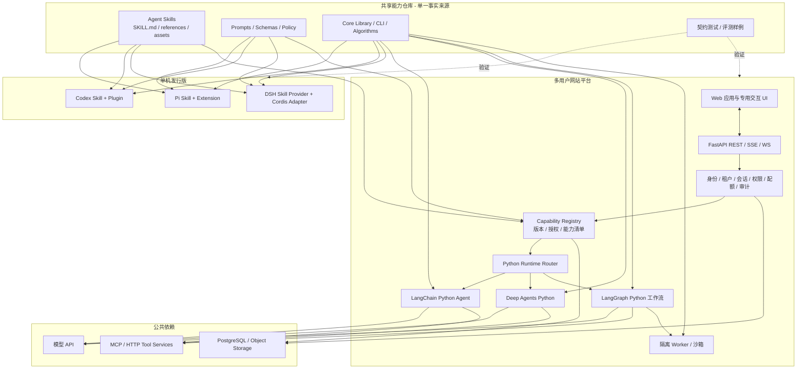
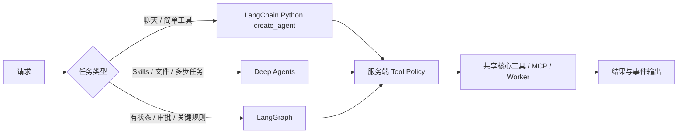
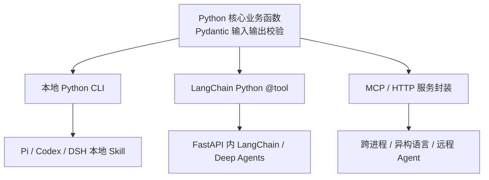
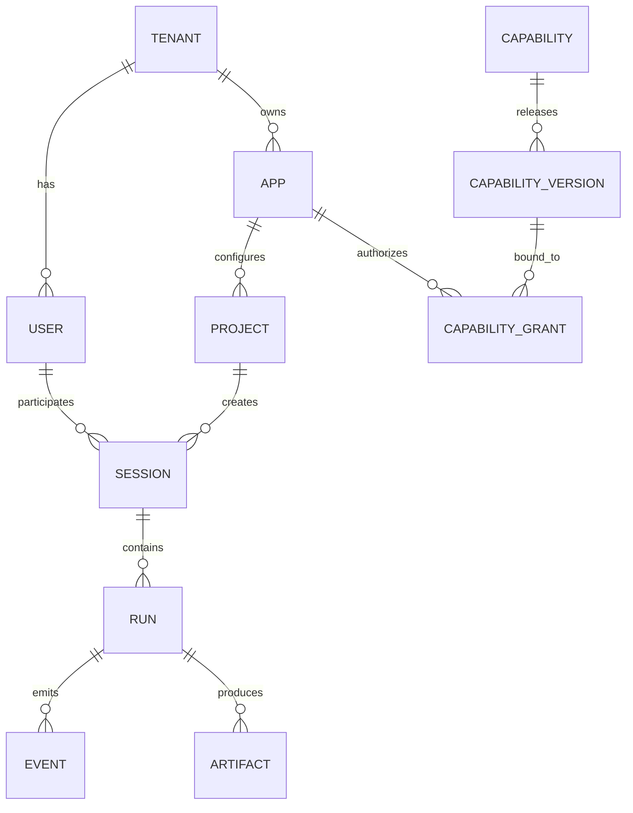
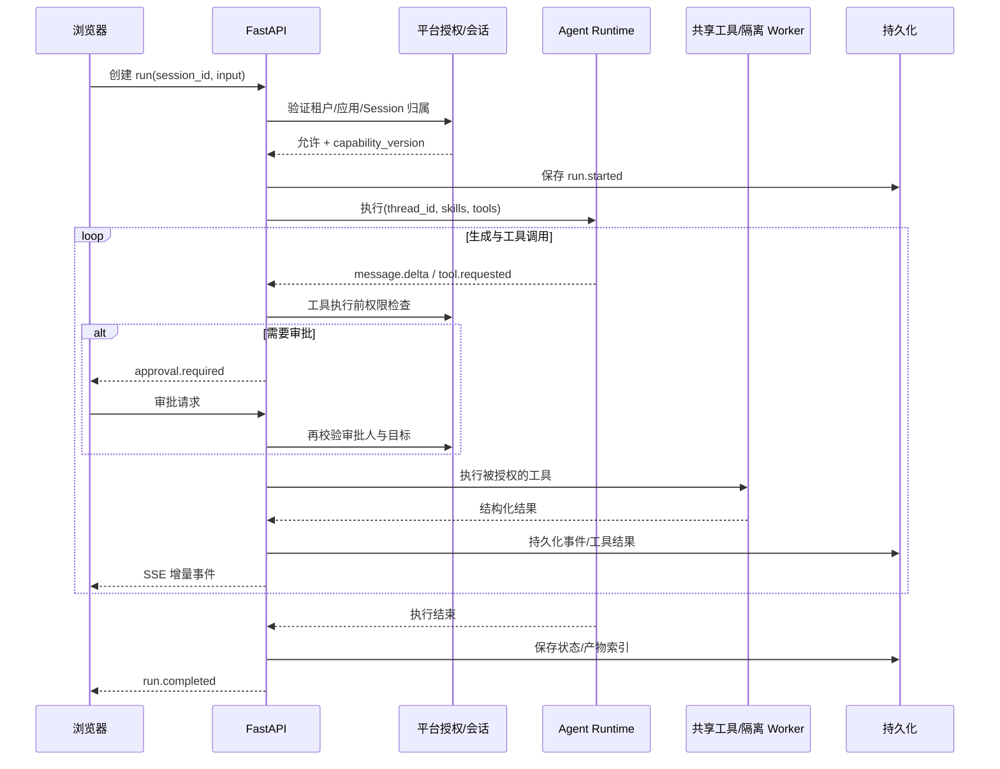
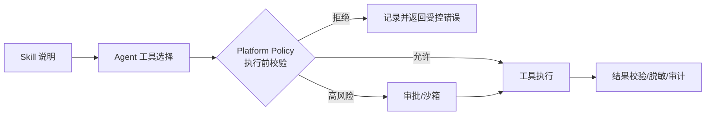

# 跨 Harness 技能与多用户 Agent 平台：总体架构与实施方案

> 版本：1.1｜核查日期：2026-11-02｜状态：技术方案（待实施与实测）
>
> 目标：同一套功能资产既可作为 Pi、Codex、DeepSeek Harness 等环境的单机技能或插件使用，也可作为多用户网站的业务能力，由 LangChain / LangGraph / Deep Agents 驱动。原则是复用业务能力、技能、数据和测试，而非强行复用所有 Harness 的运行时代码。

## 0. 执行摘要

**建议采用「标准 Agent Skills + Python 优先的独立核心能力包 + 可选 CLI/MCP + FastAPI + LangChain Python / Deep Agents Python + LangGraph Python + 薄适配层」的组合。**

- **单机端**：优先发布标准 `SKILL.md`；需要工具执行时使用本地 Python CLI/共享 Python 包；只有特定 Harness 的事件、TUI、生命周期或能力无法由 Skill 表达时才编写专属插件。
- **网站端（全新项目）**：FastAPI + Python 提供鉴权、租户隔离、REST/SSE/WS、资源管理；简单对话或工具调用用 LangChain Python `create_agent`，需要 Skills、文件工作区及多步任务时选 Deep Agents Python `create_deep_agent`；复杂、确定性和可恢复流程用 LangGraph Python。已有 Fastify 系统可保留为网关，经内部 API 连接 Python Runtime。
- **共享边界**：`skills/`、`prompts/`、`capabilities/*/core/`、资源及测试是事实来源（single source of truth）。各 Harness 的适配层只负责注册、鉴权接线、格式与事件映射。
- **安全边界**：`SKILL.md` 是指令文档，**不是授权凭据**；MCP 是工具协议，**不是天然安全沙箱**；Session 和租户隔离不由任一 Harness 自动保证。
- **实施策略**：先一个完整纵向功能验证单机 Pi/Codex 与 Web Deep Agents 的共享，再引入 DSH；绝不一开始同时维护四套实现。

### 0.1 关键决策（ADR 摘要）

| 决策 | 选择 | 原因与代价 |
|---|---|---|
| 跨 Harness 内容标准 | Agent Skills | 公开规范，跨环境支持度高；仅承诺文件与语义层兼容 |
| 功能实现 | 无 Harness 依赖的 Python 业务核心，跨语言用 CLI/MCP/HTTP | Python 算法可直接复用；Node 宿主需要入口适配 |
| 插件包装 | 以 Skill 优先，MCP/CLI 按需 | 避免为每个宿主重复实现；宿主原生 Hook/UI 仍需适配 |
| 网站 API | FastAPI + Python（新项目默认）；既有 Fastify 可保留网关 | Python Agent 与算法直接集成，存量系统避免重写 |
| 默认 Agent | LangChain Python `create_agent` | 简单对话与工具调用，轻量入口 |
| Skills 型 Agent | Deep Agents Python `create_deep_agent` | 原生 Skills、文件系统、按需工具、权限等能力；不是所有任务默认运行时 |
| 复杂执行流程 | LangGraph Python | Checkpointer、可恢复状态、人工中断 |
| 工具协议 | Python 函数 → CLI 或 MCP/HTTP（按需） | 本进程直接调用，跨语言/进程再协议化 |
| 运行时扩展 | Pi/Codex 优先，DSH 实验性 | 控制适配成本及 DSH 版本风险 |
| 部署 | FastAPI 模块化单体 + 隔离 Worker；既有 Fastify 可作网关 | 简化新项目运维并兼容既有系统 |

## 1. 2026-11-02 最新事实核查与认知修正

### 1.1 已由一手资料确认的事实

| 项目 | 已确认状态 | 对方案的影响 | 证据 |
|---|---|---|---|
| Agent Skills | 官方规范采用必需的 `SKILL.md`（YAML 元数据），可带 `scripts/`、`references/`、`assets/`，采用渐进式加载 | 统一技能原始格式 | [S1] |
| OpenAI / Codex 插件 | 新版插件可通过 `.codex-plugin/plugin.json` 打包 Skills 和 MCP 配置，OpenAI 原 `openai/skills` 仓库已标为 deprecated，指向新插件实践 | 不再把旧 Skills 仓库当最新插件标准；Codex 的插件分发与 Agent Skills 内容分开设计 | [S2][S3] |
| Vercel Skills CLI | 支持多种 Agent 的路径映射、symlink/copy、安装和更新；不同 Harness 对 hooks 等高级特性支持差异明显 | 可以借用现成安装分发，不重造跨端复制器 | [S4][S5] |
| LangChain Deep Agents JS | 当前 TypeScript 文档明确存在 Skills、按需读取、相关工具绑定、远程后端、权限与脚本沙箱等功能 | **无需默认自研 Skill Loader**；先验证并使用内建能力 | [S6][S7] |
| **LangChain Deep Agents Python** | Python 官方 Skills 文档明确支持标准 Skills、渐进式加载、工具解析、后端、权限、刷新和固定技能；Python SDK 可自行托管 | **Python 为新项目首选，不需要自研标准 Skill Loader**；特殊高级 API 仍应实测与锁版 | [S13][S14] |
| **LangGraph Python** | Checkpointer 保存 Thread 状态，Store 保存跨 Thread 数据；生产使用持久化存储 | 网站的状态治理与 Python Runtime 原生衔接 | [S15] |
| LangGraph JS | Checkpointer 提供线程状态持久化；Store 管理跨线程数据；内存 Checkpointer 不适合生产持久化 | 将 Agent 状态与平台业务数据库职责分离 | [S8] |
| Pi | 原 `badlogic/pi-mono` GitHub 地址当前重定向到 `earendil-works/pi`，仓库仍定义为 unified LLM API / agent loop / coding CLI | 以实际安装版本与迁移后仓库为准，旧仓库地址可重定向但不要写死 | [S9] |
| DeepSeek Harness | 基于 Cordis 的 Everything-is-a-Plugin 架构，官方当前依然明确标注 Developer Preview 与潜在不兼容变更；有文件系统 Skills Provider | DSH 作为可选扩展端，不作为平台启动的强依赖 | [S10][S11] |

### 1.2 必须修正的几个认识

1. **“大多数插件天然跨 Harness”不准确**：高度兼容的主要是**Agent Skills 文件夹**；Hook、Session、TUI/UI、Agent Loop、沙箱与专属命令仍是宿主特定机制。
2. **LangChain 不等于 Deep Agents**：LangChain 提供 Agent 基础能力；LangGraph 提供状态执行；Deep Agents 是在二者之上的一个 Harness，内置 Skills、文件系统等。应按任务选用，不要全部任务套 Deep Agents。
3. **MCP 不等于 Skills**：Skills 描述何时、如何完成任务；MCP 负责把数据与受控操作暴露给模型。OpenAI 的官方插件文档也强调该分工 [S2]。
4. **不必为 LangChain 自建完整 Skill Loader**：Deep Agents Python 与 JS 都已支持。新项目优先 Python。仅在需要平台技能目录、按租户授权、版本选择、审计和发布时开发外围 **Capability Registry**，而不复制内部渐进加载逻辑。
5. **Python 与 TypeScript 都可用，但不是功能对等的前提假设**：应分别核实版本/API，方案默认 Python；旧版 Fastify 保留网关选择。
6. **不要把 Web 版模拟成 Pi 进程**：网站是独立的产品入口；共享 Skills/核心代码即可。已有 Pi Project 的扩展和会话不会自动迁移到 LangGraph。

## 2. 建设目标、边界与适用场景

### 2.1 必须达成的目标

- 每项功能有一个明确的 `capability_id` 和版本号。
- 同一业务功能可以在本地 Pi/Codex 和网站中执行，独立项目可以选择性安装。
- 普通聊天、多步 Agent、确定性工作流不需要共享完全相同的 Agent Loop。
- 多用户数据、文件、工具权限和会话严格隔离；平台不混入汉字教学、诊断等业务规则。
- 网页支持结构化结果和专用 UI（例如造字画布、测量图表），不仅输出聊天文本。
- 所有发布的 Skills、工具 Schema 和关键规则都有跨运行时测试及可回退版本。

### 2.2 明确不做（第一阶段）

- 不重造通用 Skills 安装器、完整 Harness、通用代码沙箱和模型网关。
- 不尝试直接共享 Pi/Codex/DSH 与 LangGraph 的私有 Session 格式。
- 不支持任意用户上传脚本后在 Web API 进程中立即执行。
- 不一次性兼容所有第三方 Harness、Hook 或 TUI。
- 不把业务工作流藏进平台的全局系统提示词。

### 2.3 功能分级

| 级别 | 示例 | 推荐交付形态 | Web 运行时 |
|---|---|---|---|
| L0 纯知识与模板 | 汉字字义解释规范、文稿格式规范 | 标准 Skill + References | LangChain Python 或 Deep Agents Python |
| L1 确定性工具 | 查字典、计算 IRT、生成题目结构 | Skill + Python Core + CLI/Tool | LangChain Python `create_agent` |
| L2 多步 Agent | 查资料→规划→工具→复核 | Skill + Tools + 可选 MCP | Deep Agents |
| L3 状态型工作流 | 学习诊断→行动包→约束反馈→再诊断 | 核心状态机/Graph + Skills | LangGraph |
| L4 本地环境插件 | Pi TUI、文件/终端控制、DSH 生命周期 | 宿主专用插件 + 共享 Core | Web 必须另做安全执行环境/界面 |

## 3. 目标架构

### 3.1 全局架构图



说明：Mermaid 中箭头表示发布/依赖/调用的**逻辑关系**，不意味着同一请求中必须经过全部节点；单机分发与网站部署是独立路径。

### 3.2 分层及责任归属

| 层 | 职责 | 不承担 |
|---|---|---|
| Capability | 业务纯函数、算法、数据约束和结构化输入输出 | 用户身份、HTTP、LLM Session |
| Skill | 任务触发条件、执行步骤、参考资源、交付格式 | 访问授权、沙箱保护 |
| Adapter | 接入 Pi/Codex/DSH/Deep Agents 的注册与协议映射 | 业务算法的第二份实现 |
| Platform API | 身份、租户隔离、任务生命周期、接口、事件 | 教学规则、汉字解释等业务内容 |
| Agent Runtime | 模型推理、工具选择、上下文、调用流程 | 平台级数据权限最终裁决 |
| Execution | 受限代码执行、文件读写、耗时任务 | 用户身份决策与业务状态真相 |
| Frontend | 可视化、交互、呈现、上传、审批 | 直接调用模型密钥或绕过服务端校验 |

### 3.3 三种请求路径



**Router 应优先由应用配置决定**，不要仅通过 LLM 猜测而动态切换运行时。一个任务运行期间不无故更换内部执行引擎。

## 4. 统一能力包设计

### 4.1 仓库方案：Python 优先的 Monorepo，允许独立发布

```text
agent-capability-platform/
├── apps/
│   ├── web/                         # React 或原生 HTML；仅负责展示与交互
│   ├── api/                         # FastAPI：租户、Session、Run、REST/SSE/WS
│   └── worker/                      # 耗时任务与受限执行（隔离部署）
├── platform/                         # Python 共享平台服务
│   ├── capability_registry/          # 技能版本、授权与分发目录
│   ├── runtime_router/               # create_agent / create_deep_agent / LangGraph
│   ├── tool_policy/                  # 业务工具执行前授权
│   ├── sessions/                     # Session/Run/Thread 映射
│   └── events/                       # 标准化事件协议
├── capabilities/
│   └── hanzi-learning/
│       ├── capability.yaml           # 自定义能力清单，不属于 Agent Skills 标准
│       ├── skills/
│       │   ├── explain-character/
│       │   │   ├── SKILL.md
│       │   │   ├── references/
│       │   │   └── assets/
│       │   └── create-character/SKILL.md
│       ├── prompts/
│       ├── core/                     # 不依赖 Agent 框架的 Python 业务逻辑
│       ├── tools/                    # LangChain @tool、CLI、MCP 封装
│       ├── cli/                      # 本地入口：Pi / Codex / DSH 可调用
│       ├── adapters/                 # 仅在宿主需要原生扩展时建立
│       │   ├── pi/
│       │   ├── codex/
│       │   └── dsh/
│       └── tests/
├── contracts/                        # JSON Schema / OpenAPI / 事件 schema
├── infra/                            # PostgreSQL、Redis（可选）、对象存储、沙箱
├── docs/                             # ADR、兼容性矩阵与运行手册
├── pyproject.toml
├── uv.lock
└── README.md
```

Python 包内部可以按需使用合规包名 `hanzi_learning`，上述业务目录是逻辑边界。`uv` 管理 Python 环境与锁文件，`pytest` 执行测试，`ruff` 完成静态检查；前端独立使用 Node 构建工具，不要求平台后端变为 TypeScript。

**保留既有 Fastify 的场景**：增加 `apps/gateway/`，Fastify 只负责现有 API、认证或 WS 兼容，经可信内部 HTTP/gRPC 通道调用 Python Agent Runtime。不要为统一技术栈而立即重写存量系统。

> 该目录是本项目的源码组织建议；Pi/Codex/DSH 安装时仍需遵守其宿主路径与插件清单约定。

### 4.2 `SKILL.md` 保持标准、尽量不携带平台私货

```markdown
---
name: explain-character
description: 当学习者希望理解单个汉字的构形、历史义项与现代用法时使用。
---

# 汉字解释

1. 按需读取 references/etymology.md。
2. 调用已授权的 get_character_history 工具检索资料。
3. 区分已证实的构形解释和教学性记忆联想。
4. 输出字形、义项演变、现代例句和学习建议。

不要把臆测字源表述为可靠的学术结论。
```

标准规范要求 `name`、`description`，其他宿主专属元数据应放在独立的 `capability.yaml` 或安装适配文件里，而非依赖非标准 frontmatter 字段来授予权限。

### 4.3 平台元信息与能力契约（建议）

```yaml
id: hanzi-learning
version: 0.1.0
runtime_profile: skills-agent
skills:
  - explain-character
  - create-character
required_tools:
  - get_character_history
tool_permissions:
  get_character_history: read
execution:
  network: false
  filesystem: read-only
ui:
  result_schema: hanzi-explanation-v1
compatibility:
  target_hosts: [pi, codex, web]
```

该文件是**本项目自定义格式**，不要与 Agent Skills 官方 schema 混淆。真正授权必须由平台服务器的 policy 配置和用户上下文共同裁决，`tool_permissions` 只是声明需求，不是许可。

### 4.4 提示词复用规范

- **Skill instructions**：描述这个任务如何做，随 Skill 走。
- **公共 Prompt**：模型角色、交流方式、输出风格，尽量简短，与工具绑定无关。
- **业务 Policy**：不允许直接给学生答案、必须先解释等规则，另有确定性校验与执行前约束；不能只靠 Prompt。
- **宿主特定提示词**：Pi 的命令约定、Codex 的工具提示、Deep Agents 默认系统指令，只做微小适配，不作为共享的业务真相。
- **版本锁定**：每次执行记录 `capability_version`、`skill_hash`、`prompt_version`、`tool_schema_version`。

## 5. 工具与协议复用

### 5.1 一个 Python 核心函数，多个入口



优先顺序：**同进程 Python 函数 > 受控本地 CLI > 需要跨边界时才 MCP/HTTP**。对于 Pi/Codex 的 JS 宿主，运行 Python CLI 需明确 Python 环境及依赖，不能假定脚本可直接调用宿主私有 API。对于需要脱离 Python 运行环境的简单逻辑，可另打包独立可执行程序，但必须保持统一的业务测试与契约。

示例（**核心调用的最小结构，非经过生产验证的完整项目**）：

```python
# capabilities/hanzi-learning/core/hanzi_learning/core/character.py
from pydantic import BaseModel, Field

class CharacterQuery(BaseModel):
    character: str = Field(min_length=1, max_length=1)

def get_character_history(query: CharacterQuery) -> dict:
    # 实际项目在此查受授权的数据源；以下仅示例返回结构
    return {"character": query.character, "sources": []}
```

```python
# capabilities/hanzi-learning/core/hanzi_learning/tools/langchain_tools.py
from langchain.tools import tool
from hanzi_learning.core.character import (
    CharacterQuery, get_character_history,
)

@tool
async def character_history(character: str) -> dict:
    """查询给定汉字的历史字形与文献资料。"""
    return get_character_history(CharacterQuery(character=character))
```

多用户工具必须再包一层服务端权限上下文校验，例如用户可以访问哪个字典库、班级或项目；不能仅依赖工具 schema 或 Skill 文本决定权限。

### 5.2 工具契约

工具定义至少包括：`tool_id`、`version`、输入 JSON Schema、输出 JSON Schema、可读/可写权限、超时、幂等性、审计策略、可用租户/应用、错误类型。建议将结构化业务输出与给用户看的自然语言解释分离。

### 5.3 MCP 的定位

MCP 仅作为需要跨环境通信时的统一工具访问协议；不要通过 MCP 动态执行未经批准的用户脚本。远程 MCP Server 持有自己的身份和授权规则，平台须携带经服务端确认的身份上下文，并在服务端执行租户过滤。第三方 MCP 配置要经过白名单、域名与网络出口审查。

### 5.4 分发规范

- **通用**：直接分发 `skills/<skill-name>/SKILL.md` 和相对资源。
- **Pi/Codex**：利用共同支持的 `.agents/skills/` 路径或使用 Vercel Skills CLI 安装；仍须对各自实际版本做验收。
- **Codex plugin**：确需组合多个 Skill 与 MCP 时，根据最新文档加入 `.codex-plugin/plugin.json` 和 `.mcp.json`，不把该清单误当通用标准。
- **DSH**：先检验 Filesystem Skill Provider 能否加载通用 Skill；需要专属 Lifecycle 时再开发 Cordis 插件。
- **Web**：基于 Deep Agents Python 的 Skills 能力加载相同源内容，权限与可用技能由 Capability Registry 在应用/租户层选择。

## 6. 网站后端与多用户模型

### 6.1 平台对象



字段建议：

- `tenant_id`：最高数据隔离边界。
- `app_id`：业务应用或前端的能力策略。
- `project_id`：独立项目定义与配置，不等同于某个 Harness 的工作目录。
- `session_id`：平台可见的对话/任务会话标识。
- `run_id`：单次执行实例，独立于 Session，支持失败重试、取消和审计。
- `thread_id`：LangGraph 的内部状态键，**仅由服务端映射**到受授权的 Session。
- `scope_id`：可选数据/资源范围；迁移既有项目时保留兼容映射。

### 6.2 REST / 事件协议（建议，不是现成框架 API）

| 方法 | 路径 | 用途 |
|---|---|---|
| GET | `/v1/capabilities` | 按应用权限列可用能力 |
| POST | `/v1/sessions` | 创建 Session |
| POST | `/v1/sessions/:id/runs` | 发起一次执行 |
| GET | `/v1/runs/:id` | 查询运行状态 |
| GET | `/v1/runs/:id/events` | SSE 增量事件 |
| POST | `/v1/runs/:id/cancel` | 取消执行 |
| POST | `/v1/runs/:id/approve` | 审批待确认工具 |
| GET | `/v1/sessions/:id/messages` | 历史消息 |

事件建议统一为 `{event_id, run_id, session_id, seq, type, timestamp, payload}`，其中 `type` 最少支持 `run.started`、`message.delta`、`tool.requested`、`tool.completed`、`approval.required`、`artifact.created`、`run.completed`、`run.failed`。

### 6.3 事件流与中断恢复



部署初期 SSE 足以承载单向生成流；需要真正双向互动、共享实时画布或协同编辑时再启用 WS。中断恢复与工具调用的“恰好一次”不能仅依赖 LangGraph Checkpointer；有副作用的工具还需要幂等键、执行记录和补偿策略。

### 6.4 数据与状态的三个层次

1. **平台数据库**：用户、租户、项目、Session、Run、审计、工具调用、授权、产物索引。这是业务真相。
2. **LangGraph Checkpointer**：Agent Thread 的执行状态与恢复点；使用持久化后端，**不能把 `MemorySaver` 作为生产持久化方案** [S8]。
3. **对象存储/工作区**：生成文件、资源文件、模型产物；按租户、项目、Run 独立命名空间，访问通过授权签名或受控代理。

## 7. 安全、隔离与可信技能供应链

### 7.1 隔离设计

- Web 服务进程只运行可信的业务函数；`scripts/`、Shell、自由 Python、外部包安装等进入隔离 Worker/容器。
- Skill 源必须经过静态扫描、依赖锁定、版本审批与发布；平台禁止用户直接使用未知来源 Skill 获取生产权限。
- 无论 Skill 中如何描述，运行时工具许可都来自平台服务端的 Policy Engine。
- 文件系统权限采用租户/应用/会话/运行四层命名空间；任何由模型提供的路径必须归一化并映射到授权根目录，防止路径穿越与符号链接逃逸。
- 对外网访问采用默认拒绝或白名单；防 SSRF、内网探测及凭证泄露。
- Prompt/Skill 注入防护：把外来文档视为不可信输入，不允许内容要求扩大工具权限、删除日志或泄露密钥。
- 模型密钥和第三方令牌只存在于服务端密钥管理；前端永不直连保存密钥的 Provider。

### 7.2 安全检查发生在哪里？



**输出校验不能替代执行前校验。** 例如“不能直接替学生完成题目”可做输出后审核；“不能读取其他学生记录”必须在数据库和工具执行前就阻止。

### 7.3 供应链与许可证

对第三方技能维护 `source_url`、commit/tag、license、hash、scan_status、approved_by、approved_at、capability_version`。禁止自动跟随主分支在生产环境热更新，先进入预发布验证再推广。

## 8. 一个端到端案例：汉字学习应用

### 8.1 单机模式

用户在 Pi/Codex 安装 `explain-character` 和 `create-character` 两个标准 Skills。Skill 读取字源资料，通过本地 CLI 调用统一核心工具，生成文字解释和 JSON 结构结果；如需 Pi TUI 显示画布，才提供 Pi 专属 Extension。

### 8.2 网站模式

网站前端展示古文字/现代部件与拖拽画布。FastAPI 为学生建立 Session，通过 Deep Agents 调用相同 `explain-character` Skill 和 `get_character_history` 工具；绘图、拖拽状态及评价规则在前端/核心包实现，Agent 只输出规范的结构化建议，不负责浏览器像素级操作。

### 8.3 共享/专属边界

| 资产 | 单机 | 网站 | 是否同源 |
|---|---|---|---|
| SKILL.md | Pi/Codex/DSH 加载 | Deep Agents 加载 | 是 |
| 汉字字源数据 | CLI/本地文件 | 受控后端资源 | 数据内容可以同源，存取方式不同 |
| 核心造字评价 | Python 核心函数/CLI | 直接调用 Python 核心库 | 是 |
| Session | 宿主 Session | 平台 Session + Checkpointer | 否 |
| 绘图 UI | 终端/TUI 或无 UI | Web Canvas/SVG | 否 |
| 用户权限 | 本机操作系统/宿主 | 多租户平台 | 否 |

## 9. 技术实施路线与验收 Gate

### Phase 0：能力验证 / 技术探针

**目标**：不用大规模开发，先验证关键假设。

- 核查并固定 Python、uv、FastAPI、LangChain Python、LangGraph Python、`deepagents`（Python）、Pi、Codex 的实际版本；DSH 可后续验证。
- 使用 1 个标准 Skill 各在 Pi、Codex、Deep Agents Python 读取成功；DSH 作为独立可选验证。
- 测试 Skills 中 `references/`、`assets/` 和 CLI 调用，而非只检查 metadata 可发现。
- 测试 Deep Agents Python 动态工具绑定、受限工作区以及技能热更新/版本切换的实际行为。

**Gate 0：**至少 Pi、Codex 和 Web 三端完成同一固定输入的功能演示，且无宿主私有提示词复制。

### Phase 1：最小共享能力包（MVP）

交付 `capabilities/hanzi-learning`（或任选一个确定性足够强的功能），含 `SKILL.md`、Python 核心库、CLI、Schema、固定样本、日志字段和可发布打包脚本。第一阶段以本地可信 Skills 为限。

**Gate 1：**业务规则只存在一份；三端调用相同业务测试集；支持固定版本回滚。

### Phase 2：网站后端 MVP

FastAPI + PostgreSQL；用户/应用/Session/Run；LangChain Python Agent + Deep Agents Python Skill Agent；SSE 事件；最小权限列表、工具前置校验和审计日志。网页先做一个完整的业务流程，不建设空泛的通用后台。

**Gate 2：**两个并行用户不同 Session/文件互不可见；断线能通过 Event seq 续读；取消运行可见最终状态；故障有可追踪 run_id。

### Phase 3：LangGraph 与生产增强

引入持久化 Checkpointer、长任务 Worker、人工审批、中断恢复、工件存储、工具幂等、模型用量与限流。只有出现真实需求才引入复杂图。

**Gate 3：**进程重启后可恢复待处理任务；敏感工具未经批准不执行；工具重复请求无不可控副作用。

### Phase 4：多业务、多宿主扩展

增加 Capability Registry 的租户授权、版本选择、依赖检测、技能目录及发布流程；验证 DSH Provider 和 Cordis Adapter；分别加入各类业务 UI。可考虑提供对外 MCP Server。

**Gate 4：**新业务 Skill 能不修改平台核心代码而发布；不同租户可选择独立版本，审计记录准确。

## 10. 测试体系及评价标准

### 10.1 必须测试的五层

| 层 | 测试内容 | 通过标准（建议） |
|---|---|---|
| Skill 静态 | YAML、命名、路径、相对资源、依赖 | 100% 通过规范校验与文件检查 |
| Core 单元 | 输入边界、异常、算法正确性 | 确定性金样本全通过 |
| 工具契约 | Schema、超时、错误码、幂等 | 三端遵循同一输入输出契约 |
| 跨 Harness | 技能发现、触发、资料读取、工具执行、输出规则 | 关键行为一致，不要求语言逐字一致 |
| 平台/安全 | 多租户并发、权限、路径越界、注入、恢复 | 已定义的越权用例全部被阻止 |

### 10.2 关键评测指标

- **Skill Activation Precision / Recall**：应触发和不应触发的用例分别评估。
- **Tool Success Rate**：工具调用成功率及参数有效率。
- **Task Completion**：按结构化评价器核验关键任务。
- **Policy Violation Rate**：不合规回答、未授权工具请求及实际未授权执行分别统计。
- **Cross-runtime Consistency**：关键结构化输出、规则和工具结果跨端一致度。
- **成本与延迟**：p50/p95 首 token 时间、总耗时、tokens、单任务成本。
- **可靠性**：取消、恢复、超时、故障注入、重复消息、幂等性。

评测用例需固定模型、版本、工具数据快照及随机种子（若 API 支持），同时进行多次重复，不把单次运行结果当成跨框架稳定结论。

## 11. 风险及应对

| 风险 | 影响 | 缓解措施 |
|---|---|---|
| 宣称兼容但宿主工具不同 | Skill 可加载却无法执行 | 兼容分级：发现→阅读→工具执行→行为通过 |
| LangChain/Deep Agents 快速升级 | API 或加载语义变化 | 固定依赖、锁文件、集成测试、升级窗口 |
| DSH 仍为预览版 | Cordis 插件接口变化 | 适配器独立、非 MVP 关键路径 |
| 本地脚本被直接放到服务器执行 | 越权、数据泄露 | 隔离 Worker、最小权限、发布审批 |
| 模型选错 Skill | 任务失败或误触发 | 明确 description、显式调用入口、评测集 |
| Session 跨用户串读 | 严重数据事故 | 服务端 Session 归属校验、RLS/作用域查询、测试 |
| 大量 Skill 进入上下文 | tokens 增加、匹配下降 | 按应用筛选、渐进式加载、功能分包 |
| 所有能力强行 MCP 化 | 网络与维护成本上升 | 单进程优先直接函数，跨边界再 MCP |
| 共享 Prompt 过度抽象 | 不同宿主表现下降 | 共享任务规则，保留有限宿主运行时指令 |

## 12. 推荐开发任务分解（可交给执行模型）

### 12.1 第一批任务（按先后顺序）

1. 初始化 Python 3.11 或更高版本（以锁定依赖的最低要求为准） 与 `uv` 项目；建立 `platform/`、`contracts/`、`capabilities/hanzi-learning` 和 `pytest` 基础测试。
2. 实现一个无 Agent 依赖的 Python `get_character_history`，通过 Pydantic 校验输入输出，准备确定性测试数据。
3. 编写标准 `SKILL.md`，使用 Agent Skills 官方验证工具或等效校验，准备正向/负向触发样例。
4. 将同一业务函数分别封装为本地 CLI 和 LangChain Python `@tool`，验证 JSON 输出一致。
5. 将 Skill 安装至 Pi 和 Codex；记录不同宿主执行 CLI 的依赖、路径、权限与错误处理差异。
6. 使用 **当前 Python Deep Agents Skills 官方文档**为 Web Runtime 实现 `create_deep_agent`，验证 Skills、资源目录、工具、受限文件后端及权限。
7. 用 FastAPI 实现 `/sessions`、`/runs`、SSE 及运行日志，添加最小认证、Session 归属校验和平台级 Tool Policy。
8. 接入 Postgres 持久化、用量指标与跨运行时评测；通过 Gate 0/1/2 后再扩展功能。

### 12.2 第二批任务（有明确需求时启动）

- LangGraph 状态型流程；Postgres Checkpointer；审批与恢复。
- 按租户发布技能及版本治理；Capability Registry 的目录、权限和审计。
- MCP Server 作为独立工具服务，面向跨语言或外部 Harness。
- DSH Cordis Adapter；Pi 原生 UI/事件扩展。
- Worker 沙箱、对象存储、工具副作用幂等。

### 12.3 交付物清单

- 架构决策文档 ADR、可运行 Monorepo、示例能力包、三个实际入口（Pi/Codex/Web）、跨端测试报告、安全用例报告、部署说明及回滚手册。

## 13. 最终推荐与明确结论

**新项目默认路线（Python 优先）：**

```text
Agent Skills（跨 Harness 的内容标准）
        +
Python Core Library / Pydantic（业务能力、数据与契约）
        +
CLI / MCP / HTTP（按运行环境边界选择）
        +
FastAPI + LangChain Python / Deep Agents Python（网站运行时）
        +
LangGraph Python（仅当复杂持久化、审批或恢复有需要）
        +
Pi / Codex / DSH 薄适配层（单机分发）
```

**有既存 Fastify 项目时**：保留 Fastify 外层 API/WS 网关，将 Python Agent Runtime 独立服务化，避免整体迁移。统一平台 Session/Run 语义和授权，不直接共享 Pi/Codex/DSH 与 LangGraph 的内部 Session 格式。

**架构价值来自三个独立性**：功能独立于 Agent 宿主、业务独立于平台、平台独立于特定 Harness。能力包的 `SKILL.md` 可以复用，但宿主 Hook、权限、工具、文件系统与 UI 必须按运行环境验证。

对于已有 Pi 多用户后端与外部 `xiaoxue` 项目，建议**保留现有运行路径**；新平台先以独立能力包验证 Pi/Codex/Python Deep Agents 三端共享，再根据测试决定是否接入原平台。

### 13.1 技术选型的条件性说明

| 项目情形 | 首选 | 说明 |
|---|---|---|
| 全新多用户网站、算法工具较多 | FastAPI + Python Deep Agents / LangChain | 与 Python 业务核心同语言，适合 `uv` + `pytest` 维护 |
| 简单聊天和结构化工具 | FastAPI + LangChain Python `create_agent` | 不必每个请求都进入 Deep Agents |
| 标准 Skills、多步工具、文件上下文 | Deep Agents Python `create_deep_agent` | 直接使用现成 Skills 机制，不自研底层 Loader |
| 教学闭环、确定性状态机与人工审批 | LangGraph Python | 显式编排规则，状态持久化与人工中断 |
| 既有 Fastify 平台 | Fastify 网关 + Python Agent Service | 避免迁移已有认证、RPC 与业务接口 |
| 本地编码或 Shell 工作空间 | Pi / Codex | 保留成熟本地 Harness 优势 |

### 13.2 最小 Python 原型与运行原则

```bash
uv init --python 3.11
uv add fastapi uvicorn langchain langgraph deepagents pydantic pyyaml
uv add --dev pytest ruff httpx
uv lock
```

> 以上为依赖选择示例，不锁定具体版本；正式项目应提交 `uv.lock`，在 Phase 0 验证对应模型 Provider 包、Checkpointer 驱动和 Deep Agents 实际接口。生产部署不要使用内存 Checkpointer。

```python
# 示例结构：具体技能目录访问与工具绑定需按锁定版本验证
from deepagents import create_deep_agent

agent = create_deep_agent(
    model="openai:<your-model>",
    skills=["/skills/"],
    tools=[character_history],
)
```

这里使用占位模型名称，不能直接运行。Python 官方文档明确支持 `skills=["/skills/"]`，其中路径由配置的文件后端解析；部署时应确认实际目录映射与读取权限。不能把 JavaScript 的其他选项直接复制成 Python 参数。生产中应显式配置后端访问、工具白名单、应用级 Skill 范围、可持续化状态和运行超时。

---

## 附录 A：官方与一手参考资料（2026-11-02 复核）

- **[S1]** Agent Skills 官方规范：https://agentskills.io/specification （对应官方源码 https://github.com/agentskills/agentskills/blob/main/docs/specification.mdx）
- **[S2]** OpenAI Plugins — Skills：https://developers.openai.com/plugins/concepts/skills
- **[S3]** OpenAI API — Plugins 打包示例：https://developers.openai.com/api/docs/guides/agents-api/tools/plugins ；原 `openai/skills` 仓库弃用提示：https://github.com/openai/skills
- **[S4]** Vercel Skills CLI 官方：https://github.com/vercel-labs/skills
- **[S5]** Vercel 支持的 Agent 与功能差异：https://github.com/vercel-labs/skills/blob/main/docs/agents.md
- **[S6]** LangChain Deep Agents TypeScript — Skills：https://docs.langchain.com/oss/javascript/deepagents/skills
- **[S7]** LangChain Deep Agents TypeScript — Overview：https://docs.langchain.com/oss/javascript/deepagents/overview
- **[S8]** LangGraph TypeScript — Persistence：https://docs.langchain.com/oss/javascript/langgraph/persistence
- **[S9]** Pi 仓库（现重定向至 earendil-works/pi）：https://github.com/badlogic/pi-mono
- **[S10]** DeepSeek Harness 官方：https://github.com/deepseek-ai/deepseek-harness
- **[S11]** DeepSeek Harness Skills Subsystem：https://deepseek-harness.github.io/deepseek-harness/en/reference/subsystems/skills
- **[S12]** Vercel Skills CLI 安装与版本控制：https://github.com/vercel-labs/skills/blob/main/docs/commands.md

> 证据与限制：本文中“已支持”表示当前官方文档或仓库已给出明确说明；**尚未在用户的项目环境中运行代码或进行兼容性实测**。具体依赖版本与集成 API 应在 Phase 0 锁定，不能把文档示例视作已经运行通过的实现。

- **[S13]** Deep Agents Python — Skills：https://docs.langchain.com/oss/python/deepagents/skills
- **[S14]** Deep Agents Python — Overview：https://docs.langchain.com/oss/python/deepagents/overview
- **[S15]** LangGraph Python — Persistence：https://docs.langchain.com/oss/python/langgraph/persistence
- **[S16]** Deep Agents Python — Profiles（Python 专属公测能力）：https://docs.langchain.com/oss/python/deepagents/profiles
