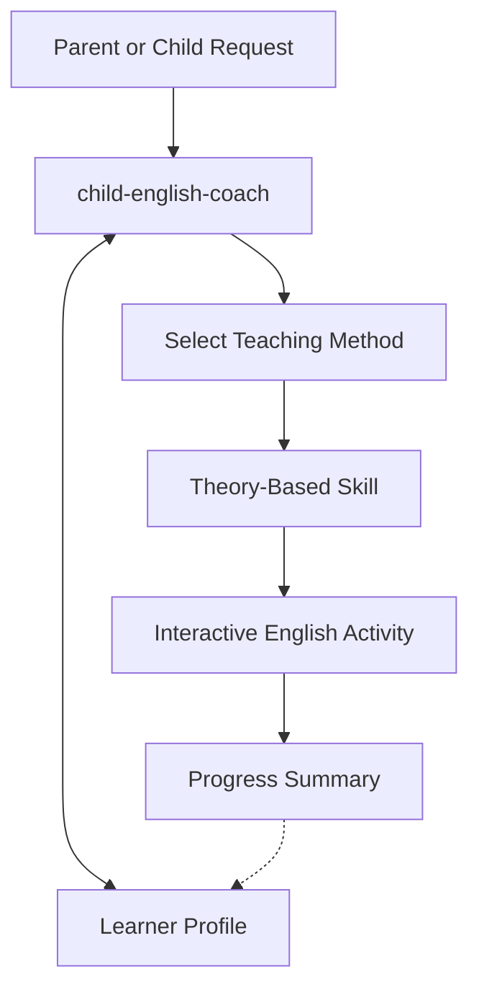

I’ve created 8 detailed, theory-based English-learning Agent Skills, designed primarily for DeepSeek Harness (DSH) and compatible with the standard `SKILL.md` format.

They are independent of your other educational projects and can be adapted to your child's age, proficiency, interests, and learning goals.

## 1. The skills

8 skills validated

| Skill                         | Theoretical foundation              | Purpose                                                             |
| ----------------------------- | ----------------------------------- | ------------------------------------------------------------------- |
| child-english-coach           | Adaptive language teaching          | Coordinates activities, collects learner variables, selects methods |
| comprehensible-input          | Krashen's Input Hypothesis          | Provides understandable stories, conversations, and explanations    |
| interaction-hypothesis        | Long's Interaction Hypothesis       | Encourages meaningful dialogue and clarification                    |
| output-hypothesis             | Swain's Output Hypothesis           | Encourages independent expression and language production           |
| scaffolding-zpd               | Vygotsky's ZPD                      | Provides progressive hints and gradually withdraws support          |
| task-based-language-learning  | Task-Based Language Teaching        | Organizes games, missions, role-play, and practical activities      |
| usage-based-language-learning | Tomasello / Ellis                   | Develops reusable sentence patterns through meaningful examples     |
| spaced-retrieval              | Retrieval Practice / Spacing Effect | Strengthens vocabulary and expression retention                     |

Each skill contains its theoretical principle, configurable variables, step-by-step teaching procedure, examples, and behaviors to avoid.

## 2. How they work together



The coordinating skill can choose among the teaching methods according to the child's immediate needs.

For example:

- If the child struggles to understand a story, emphasize Comprehensible Input.
- If the child understands but rarely speaks, emphasize the Output Hypothesis.
- If the child cannot complete a task independently, use Scaffolding/ZPD.
- If the child needs to use English meaningfully, choose Task-Based Language Teaching.

The parent can also explicitly request a particular method.

## 3. Shared configuration variables

The coordinator supports variables such as:

```
learner:
  age: null
  home_language: null
  proficiency:
    listening: null
    speaking: null
    reading: null
    writing: null
  goals: []
  interests: []

session:
  mode: null
  duration_minutes: null
  modalities: []
  explanation_language: null
  correction_preference: null

progress:
  familiar_expressions: []
  independently_used: []
  needs_support: []
```

The agent gathers missing information naturally, without requiring you to complete a lengthy questionnaire.

## 4. Using the skills in DSH

According to the [DeepSeek Harness filesystem skill documentation](https://github.com/deepseek-ai/deepseek-harness/blob/master/packages/skill/skill-filesystem/README.md?utm_source=chatgpt.com), DSH supports local skill directories containing `SKILL.md`.

For a user-level installation, the layout is:

```
~/.dsh/skills/
├── child-english-coach/
│   └── SKILL.md
├── comprehensible-input/
│   └── SKILL.md
├── interaction-hypothesis/
│   └── SKILL.md
├── output-hypothesis/
│   └── SKILL.md
├── scaffolding-zpd/
│   └── SKILL.md
├── task-based-language-learning/
│   └── SKILL.md
├── usage-based-language-learning/
│   └── SKILL.md
└── spaced-retrieval/
    └── SKILL.md
```

Copy the eight folders into that directory. DSH needs its filesystem-skill and skill-access components enabled in the active configuration.

Example requests:

> Use child-english-coach to start a 15-minute English activity with my child.

> Use the Comprehensible Input approach to teach my child about dinosaurs.

> Use the Output Hypothesis to help my child practice speaking English.

> Combine Task-Based Language Teaching and Scaffolding to help my child practice ordering food.

## 5. Design decisions

The implementation follows three principles:

1. Theory-based: Skills explicitly name established theories so the LLM can use its prior knowledge.
2. Configurable: Age, English level, learning goals, interaction mode, available time, and other preferences are variables.
3. Portable: Skills use plain Markdown instructions and require no database or external service.

The skills also include safeguards for children: gentle feedback, age-appropriate activities, parent supervision, minimal personal-data collection, and stopping when a child becomes frustrated.

### Completion status

All eight skill files were created and passed structural validation. Six have also been saved to your personal skill directory. The final two (`usage-based-language-learning` and `spaced-retrieval`) are available in the linked local files, but their remote saves were interrupted by a connection/authentication problem.

My suggested first test: Run `child-english-coach` in DSH with a simple request such as “Help my child practice talking about animals for 10 minutes.” Observe whether it asks only necessary questions, selects an appropriate method, and adapts when the child struggles.

That will tell us more about the practical quality of the skills than structural validation alone.