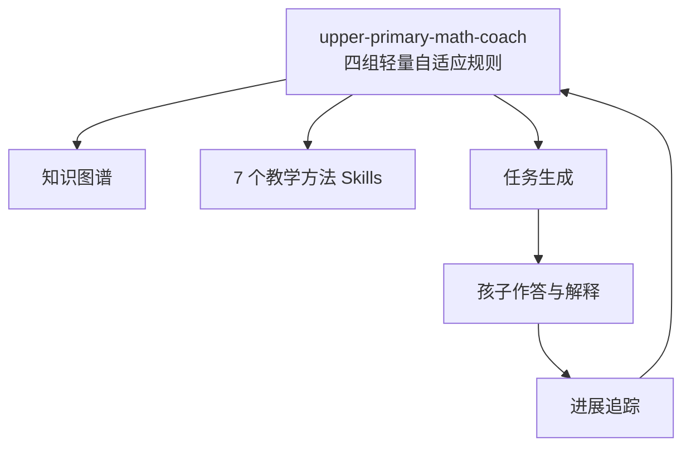

## 小学高年级

## 本次实现的内容

| 自适应机制   | 已实现的规则                     |
| ------- | -------------------------- |
| 知识点自适应  | 利用现有知识图谱检查先修关系，必要时回退一个节点   |
| 难度自适应   | L1–L3 三级难度，根据独立完成和解释情况调整   |
| 提示自适应   | H0–H4 五级提示，逐步增加或撤除帮助       |
| 教学方法自适应 | 根据困难类型选择 CPA、Pólya、变式等教学方法 |

另外加入了以下约束：

- 所有自适应阈值均可配置。
- 一次错误不会触发知识点回退。
- 答对但无法解释，不自动提高难度。
- 优先调整提示和表示方式，再考虑更换教学方法。
- 根据孩子的兴趣、疲劳程度及自主选择调整活动。
- 学习结束后记录必要证据，供下一次活动使用。

## 更新后的结构

## 如何使用

你可以在 DSH 中这样开始：

> 请使用 upper-primary-math-coach，帮助一个五年级孩子培养数学思维。先用简短活动了解他的水平，然后根据表现动态调整知识点、难度、提示和教学方法。每次只提出一个主要问题，等待孩子回答。活动结束后生成简短的学习记录。

最终保持了你希望的轻量设计：11 个 Skills、一个知识图谱、四组规则。 没有加入 BKT、IRT、Bandit 等复杂算法，也没有引入其他项目的架构。