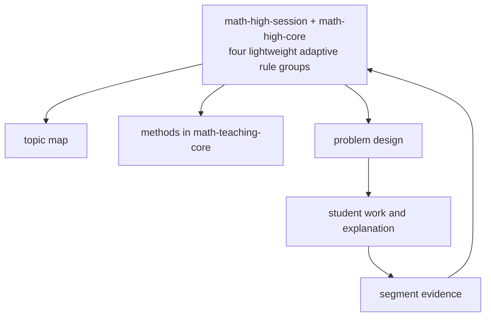

# 高年级方法、推导与证明

[English](methods.md) | [中文](methods.zh.md)

仅维护者背景——**教学材料，不是已安装技能**。运行时的选法与步骤在已装包里：[`math-teaching-core.md`](../skills/math-high-core/references/math-teaching-core.md)，加上子技能和下面列出的其他 `math-high-core` 参考。`math-primary-high/package.json` → `files` 只发 `cordis.patch.yml`、`build.json`、`resources`、`skills`、`README.md` 与 `LICENSE`；本 `docs/` 目录只留在仓库里。

撤掉模块式方法技能，是为了不让一个技能背同一个教学环节的两套互相冲突的控制流规则。本页保留这些方法名到已安装落点的映射。

## 方法 → 已安装落点

| 旧方法名 | 已安装落点 | 4–6 年级用法 |
|---|---|---|
| `concrete-pictorial-abstract` | `math-teaching-core.md`（CPA） | 实物或想象的动作 → 图 → 记号；分数、小数、比、几何、早期代数 |
| `polya-problem-solving` | `math-teaching-core.md`（Pólya） | 多步与陌生题的读懂、计划、执行、回看 |
| `variation-theory-math` | `math-teaching-core.md`（变式）；练习规则 | 只差一个关键特征的对比例子，暴露不变量 |
| `inquiry-and-proof` | `math-teaching-core.md`（探究） | 受限规律 → 猜想 → 试算与反例 → 说理 |
| `cgi-algebraic-thinking`（提议过，未建技能） | `math-teaching-core.md`（关系思维与推广）；`references/early-algebra.md` | 等号、关系策略、推广算术、字母、函数思维；来源见 [`cgi-early-algebra.md`](../../docs/research/cgi-early-algebra.md) |
| `explicit-instruction-math` | `math-teaching-core.md`（显式）；`scaffold-calibration.md` | 例题 → 逐步撤除的步骤 → 独立检查，前提是当前任务工具可用；确认缺失的工具先进入有记录的先修子任务 |
| `formative-metacognition-math` | `math-teaching-core.md`（形成性）；支架记录 | 引出思考 → 一条可操作的反馈 → 学生自评 |
| `mathematical-modeling` | 子技能 `math-high-application-modeling` | 情境 → 假设 → 表示 → 求解 → 解释与验证 |
| `upper-primary-math-knowledge-map` | `references/topic-map.md` | 概念 id、先修边、误区探查 |
| `adaptive-math-task-generator` | `references/problem-design.md` | 已核验的任务包，含儿童视图与成人答案 |
| `math-learning-progress-tracker` | `references/math-segment-fields.md` | 每个活动按独立性与支持记录证据；不做汇总分数 |
| `handwritten-math-reader` | 共享入口 `learn-errors` | 忠实读取手写照片、扫描件或数字墨迹 |
| `upper-primary-math-coach` | `math-high-session` + `math-high-core` 规则 | 知识点、难度、提示与方法——一次只动一个 |

`references/learn-act-allocation.md` 决定活动归谁，`math-teaching-core.md` 独立决定教学法。本包注册唯一的 `math-high-*` 技能名；低年级包用 `math-low-*`。共享教学解析为新任务选实际的核心技能与会话技能名，并在任务未完成时保留已解析的带。

## 推导与证明模块

[教学核心](../skills/math-high-core/references/math-teaching-core.md)与[支架校准](../skills/math-high-core/references/scaffold-calibration.md)为下列模块共用；每个模块按任务读取：

- [推导教学](../skills/math-high-core/references/derivation-teaching.md)：观察与猜想、关系发现、公式推导；保留公式揭示前的目标门与七步搭桥循环。
- [复杂应用题的关系推导](../skills/math-high-core/references/word-problem-derivation.md)：复用七步循环，覆盖行程、工程等题中的中间量、时间起点、分段关系与原条件检验；保留学生自己选的有效算术、方程或图表路线。普通教材题不因有情境或步骤多就转建模，也不被迫进入形式证明或公式发现。
- [证明教学](../skills/math-high-core/references/proof-teaching.md)：命题与量词分析、策略选择、逻辑有效性、学生自主组织与检查。区分独立构建、理解给定证明、修复论证与整理表达；学生有效的替代路线优先于预设路线。

证明是当前教学环节内的方法：不新增技能、调度分支、长期字段或能力阶段。对话内的障碍与支持留在现有临时状态，学习记录分开描述猜想、支持下完成与独立证明。有限举例不能证明一般命题；有效见证可以证明存在性。教学入口按共享核心的门槛与知情全解选择：[教学边界](teaching-boundaries.zh.md)。

## 策略试验与递归先修

源规则现在在[三方法索引](../skills/math-high-core/references/mathematical-strategies.md)与[递归先修教学](../skills/math-high-core/references/prerequisite-learning.md)；[共享计划协议](../../learn/skills/learn-data/references/learning-plan.md)拥有任务快照与持久化。这把确认缺失工具时的处理从内联示例改成一个有记录的子任务；子任务内部仍可正常讲授。见[设计规格](../../.scratch/math-strategy-recursion/spec.md)、[决策与取舍](../../docs/adr/0003-prerequisite-learning-plans.md)与[独立验收结果](../../.scratch/math-strategy-recursion/acceptance.md)。源改动不代表运行中的档案已升级；安装与真实学生效果和静态或合成检查是两回事。

## 策略扩展方法（按条件接线）

几何、结构化递推、数论、逻辑约束、抽屉存在性、极值优化、不变量与染色、初等博弈、路径与网络计数、边界变式、反例与学生编题，现在在包源码里以任务选择的参考接在既有核心技能条件表与方法索引之后。它们复用当前先修计划、证明、回合段证据与知情全解契约。源码接线、数学检查与静态／契约回归不等于运行档案升级，也不是模型行为结论；见[整合验收记录](../../.scratch/math-strategy-extension/integration-acceptance.md)，其中真实模型回放、安装与真实学生效果仍然分开且大多未测。

## 自适应设计约束

打包时期的笔记（旧名 `upper-primary-math-coach` → 今天的 `math-high-session` 与 `math-high-core`）。实现遵循 [`adaptive-thresholds.md`](../skills/math-high-core/references/adaptive-thresholds.md)与 [`learn-act-allocation.md`](../skills/math-high-core/references/learn-act-allocation.md)。阈值是可配置默认值，不是经验校准的结论。

| 机制 | 规则 |
|---|---|
| 知识点自适应 | 用主题图判断先修；必要时最多回退一个节点 |
| 难度自适应 | L1–L3 由独立完成与讲解决定 |
| 提示自适应 | H0–H4，逐步增加或撤除帮助 |
| 方法自适应 | 按困难类型选 CPA、Pólya、变式等 |

仍然生效的附加约束：

- 所有自适应阈值都可配置。
- 单次错误不触发知识点回退。
- 只是算对但讲不出，不自动升难度。
- 优先调整提示与表示，再考虑换教学法。
- 兴趣、疲劳与学生选择可以调整活动。
- 一轮结束后，记录下一个活动需要的证据。



## 任务包示意

多子题与验证的运行规则在 [`problem-design.md`](../skills/math-high-core/references/problem-design.md)。供维护者参考的形状：

```yaml
task_bundle:
  topic_id: equivalent-fractions
  learning_target: explain why scaling numerator and denominator preserves value
  assumed_prerequisites: [fractions-as-number, multiplicative-thinking]
  grade: 5
  method: concrete-pictorial-abstract
  goal: reasoning
  difficulty: core
  child_view:
    - id: diagnose
      prompt: "Which is larger, 3/4 or 6/8? Explain using the same-sized whole."
    - id: build
      prompt: "Draw two equal bars, split one into 4 pieces and the other into 8. Shade equivalent amounts."
    - id: transfer
      prompt: "Is 4/6 the same as 6/9? How do you know without decimal conversion?"
  adult_key:
    - id: diagnose
      reasoning: "They are equal; 6/8 is obtained by partitioning each quarter into two equal pieces."
      error_probe: "Comparing the size of numerator/denominator independently"
    - id: transfer
      reasoning: "Both simplify to 2/3; multiplying both parts of 4/6 by 1.5 is valid numerically, but 2/3 equivalence is clearer."
  graduated_hints:
    - "What is the whole?"
    - "Can the two bars be the same length?"
    - "What happens if each fourth is cut into two?"
  verification: {arithmetic_checked: true, unique_answer: true, units_checked: true}
```
